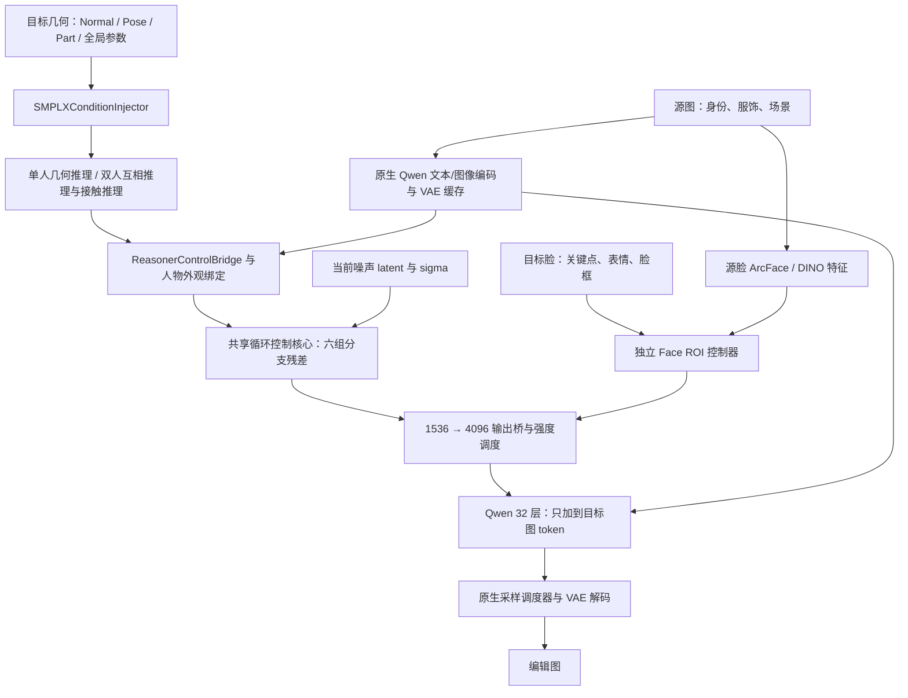

# 人物图像姿态编辑：当前代码架构梳理

核查日期：2026-10-03（北京时间）。通过 `ssh sg` 直接读取远端工作目录，结合源码、模型配置、检查点和现有测试进行整理。本次只新增此文档，没有修改训练代码、数据、模型或实验产物。

## 1. 当前工作位置与项目目标

- 远端主项目：`/home/shangguanrz/project/pic-edit`，分支 `main`，HEAD `b1a00c2`。
- 远端实验、缓存和报告还大量保存在 `/home/shangguanrz/nihaochen/`。
- 本地：`D:\codeplus\pictureedit`，HEAD `8e01dbc`；与远端不是完整同步副本。本地存在大量原有删除和未跟踪文件，本次保留原状。
- 远端 HEAD 也不能代表全部现有实现：Qwen 相关文件有大量未提交变更，应以工作目录源码和运行记录为准。
- 梳理期间观察到其他工作正在更新 Full 的 TikTok 数据接入。本文按最后读取的代码描述这部分，已有 CPU 验证覆盖控制核心，不代表新 TikTok 接入已经完成训练验收。

目标是把**源图人物的身份、服饰和背景**与**目标姿态的几何结构**组合成新图。可见主链路集中在图像编辑：离线构造几何条件，训练外挂控制网络，调用冻结生成基座采样。

姿态估计和体型重定向属于上游概念。仓库还包含 `add/tools/multi-hmr`、`add/tools/SMPLest-X` 等资产生成工具，但本次没有验证完整的估计→重定向端到端业务流程，不能把它与已验证的编辑入口等同。

## 2. 四种代码形态及入口

下表路径均相对远端主项目。

| 路径 | 核心实现 | 主要入口 | 定位 |
|---|---|---|---|
| 早期 CNN Adapter | `src/adapter/pose_adapter.py` 的 `PoseConditionAdapter` | `train_adapter.py`、`run_demo_pose_edit.py` | 早期 8 通道控制与显存实验；README 主要介绍这一路 |
| DeepGen V6 / V6.5 / V6.6 | `src/pose_control/v6/` 的 `UnifiedSMPLXAdapterV6` | `train_iper_v6_native.py`、`train_iper_v65_face.py`、`train_iper_v66_hand.py`；TikTok 有 `train_tiktok_overfit_sanity.py`、`train_tiktok_v65_face.py` | 完整控制结构的原始实现，逐步加入人脸和独立手部 |
| Qwen 简化控制器 | `src/pose_control/qwen21/` 的 `Qwen21BodyAdapter`、`Qwen21FaceAdapter`、`Qwen21DualAdapter` | `train_iper_qwen21_body.py`、`train_iper_qwen21_face.py`、`train_hi4d_qwen21_dual.py` 及对应 eval 脚本 | 复用几何编码/推理，另建 Qwen 控制头；双人 Hi4D 属于此路线 |
| Qwen 完整迁移 | `src/pose_control/qwen21_full/` 的 `Qwen21FullAdapter` | `train_iper_qwen21_full.py`、`eval_iper_qwen21_full.py` | 保留 V6 全部 47 个原始架构文件，外加 Qwen 输入输出桥接和运行工具 |

Full 内仍有 `deepgen_adapter.py`、`ControlledDeepGenPipeline` 等名称，因为原控制器结构被保留。**真正接入 Qwen 的入口是 `qwen_adapter.py` 的 `Qwen21FullControlContext`。**

原 DeepGen、Qwen 简化版和 Full 的检查点格式不同。Full 加载器要求 `architecture == qwen21_full_v1`，并严格检查 state_dict；不能直接把简化版检查点交给 Full 加载。

## 3. Qwen Full 的一次数据流



1. **读取配对数据。** `data_runtime.QwenFullDataset` 为入口提供 RGB 和目标条件。iPER 包装器先以目标/目标代理读取目标几何，再替换为真实源图；最新代码还通过 `TikTokV3PoseDataset` 支持 `dataset_type=tiktok_v3`，使用 `resize` 对齐坐标。默认 manifest 仍来自 iPER。
2. **缓存原生条件。** `qwen_runtime.Qwen21IPERCache` 用官方 Qwen Pipeline 编码源图 prompt embedding、源 latent 和训练用目标 latent。键包含固定模型 revision、prompt、分辨率、类别和图像字节哈希。
3. **构造条件。** `data_runtime.build_condition_bundle` → `SMPLXConditionInjector`：分别编码法线、姿态热图、部位图、全局参数和任务 token。该模块不做人体参数估计，也不渲染网格。
4. **推理空间关系。** `reasoning.SMPLXAdapterReasoner` 先运行单人路径；仅对 `person_count == 2` 的行运行第二个人、双向人物注意力、接触推理和融合。单人 interaction 特征显式归零。
5. **绑定身份。** `Qwen21FullAdapter.prepare_conditioning` 把 Qwen 源 latent 转为旧控制器坐标，构造 `AdapterIdentityCondition`。单人第二槽置零；双人必须显式提供分别绑定的 `source_person_latents`。Face/Hand 的 `source_indices` 还会与人物身份绑定核对。
6. **生成动态残差。** `SharedRecurrentControlCore` 接收当前噪声、时间步、文本和已准备几何；共享一个 Transformer block，循环六阶段，使用独立阶段嵌入、低秩适配和零初始化输出头。它会随每个去噪步重新产生控制残差。
7. **桥接并注入。** `Qwen21FullAdapter.build_residuals` 把每个分支的 1536 维残差投影到 Qwen 的 4096 维，按任务有效性、分支强度和去噪进度缩放。`Qwen21FullControlContext` 为 32 个原生 block 安装 hook，退出 context 后移除。
8. **采样输出。** eval 入口调用原生 `QwenImage21Pipeline`，默认 30 步、`true_cfg_scale=1.0`。原生 VAE 解码后，输出 RGBA 经白底合成为 RGB。

特别注意命名：配对中的“源图 A / 目标图 B”与条件字段中的“person A / person B”不是同一含义。例如单人 `normal_a` 是**目标图里的第一个人物**的法线图，并不是源图的法线。

## 4. 关键张量与模型边界

| 数据 | 形态与用途 |
|---|---|
| RGB | `[B,3,H,W]`，数据集归一化为 `[-1,1]` |
| 目标法线 | `[B,3,H,W]`，法线值 `[-1,1]`，背景乘人物 mask |
| 姿态热图 | `[B,25,H,W]`，由关节点坐标生成；不是三通道彩色骨架图 |
| 部位 one-hot | `[B,14,H,W]`，背景不占通道 |
| 人物 mask / 深度 | 各 `[B,1,H,W]`；深度是否参与取决于 `use_depth`，Full 默认构造未开启 |
| 全局人体条件 | `[B,26]`；是当前缓存定义的结构摘要，不能等同于全量 SMPL-X 姿态参数 |
| 标准条件 bundle | 每个人的空间特征 256 通道、4 个 256 维全局 token；可选双人相对 token、接触栅格与最多 8 条接触关系 |
| Qwen latent | `[B,N,64]`，`N=(H/16)*(W/16)`；512 是 1024 token，1024 是 4096 token |
| 旧控制器 latent | `latent_bridge` 后使用 pixel shuffle：`[B,16,H/8,W/8]` |
| 原控制残差 / Qwen 残差 | 六组 `[B,N,1536]` → 六组 `[B,N,4096]` |
| Face / Hand 局部区域 | 先在 16×16 ROI 上计算，再散射到目标全图 token 网格 |

DeepGen 模型配置是 24 层、24×64=1536 隐藏维、16 latent 通道、patch_size=2。Qwen 2.1 配置是 32 层、32×128=4096 隐藏维、64 输入通道、patch_size=1。

Qwen 的残差组号为 `6 * layer // 32`，对应层组 `0–5 / 6–10 / 11–15 / 16–21 / 22–26 / 27–31`。每次只修改序列末尾 `H/16 × W/16` 个目标图 token，保留前面的条件 token。

零初始化有一个重要细节：继承头已有非零权重时，新输出桥初始化为零；原分支头仍为零时，桥采用 Xavier 初始化。这样既保留初始基座行为，又避免连续两个零映射阻断梯度。

## 5. 分支存在、入口启用与训练证据

| 分支 | 架构实现 | Full 标准训练/评估现状 |
|---|---|---|
| Geometry | 条件编码、单人推理、空间桥和共享循环核心 | Body 阶段训练，有非零头 |
| Interaction | 第二个人、角色嵌入、相对几何、接触推理、独立残差 | 标准 Full 构造单人，Body/Face 参数组均未选择交互分支 |
| Detail | 旧局部细节兼容路径 | 标准入口未提供所需条件，当前默认检查点输出头为零 |
| Face V6.5 | 源 ArcFace 512 维 + 源 DINO patch；目标关键点、jaw、expression 和脸框；独立六阶段 ROI 残差 | Face 阶段训练，要求从 Full Body 检查点开始 |
| Hand V6.6 | 独立手部准备器；几何与外观注意力融合；四只手的 ROI、深度/可见性与散射 | 网络可构建，标准 Full 入口显式 `hand_strength=0, hand_mode=off`，并未训练该分支 |

本次 mmap 读取了 `/home/shangguanrz/nihaochen/qwen21_full/face_512_100/checkpoint_last.pt`，metadata 为 `qwen21_full_v1`、Face、512、100 步：

| 分支零输出头 | 张量数 | 非零元素数 |
|---|---:|---:|
| Geometry | 12 | 14,164,992 |
| Interaction | 12 | 0 |
| Detail | 12 | 0 |
| Face | 12 | 4,727,808 |
| Hand | 12 | 0 |

这只是默认短训检查点的状态，不能推广为所有历史实验都相同。当前 Full 默认 manifest 为 8 条 train、4 条 val；属于迁移短训验收。已有 `training_accounting.json` 记录 Body 100 次有效更新、Face 99 次有效更新；Face 第 45 步因 BF16 调度边界为零而未产生有效更新。该统计是读取已有记录，本次没有重跑训练。

Hi4D 双人入口使用 **Qwen 简化双人网络**：从同一源图的 A/B mask 裁切并池化源 latent，显式绑定两人外观；目标输入包含分别的人体几何、深度、相对位置、接触栅格和关系。它是另一套训练闭环，不能用来证明 Full 的 Interaction/Hand 已训练。

## 6. 训练方式和需要记住的协议

- Qwen Transformer、text encoder、VAE 全部冻结。Adapter 参数保持 FP32，前向使用 BF16，Transformer 开启梯度检查点。
- 先缓存文本和 latent，再把 text encoder 移至 CPU；Body 阶段 VAE 也移至 CPU。Face 辅助监督需要 VAE 解码，仍可对输入保持可微，而不更新 VAE 权重。
- Body/Face 各自按白名单选择参数；学习率分为输出头/接口 `1e-4`、编码器 `5e-5`、控制核心 `1e-5`。默认前 20 步只训练对应输出桥。
- Flow Matching 使用 `x_sigma=(1-sigma)*target + sigma*noise`，监督速度 `noise-target`。Body 对人物区域赋更高权重；Face 可选全图 flow 或单独归一化的 ROI flow。
- Face 总损失为 `flow + 0.10*identity + 0.05*perceptual + 0.02*outside`。源身份条件来自源图；目标 RGB 可以用于同身份训练监督，不作为目标人物外观条件输入。
- 跨人物 A/B 配对被 Full 训练入口拒绝；它们只能用于姿态迁移推理检查，不能当作源人物应该重建目标身份的训练真值。
- 当前普通 Face CLI 默认仍为 `--face-evaluator-range legacy`、`--face-flow-loss global`。已有修复选项是 `normalized` 和 `roi`；本文不改变默认值，也不把选项存在当作质量验收通过。
- Face 主控制从 progress 0.35 开始，纹理从 0.65 开始。训练默认 progress=`1-sigma`，eval 默认 `step`，可用 `--progress-mode sigma` 对齐比较。
- 512 Face 权重用于 1024 时，已有 `--face-scatter-grid checkpoint` 按训练网格散射后映射到实际网格；默认仍是 `native`。
- 缓存采用固定 `MODEL_REVISION`，未自动核验实际指定 `--model` 的内容。换基座/预处理实现时应使用独立 cache 目录。

## 7. 目录职责和阅读顺序

`src/data/` 负责读 manifest 和离线资产；`src/controls/` 是早期控制图工具；`src/pose_control/` 是控制网络；`scripts/` 负责预计算、数据切分、核查和报告；根目录保留了许多实际 train/eval 入口。`third_party/` 保存外部算法复用代码，`add/` 是较独立的数据准备工作区。权重在 `models/`，数据在 `datasets/`，旧实验在 `experiments/`，Qwen 新实验还分布在 `/home/shangguanrz/nihaochen/`。

建议按这个顺序读当前 Full：

1. `train_iper_qwen21_full.py`、`eval_iper_qwen21_full.py`：完整流程和可用 CLI。
2. `src/pose_control/qwen21_full/data_runtime.py`、`qwen_runtime.py`：条件来源和原生缓存。
3. `conditions.py`、`condition_injector.py`：张量契约和模态编码。
4. `reasoning/reasoner.py`、`condition_bridge.py`：单人/双人路径及其合并。
5. `deepgen_adapter.py`、`control_core.py`：条件准备、外观绑定、动态残差。
6. `qwen_adapter.py`：两种模型之间的坐标与维度桥接、32 层注入。
7. `face/`、`hand/`、`interface/strength.py`：局部区域和控制调度。
8. `execution.py`、`checkpoint.py` 及相关 tests：冻结、优化器选择、恢复和可验证边界。

## 8. 如何测试与使用

本次实际执行并通过以下四组 CPU 测试：**33 passed，13.88 秒**。只有第三方 SWIG 弃用警告。覆盖 Full 桥接/梯度、原始结构保留、Face 对齐、简化双人控制；不等同于生成质量验收。

```bash
ssh sg
cd /home/shangguanrz/project/pic-edit
PY=/home/shangguanrz/nihaochen/envs/qwen21/bin/python

# CPU 复现，关闭 GPU 与测试缓存写入
CUDA_VISIBLE_DEVICES="" PYTHONDONTWRITEBYTECODE=1 "$PY" -m pytest -q -p no:cacheprovider \
  tests/test_qwen21_full_bridge.py \
  tests/test_qwen21_full_preservation.py \
  tests/test_qwen21_face_loss_alignment.py \
  tests/test_qwen21_dual_control.py

# 查看实际入口参数；本次已成功执行这两条 help
"$PY" train_iper_qwen21_full.py --help
"$PY" eval_iper_qwen21_full.py --help
```

实际使用时，可先用已有默认 Body 检查点跑一条验证配对，生成图片和 `per_sample.jsonl` / `summary.json`。以下命令是经源码与 help 核对的使用示例，**本次没有执行 GPU 出图**；运行会写入新的输出目录。

```bash
"$PY" eval_iper_qwen21_full.py \
  --modes body --max-samples 1 --steps 30 --resolution 512 \
  --output /home/shangguanrz/nihaochen/qwen21_full/architecture_smoke_20261003
```

查看该目录的 `images/` 中 source、target、body 三类图片，比较姿态、服饰和背景；检查记录中的控制 forward 数和 block 调用次数是否均等于 30。Face 试验可增加 `body_face` 模式，但默认短训 Face 检查点不应直接视为推荐的质量版本。

当前核实的 Qwen 环境：Python 3.12.14、torch 2.8.0+cu128、diffusers 0.41.0.dev0、transformers 5.17.0；解释器为 `/home/shangguanrz/nihaochen/envs/qwen21/bin/python`。DeepGen 另有 conda 环境，不应假设两个解释器可互换。

本次完成的是架构理解、代码边界和 CPU 测试核查，未重新训练、未进行 GPU 采样、未移动目录或同步本地与远端。
