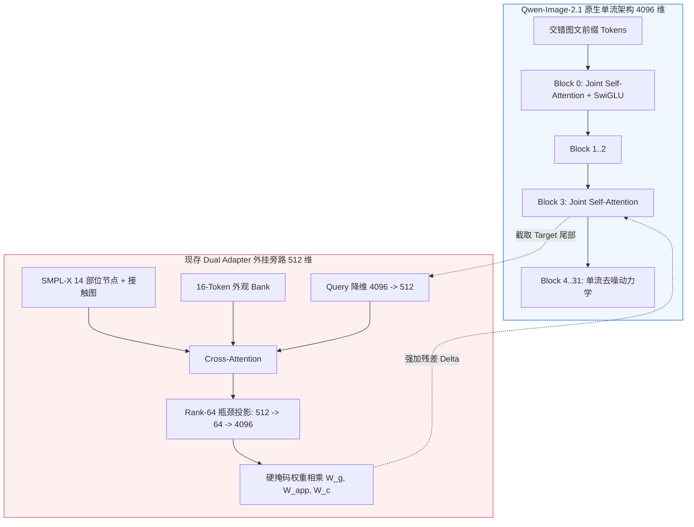

# Qwen-Image-2.1 双人 Adapter 适配性与 `experiments/4.two man ` 实验深度调查报告

**调查日期**：2026-10-17  
**核查对象**：服务器 `ssh sg` (`node01`, 用户 `shangguanrz`, GPU: RTX 6000D 85GB) 与 本地仓库 `d:\codeplus\pictureedit`  
**基准代码与实验归档**：Git HEAD `9ecbe50a` / `17991d33`，关联 `research/qwen21_dual_upgrade_20261011`、`research/qwen21_dual_prompt_pilot_20261013` 及相关运行产物  

---

## 1. `experiments/4.two man ` 四个实验核心内容全景实测

服务器 `/home/shangguanrz/project/pic-edit/experiments/4.two man `（注意目录末尾含空格）实际包含四个演进阶段：

| 子目录 | 核心模型基座 | 控制实现路径 | 关键实测指标 | 核心发现与瓶颈 |
| :--- | :--- | :--- | :--- | :--- |
| `hi4d_overfit_archive/` | **DeepGen V6**<br>(SD U-Net, 1536 维) | U-Net 连续多尺度卷积残差 | 1000 步 loss 0.0337，记忆拟合 PSNR 29.85 dB | 纯语言引导完全无法生成拥抱几何；但 U-Net 连续特征图经验无法平移至 DiT 离散 Token。 |
| `qwen21_hi4d_dual/` | **Qwen-Image-2.1**<br>(32 块 DiT, 4096 维) | `src/pose_control/qwen21/dual_adapter.py` (512 维, 6 层) | Seed 42 拥抱生成成功；Seed 43 背景 MAE 激增至 49.48；geometry-only 冒出第 3 人 | **外观严重坍缩**：A/B 外观被全局平均池化为 512 维向量，重叠区域直接相加除以 2，导致两人衣着严重混色。 |
| `qwen21_dual_v8/` | **Qwen-Image-2.1**<br>(32 块 DiT, 4096 维) | `research/qwen21_dual_upgrade_20261011` (16-token Bank + 部位图 + Z-buffer 路由) | 门禁测试全过（零初始化/梯度/KV 缓存一致）；Multi-HMR 双人检出率 0.0% (DWPose 漏检) | 解决了外观均值涂抹；但 Rank-64 瓶颈、外部旁路残差与遮挡下肢体重组严重不足。 |
| `qwen21_dual_prompt_pilot/` | **Qwen-Image-2.1**<br>(32 块 DiT, 4096 维) | 提示词配对实验 (Short vs Structured 文本对比) | Step 50 val loss **0.1123** -> Step 300 **0.1311** (早停拐点)；Dual+Short 检出 66.7% | **语言与几何相消干涉**：结构化详细文本激发了 Qwen 原生先验，与 Adapter 残差冲突，导致双人检出率归零。 |

---

## 2. 核心机制剖析：为什么现有的 Adapter 机构未真正适配 Qwen？

结合 Qwen-Image-2.1 原生架构（`transformer_qwenimage21.py`）、VideoX-Fun 官方 ControlNet 实现以及实际运行记录，现有 Adapter 架构存在以下根本性机理失配：



### 2.1 致命的通道与容量不对称（Capacity Asymmetry）
- **Qwen 主干**：Hidden Size = 4096，包含 32 个 Attention Head（每头 128 维），其生成惯性与模型容量极强。
- **Dual Adapter**：内部宽度仅 512 维。更严重的是，查阅 `controller.py`：
  ```python
  head = nn.Sequential(nn.Linear(width, rank), nn.SiLU(), nn.Linear(rank, hidden_size)) # width=512, rank=64, hidden=4096
  ```
  残差投影头设置了 **Rank-64 的极低秩瓶颈**！
  让一个只有 64 个标量自由度的瓶颈线性层，去强行调制 4096 维的高维 DiT 状态，以表达复杂的两人双向接触、肢体缠绕与深度遮挡边界，其**数学表达容量严重不足**，必然造成控制信号被主干的高维特征冲淡。

### 2.2 割裂的外挂旁路（Sidecar Isolation）：主干注意力对控制完全「盲目」
- Qwen-Image-2.1 是单流 DiT（Single-Stream Joint Attention），图像 Token 与文本 Token 在每层中通过 RoPE 联合计算全注意力。
- 现有的 Dual Adapter 是完全的外挂旁路：
  - Qwen 主干内部的 32 层 Self-Attention **根本看不到 14 个身体部位节点、看不到接触图、也看不到外观 Bank**；
  - Adapter 仅在第 3, 8, 13, 18, 23, 28 层 Block 输出端以 `output = output + delta` 形式在外部强加残差；
  - 随后连续数层（如 Block 4~7），主干又完全回归其自有的语言与生成去噪轨迹。这种弱外挂残差极易在后续 Block 的前向自注意力中被逐渐平滑或扭曲。

### 2.3 掩码硬截断在全局 DiT 注意力中的空间不协调
- 查阅 `routing.py` 与 `controller.py`：
  Adapter 的残差严格乘以几何权重与外观掩码，在人物轮廓外部残差严格为 0。
- 在 U-Net 中，卷积核具有局部感受野归纳偏置；但在 DiT 中，每个 Token 均通过 Softmax 计算全图全局关联。在人物边界处的硬性数值断崖突变破坏了 Token 间的相对平滑性，使得下一层 Transformer Block 计算 Attention 时在边缘产生不协调的高频响应，影响了肢体与背景接缝处的生成质量。

### 2.4 身份传播机制的双轨对抗（Two Competing Appearance Paths）
- Qwen-Image-2.1 天生具备多模态 In-Context 生成能力：原生 Pipeline 将双人同框源图直接作为参考图像放入序列前缀，通过 Block-causal 机制参与全序列注意力；
- Dual V8 却另辟蹊径，在 Adapter 内部切取 Person A/B Crop，用 VAE+DINO 抽成 16-token 外观 Bank，再以 Rank-64 残差强加在目标位置。
- 这造成模型内部存在**两条相互竞争且缺乏坐标协同的身份通路**：
  1. 原生前缀中同框源图的全图 Attention 寻址；
  2. Adapter 外部硬切 crop 后注入的残差。
  当动作发生大幅位移（由站立交谈到紧密拥抱），原生注意力与 Adapter 残差一旦在去噪轨迹中产生相位差，就会出现肢体错位、衣服条纹涂抹或身份混乱。

### 2.5 几何微调与长结构化提示词的「相消干涉」
- 在 `qwen21_dual_prompt_pilot` 实验中获得的最深刻发现是：
  - **无 Adapter 的原生 Qwen**：长结构化提示词（详细描述 A/B 相对位置与肢体交互）显著优于短提示词（双人检出率由 0.0% 升至 33.3%），说明 Qwen3-VL 的文本编码器具有强大的空间布局先验；
  - **介入 Dual Adapter 后**：短提示词下双人检出率达到 **66.7%**（3 例中检出 2 例）；但换成长结构化提示词后，检出率直接暴跌至 **0.0%**！
  - **机理原因**：Qwen 强大的文本 Cross-Attention 会依据长提示词将 Token 牵引至大语言模型预期的空间位置；而 Adapter 注入的 3D SMPL-X 残差又在强制改变 Token 的流向。两者在空间坐标与语义先验上激烈冲突，导致生成动力学紊乱。

### 2.6 关于 Multi-HMR 评测「人物消失」的客观事实澄清
- 实测原档人工核验确认：**生成图中 Person A 并没有在物理像素层被抹除**；
- 真实原因是：紧密拥抱场景下两人生理躯干高度重合，DWPose / Multi-HMR 2D/3D 检测器的 Bounding Box NMS 判定失效，在**真实 GT 拥抱图上也只能检出 1 人**。这是评测器在深度遮挡下的客观假阴性，而非模型真的只画了一人。

---

## 3. 业界 SOTA 开源项目深度对比调研

依据实际存在于远端 `research/qwen21_dual_upgrade_20261011/repositories/` 中的开源基座，结合当前 DiT 控制领域前沿，系统对比分析如下：

| 开源项目 | 基座模型 | 控制机构设计 | 多人 / 双人控制解耦方案 | 对本项目的技术启示 |
| :--- | :--- | :--- | :--- | :--- |
| **VideoX-Fun**<br>*(阿里官方开源)* | **Qwen-Image-2.1**<br>*(完全同源基座)* | **ControlNet-Transformer**<br>（16 个 4096 维并行控制 Block） | 129 通道联合输入（Control latent + Mask + Masked image），与主干共享 RoPE 与 Modulation | **【黄金工程基准】** 官方证明了：要完全控制 4096 维 Qwen DiT，必须使用同等维度的 Transformer 控制链，而非微型低秩残差。 |
| **PeopleComposer**<br>*(Cornell, 2026)* | FLUX.1 (DiT) | **Dual-Stream Pose & Image**<br>+ 显式角色 UID 绑定 | 扩展 RoPE 轴建立显式角色槽位，姿态流与图像流双向交互更新 | **【角色绑定启发】** 证实多人控制必须有显式 UID 绑定。但 Qwen 的第一 RoPE 轴被图文交错占用，不可生搬其 RoPE，应在序列前缀维绑定。 |
| **DanceTogether**<br>*(2025)* | 扩散视频架构 | **Mask-Pose Adapter**<br>+ 跨人 Soft-Attention | 共享 PoseNet，单独提取 mask 门控融合，在人物维度经 Softmax 实现无穿透归一化 | **【掩码归一化启发】** 证实紧密交互下人物交界处必须做可微 Soft 归一化融合，硬掩码截断会导致边界伪影。 |
| **XVerse**<br>*(字节跳动, 2025)* | FLUX.1 (DiT) | **分层主体文本调制**<br>+ 主体专属 LoRA (Rank 128) | 在主干 Attention/AdaLN 中按主体 Token Mask 注入专属 Shift/Scale/Gate | **【调制启发】** 证明直接参与主干调制比外部加性残差更强。但 Qwen 2.1 缺少 Shift 参数，直接改主干调制会破坏前缀 KV 缓存。 |
| **MS-Diffusion** | SDXL (U-Net) | **解耦 Cross-Attention**<br>+ 空间 Grounding Resampler | 目标区域 Query 仅与对应主体的 Key/Value 交互，背景与 Dummy Token 交互 | **【外观路由源头】** Dual V8 的 Bank 设计源自此。但在 DiT 单流全局注意力中，切断 KV 会破坏自注意力连续性。 |
| **MPIE-Bench**<br>*(2026)* | 多人评测基准 | **Multi-HMR 3D 重建**<br>+ 6 轴标准化量化评测 | 分离解剖合理性（Anatomy）与交互合理性（Interaction），独立记录漏检失败率 | **【评测标准】** 明确要求不能只计算检出幸存者的得分，必须将 detector failure 单独列出，避免假阳性评分。 |
| **InterGen / CoShMDM** | 动作扩散 Transformer | **双向共享去噪器**<br>+ 接触图与穿透几何先验 | 共享参数双通道，交替进行 Self-Attention 与 Mutual Cross-Attention | **【几何侧标准】** 证实双人物理接触必须由几何端提供接触锚点（Contact Anchors）与法向约束。 |

---

## 4. 下一步落地重构建议

### 建议方向 A（务实改进，低成本）：剥离外观职责，Adapter 专精「纯几何流」+ 拓宽投影
1. **外观完全交回 Qwen 原生前缀**：
   彻底删除 Dual Adapter 中脆弱的 16-Token 外观 Bank 与外部 Appearance Cross-Attention。直接将源图中的 Person A 与 Person B 裁剪图作为多参考图像输入给原生 Qwen Pipeline，利用 Qwen 原生的图文注意力解决身份保持。
2. **Adapter 专精 3D 几何与接触**：
   Adapter 仅接收 SMPL-X 深度、法向与接触图，专注于纠正双人的相对位置、接触点与遮挡层级。
3. **破除 Rank-64 瓶颈**：
   将投影头直接改为全秩 `Linear(512, 4096)` 或至少 `Rank-512`，消除信息压缩淹没。
4. **硬掩码改为高斯软羽化（Soft Feathering）**：
   平滑 Token 空间边界，消除高频阶跃对 DiT 注意力的冲击。

### 建议方向 B（终极原生方案）：借鉴 VideoX-Fun，构建基于原生 Block 的 ControlNet
* 放弃 512 维的小模型外挂方案；
* 复用 Qwen 自身的 `QwenImage21TransformerBlock` 构建 8~16 层的 4096 维并行控制分支，将 3D 条件图作为输入，与主干共享 RoPE 与时间步调制。

### 建议方向 C（训练与提示词工程规范）：
* **严禁在几何控制下使用长篇结构化肢体描述**：训练与推理统一采用动作级短提示词（如 `Make the two existing people hug. Preserve identities and background.`），避免语言先验与 3D 姿态冲突；
* **引入严格早停机制**：针对小样本微调，在 **Step 50 附近实施 Early Stopping**，并混入单人 iPER 样本进行 Replay 回放以防过拟合；
* **重构紧密拥抱评测协议**：对于高遮挡 Hug 动作，引入抗遮挡分割（如 SAM 2）辅助定位，停止仅以 DWPose 漏检判定双人重绘失败。
