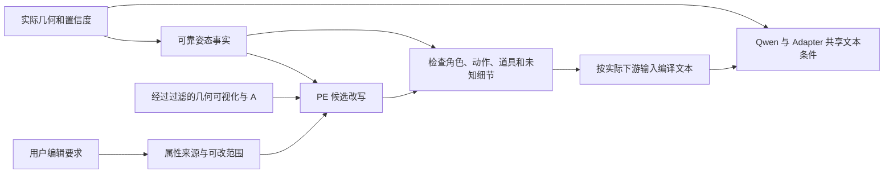

# 几何条件与提示词协调：现有证据、PE-I2I 实测与接入设计

日期：2026-10-09。范围：审查已有提示词实验、实际条件入口，并运行四次 PE-I2I 提示词重写；没有进行新的扩散出图或 Adapter 训练。下文的接入流程和出图对照尚未实现、尚未验证收益。

## 1. 结论

让 PE-I2I 观察几何可视化，再辅助生成姿态提示词，技术上可行。当前证据支持把它用于生成候选描述，随后依据可信几何事实审查；不支持让它单独决定姿态、表情、构图或条件优先级。

本次两例各比较骨架输入与骨架＋normal＋depth 输入：增加后两种条件后，一例的仰头描述得到纠正；双拳前伸仍没有恢复。进一步逐图核对发现，双拳案例的 SMPL-X normal 本身已经渲染成松开的手，DWPose 骨架也存在缺少可靠关节支撑的腿部连线。因此要分别审查“几何是否正确”“PE 是否正确解释几何”“最终图是否执行指令”，不能把三层错误混在一起。

推荐顺序是：确定任务属性来源 → 审查实际输入几何 → 提取可信姿态事实 → PE 辅助改写 → 检查冲突与无依据细节 → 按真正的模型输入编译提示词。先冻结现有模型做提示词对照，再考虑改变训练文本。

## 2. 我们的文本和几何实际上如何进入模型

当前完整分支的默认训练文本在 `src/pose_control/qwen21_full/qwen_runtime.py:19`：

```text
Change the person pose to match the target pose. Preserve identity, clothing, and background.
```

`joint_training.py:219` 调用 `cache.pair(pipe, batch, device)`，没有传逐样本文本。缓存接口本身已经支持 `prompts=...`，但这一训练调用没有使用。

文本不是只作用于 Qwen 基干。`qwen_adapter.py:331–381` 将同一份 prompt embeddings 经 `text_bridge` 和 `pooled_bridge` 送入控制分支。因此改变提示词，会同时改变基干条件和 Adapter 条件。Qwen-Image-2.1 的文本与图像处理也不能简单等同于“文本独立 cross-attention，几何完全独立 residual”的两条互不影响的路径。[官方 Transformer 实现](https://github.com/huggingface/diffusers/blob/main/src/diffusers/models/transformers/transformer_qwenimage21.py)

可以在应用规则上分配职责，但没有证据说明写一句“严格保留”就能锁定注意力权重，或保证几何一定胜过文本。

完成的联合 pilot 中，Qwen 的 RGB 参考是 A；B 的条件通过 Adapter 输入。Body 条件包括 normal、25 通道 pose、part、26 维 global 和 mask；depth 在该 pilot 的配置下关闭，DWPose 不是额外已启用的 Body 控制通道。Face 另有目标 jaw / expression / landmarks 及源身份特征。不能把“PE 能看 depth”理解成“当前训练已经使用 depth”。

最新 `native_value_audit_20261008` 的原生骨架/几何方法则把 DWPose、normal、depth 可视化作为 RGB 参考图送入 Qwen。这与 Adapter 接收数值/特征条件是两个输入协议。该审查中的 Adapter 推理已经使用逐案例的丰富姿态文本；所以并非所有已有推理都只有上述短模板，但已完成 pilot 训练仍用固定文本。

另一个需要先解决的冲突：现有 26 维 global 包含目标 B 的 beta（体型），normal 也是 B 的人体网格。若任务要求保持 A 的体型，单靠提示词不能消除这项条件矛盾。合理的后续候选是用 A 的 shape、B 的 pose / expression 和确定的输出 camera 重新渲染控制条件；尚不能把它当成已经验证过的流程。PE 应观察最终实际送入控制分支的条件。

## 3. 已有提示词实验能说明什么

### 3.1 16-test

远端原始目录：`/home/shangguanrz/project/pic-edit/experiments/16-test`。本地已有对照图位于 `D:/codeplus/pictureedit/experiments/qwen-2.1-test/16-test/`。

简单 A/B 指令曾明显借用 B 的黑色上衣；详细指令改善了 A 的蓝色西装、场景保持，补充明确头向后也有局部收益。这说明角色来源、保留范围和明确编辑动作值得写清楚。

但不能据此证明“越长越好”“六段式最优”或“英文普遍更好”：这里只有一对图、一个 seed；PE 路径将 A/B 预处理到 640×1088，而详细指令路径传入原始参考，输入处理并非完全相同。

特别是篮球：实验需求要求保留/引入目标篮球，但传给 PE 的简短指令只写了姿态迁移和 A 外观保持，没有明确篮球。中文重写明确排除篮球，英文重写却引入篮球。这里首先暴露的是任务约束未完整传入，其次是重写行为不一致。应将“篮球必须出现、由哪张图提供”写入任务契约，不能简单得出中文劣于英文的结论。

旧调研中“ratio_follow 自动解决构图、比人工更可靠”的结论需要收窄：它提供宽高比建议，不提供与 SMPL-X camera、像素坐标、mask 对齐的一致性保证，也不等于精确原始像素宽高。

### 3.2 最新原生输入审查

四个独立开发案例对 structured / narrative 文本的人工复核全部为 tie；structured 是按预先定义的平局规则选中的，不是实验已证明更优。

该审查表明 A＋骨架有竞争力，depth 在部分姿态指标上有增益，但身份和背景指标可能下降；堆更多 RGB 几何图也会产生染色、骨架覆盖或额外肢体。因此“更多条件＋更详细提示词一定更好”不成立。

证据摘录已保存到 `research/geometry_prompt_coordination_20261009/existing_evidence.json`。这些属于已有实验，不计入本次四次 PE 重写。

## 4. 本次 PE-I2I 几何读图测试

使用已经下载的 `/data/shangguanrz/pic-edit-models/Qwen-Image-2.1-PE-I2I`，BF16；保留模型自带 system prompt，开启 thinking，seed 42，使用官方示例的采样设置。PE-I2I 是基于 Qwen3.5-VL 9B 的多图编辑指令重写模型；官方接口没有承诺对 SMPL-X / depth 的专门训练或精确姿态理解。[官方模型卡](https://huggingface.co/Qwen/Qwen-Image-2.1-PE-I2I)

每个案例两组：

- S：A RGB＋目标 DWPose 骨架图。
- SND：A RGB＋目标 DWPose＋目标 SMPL-X normal＋目标 depth_vis。

本次骨架是 DWPose RGB，不是 pilot 报告中黑底稀疏的 Body25 热图。depth_vis 是可视化图，不是直接把 metric depth 数值传给 VLM。

没有给 PE 目标 B 的 RGB，也没有给它人工动作描述。角色、禁止借用外观、不要编造隐藏关节等规则已明确写入输入。人工动作描述只用于事后比较。所有传入图原始尺寸都是 604×1080；脚本没有自行 resize，VLM processor 仍执行模型需要的内部视觉预处理。

| 案例 | 输入 | 重写耗时 | 与目标照片比较 | 条件质量 / 限制 |
|---|---|---:|---|---|
| tiktok_03，明显仰头 | S | 88.8 秒 | 写成头部正面、颈部直立，未恢复仰头 | 仅二维脸点，对俯仰判断有歧义 |
| tiktok_03，明显仰头 | SND | 100.6 秒 | 改为抬下巴、脸朝天花板，头向描述改善 | 还补出了双脚分开站立，缺少可靠脚部证据 |
| tiktok_05，双拳向镜头前伸 | S | 117.5 秒 | 写成双手在髋部张开，未恢复前伸握拳 | 手部骨架不稳定；二维投影难以表达前伸距离 |
| tiktok_05，双拳向镜头前伸 | SND | 113.0 秒 | 双手移到躯干前腰胸之间，但仍描述张开的手 | normal 已呈松开的手，几何与目标照片不一致 |

四条结果全部是合法 JSON，`ratio_follow` 全部为 `<image1>`。格式通过不代表语义通过。只有两例，且 normal、depth 一起增加，不能区分它们各自的贡献，也不能计算泛化准确率；尚未证明这些重写提高最终出图质量。

### 条件核验发现

两个案例的 SMPL-X Body25 膝、踝有效标记都为零；DWPose 的部分膝点在画布外，踝/足点置信度较低。但已保存的 RGB 骨架仍可见腿部连线。PE 并不知道这些连线背后的置信度，所以腿脚补全可能同时来自渲染误导与模型先验，不能全归因于 PE 无端幻觉。

双拳案例的目标照片确实是向镜头握拳；normal 图却显示手掌/手指放松。因此文本与几何冲突已经出现在 PE 之前。此时应标记或修复手部条件，或者暂时停用不可信的手部控制；不能同时要求文字握拳、几何张手，再期望 CFG 自动解决。

本地保留了八张真正的 PE 输入原图，以及两张仅供事后人工复核的 B RGB（文件名带 `posthoc_only`）。后两张没有被 PE 读取。

## 5. 推荐的协调流程（设计建议）

### 5.1 先规定哪些属性可改

| 属性 | 默认依据 | 冲突时的处理 |
|---|---|---|
| 人物身份、发型、服装设计与纹理 | A | 不能因 B 或 PE 描述而改成另一人物 |
| 身体姿态、头向 | 经审查的目标几何 | 文本可复述可信动作；无依据的角度/关节细节不加入 |
| 表情 | 经审查的 B Face 条件 | 保持身份允许表情变化；条件不可信时明确选择保留 A 表情 |
| 体型 | 任务约定，当前目标是 A | 与 B beta / mesh 冲突应在条件生成阶段解决 |
| 背景、光照、风格、道具 | 用户明确要求，否则保持 A | 新背景若改变视角/构图，需要同步处理几何坐标 |
| 输出像素宽高、camera、padding | 已确定的几何与原始尺寸协议 | PE 的比例建议不能自行覆盖 |

用户要求与固定属性冲突时，在任务输入阶段明确修改属性范围；不要把互相矛盾的要求同时送入模型。这个优先规则由应用执行，不能只靠一段自然语言产生硬约束。

### 5.2 事实与润色分开



先过滤越界/低置信度关节，并检查不同几何模态是否描述同一目标。用有坐标约定的 SMPL-X / DWPose 数据提取可靠关系，例如“手腕高于髋部”“肘部弯曲”；头部俯仰、左右旋转与深度遮挡必须确认坐标系、相机和编码后再转成语言。不能从任意灰度图默认推断哪一侧更近。未可靠识别的动作、接触、脚部或手指设为 unknown；早期可直接沿用已有人工核验动作，不必立即造完整的几何转语言模型。

PE 的职责是把这些事实和任务要求组织成易执行的文本，并补充允许的衣物褶皱、光照适配等说明。官方 system prompt 保持原样，把项目规则放入 user 指令。随后检查：人物/图像角色是否正确；已知姿态是否被改写反转；物体是否遗漏或新增；是否把 normal 颜色当肤色；是否写出 unknown 关节；是否锁住了本应变化的头向/表情。发现冲突则移除无依据内容或退回人工事实模板。规则检查只能保证文本满足声明的规则，最终图仍需评估。

**下游角色映射非常关键。** PE 看四张图不等于生成模型也看四张图。当前完整 Adapter 的 Qwen RGB 输入只有 A，因此不能直接把本次 PE 写出的“参考 `<image2>/<image3>/<image4>`”交给它。应编译成源图编辑指令＋明确动作事实；原生多图方法则保留与真实列表对应的标签。BFS 官方 photo 顺序与我们 A-first 协议也可能不同，需逐条匹配实际调用，不能复制标签。

### 5.3 提示词模板

给 PE 的项目指令示例（四图协议；可靠事实应由数值条件或人工核验提供）：

```text
<image1> 是人物身份、服装和原场景的唯一来源。
<image2> 是已过滤的目标骨架；<image3> 是目标 normal，颜色表示方向；
<image4> 是 depth 可视化。后三图只用于几何理解，不提供人物外观。
可信事实：躯干基本正面，头部明显后仰、下巴朝上；双臂总体放低。
未知项：画外膝、踝、双脚的位置。不补写这些部位。
保持源人物身份、发型和服装设计，允许头向与指定表情改变。
服装褶皱和人物局部阴影随动作适配；背景、光照风格和输出画布按任务约定保持。
只改写这些已允许属性；不添加动作、道具或情绪，不照搬几何图颜色和线条。
```

编译给当前 A-only RGB＋Adapter 的示例（仰头案例，动作事实已人工确认）：

```text
编辑源图中的同一人物，使躯干基本朝向镜头，头部明显后仰，
下巴向上、脸朝向天花板，双臂总体放低。
保持源人物身份、发型、服装设计、颜色和纹理；衣物褶皱与人物局部阴影随新动作调整。
保持源图背景和既定输出构图。不加入额外人物、道具或几何引导线与色彩。
```

上例没有指定表情；如果 Face 条件经核验，应另外加入目标表情描述，并避免“脸和表情完全不变”。“身份不变”与“脸部像素不变”是不同要求。若采用 A 表情的回退策略，也应在编译时明确写出这一选择，而不是让模型自行判断。

保留句不必逐项重新描写源图所有五官和衣物。官方重写规则强调基于图像、只更改指定属性；中文输入允许中文输出，没有规定固定六段式或普遍优先英文。[官方重写规则](https://github.com/QwenLM/Qwen-Image-2.1/blob/main/prompt_rewrite/prompts/system_prompt_edit.txt)

## 6. 对提供方案的修正

| 说法 | 审查意见 |
|---|---|
| 几何与文本明确分工，避免动作矛盾 | 可作为应用设计原则；现有模型内两者耦合，不是独立控制器 |
| 文本补充宏观动作、材质、保留约束 | 合理候选；必须与可信目标/训练 GT 一致，不能随意添加情绪 |
| 绝不描述几何细节 | 过于绝对；可靠的头向、相对肢体位置和接触关系对任务有帮助，避免的是无依据细节和虚假精度 |
| 70% 保留、30% 动作；英文最优；固定六段式 | 没有现有实验或官方规则支持这些固定标准 |
| 保留句锁定注意力 | 未测注意力，也不是硬性保证 |
| PE 自动生成无冲突姿态提示词 | 本次实测不支持；合法 JSON 仍有语义错误，输入条件本身也可能错误 |
| 提示词 dropout 能保证 100% 几何控制 | 不成立；它是训练正则化候选，不能修复错误几何或保证硬约束 |
| 独立调整文本 CFG 与几何 CFG | 当前代码尚无这两项独立 CFG；Adapter residual strength 不是 CFG |

当前 Qwen-Image-2.1 pipeline 默认 `true_cfg_scale=1.0`；启用 true CFG 还需相应负向文本/embeddings。先保持已有 CFG 与 Adapter 强度，隔离提示词效应。[官方 pipeline 实现](https://github.com/huggingface/diffusers/blob/main/src/diffusers/pipelines/qwenimage21/pipeline_qwenimage21.py)

若将来研究多路引导，可定义有序三预测：`v0 = v(A, empty_text, no_geometry)`、`vT = v(A, text, no_geometry)`、`vTG = v(A, text, geometry)`，组合为 `v0 + sT*(vT-v0) + sG*(vTG-vT)`。这只是待验证方案：三次预测、顺序相关、文本与几何有交互；空文本仍保留 A 图条件。不能把当前 Adapter 强度直接当作这里的 `sG`，也不能在原两项都减 unconditional 的公式中重复计算文本贡献。

## 7. 建议的最小出图对照（尚未运行）

先冻结同一个现有联合 checkpoint、同一个基干与 LoRA 状态，固定 A、实际启用的几何、原始像素尺寸协议、步数、seed、CFG 和 Adapter 强度。先在两个困难开发案例上做 4 种提示词×2 个 seed，共 16 张；通过后锁定方法，在六个未用于提示词调试的案例上做相同对照，共 48 张。

| 组 | 文本来源 | 目的 |
|---|---|---|
| P0 | 现有固定短提示词 | 保留旧基线 |
| P1 | 已核验动作＋简洁属性规则 | 判断清晰文本本身的收益 |
| P2 | PE 自由观察几何的候选稿，修正下游标签后使用 | 诊断自由重写的增益与错误；记录条件误判 |
| P3 | 可信事实＋PE＋检查与最终编译 | 验证推荐流程是否超过 P1 |

这里 P2 的“候选稿”不代表原始四图标签可直接传入 A-only 模型；所有组必须对应真实输入。手部条件明显错误的案例先单列为数据问题，不混入判断 PE 语义准确率的干净案例。评估真实目标动作/头向/手势与条件图动作的吻合分别记录，避免只算对错误条件的 PCK。

逐图保留 A、目标 B（只作复核）、实际条件、PE 原始 JSON、最终文本、图片和设置。共同评价 A 身份/服装/场景、目标身体姿态、头向、表情、手势/接触及几何染色；PCK 提高而身份或背景恶化不能直接判为整体胜出。

若 P3 稳定优于 P1，再考虑逐样本提示词训练。沿用现有 `prompts=` 缓存接口，修改训练调用即可成为实现候选；生成训练文本必须只描述 GT 真正发生的编辑。TikTok 同人物配对不天然支持“改成新背景/新衣服”的监督，不能一边使用旧 GT、一边在训练文本中要求不存在的编辑。

可另设 0 与 0.1 的语义文本 dropout 对照，但不要和首次提示词比较、LoRA、额外 depth / hand 条件一起改变。空文本仍包含源图视觉条件。缓存键已包含 resolved prompt；native cache policy 还约束默认文本，改变策略时应使用独立 cache，检查旧 embeddings 未被误复用。

## 8. 保存位置与复现

本地证据目录：`D:/codeplus/pictureedit/research/geometry_prompt_coordination_20261009/`。

- `manifest.json`：实际输入顺序、说明、尺寸、哈希和采样参数。
- `results.json`：四次完整原始输出（包括 thinking）与解析结果。
- `review.json`：逐例语义审查与适用边界。
- `geometry_visibility.json`：Body25 有效标记与 DWPose 坐标/置信度。
- `existing_evidence.json`：既有实验与输入协议摘录。
- `inputs/`：八张 PE 原始输入＋两张仅供事后复核的 B。
- `probe_pei2i_geometry.py`：本次研究脚本。

远端复现命令（先 `ssh sg`，需要空闲 GPU；使用新结果目录）：

```bash
cd /home/shangguanrz/project/pic-edit
/home/shangguanrz/nihaochen/envs/qwen21/bin/python \
  /home/shangguanrz/nihaochen/qwen21_full/geometry_prompt_coordination_20261009/probe_pei2i_geometry.py \
  --output /home/shangguanrz/nihaochen/qwen21_full/geometry_prompt_coordination_20261009_rerun
```

脚本拒绝覆盖已有 `results.json`，并要求至少 30 GiB 空闲显存。此复现只重写提示词，不会出图、训练或自动接入生产。当前环境缺少部分可选加速 kernel，使用 PyTorch 回退完成了测试；没有为本次研究更改环境。无需重跑即可检查本地 JSON 与输入图；最终出图收益仍需要第 7 节的独立对照。
