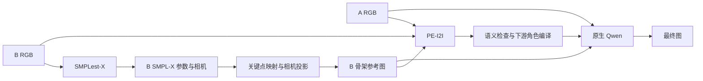

# 单人动作迁移：原生 Qwen Workflow 可行性与资产评估

日期：2026-10-11。范围：通过 `ssh sg` 核对现有源码、权重、参数缓存、历史实验与依赖；查阅官方接口。本文是评估报告，不是已经实现或验证效果的 Workflow。本轮没有修改训练/推理源码，没有启动生成、训练或新的 PE 重写。

## 结论

用户提出的 `A 外观 + B 动作 → SMPL-X → 骨架参考 + PE 指令 → 原生 Qwen` 在接口上可行。生成阶段可以完全不加载 adapter/LoRA，已有 `native_skeleton` 路线已经证明 A RGB 与骨架图能够作为两个原生参考输入。

权重与主要基础工具已经齐全，缺口集中在单图封装、SMPL-X 全身关键点映射与绘制、质量判断、PE 到生成器的图像角色编译，以及端到端编排。但现有结果尚未证明“SMPL-X 投影骨架优于 B 原图的 DWPose”或“加入 PE 后最终图一定更好”。这两项需要独立对照。

“当前基座更好”的适用范围是已检查的 checkpoint、输入路线和诊断样本；不能推广成所有 adapter/LoRA 都无效。这个 Workflow 可以把无 adapter/LoRA 固定为工程配置，无需依赖这样的普遍结论。

## 1. 对四个步骤的评估

### Step 1：B RGB → B SMPL-X

可复用现有 SMPLest-X。注意 SMPL-X 是参数化人体模型，SMPLest-X 才是本项目已有的估计器。[SMPLest-X 官方项目](https://github.com/MotrixLab/SMPLest-X)

本地化的估计入口是远端 `add/tools/SMPLest-X/main/inference.py`，参数导出入口 `scripts/run_smplestx_params_only.py` 已避开不必要的 mesh overlay 渲染。当前入口围绕编号图像序列工作，任意单张 B 需要独立任务目录与一帧映射封装。还需明确无人物、多人、检测失败时返回失败，不能沿用“默认选择第一人”作为严格单人校验。

现有导出包含：`global_orient`、`body_pose`、左右 `hand_pose`、`jaw_pose`、`betas`、`expression`、`mesh_cam`、`joint_proj_model`、`transl`、焦距、主点与图像宽高。一个实际 TikTok 缓存已核对：359 帧，mesh 为 `[359,10475,3]`，投影点为 `[359,137,2]`。选择帧时必须读取配套 `frame_map.json`，不能把原图文件编号直接当 tensor 下标。

单张图推断出的隐藏关节、手指、深度与体型属于估计值。旧案例中，B 双拳前伸，但 SMPL-X normal 已显示松开的手；重写文本无法修复上游错误几何。

### Step 2：B SMPL-X → “3D DWPose”

建议把实际产物命名为 `B_smplx_poseguide.png`：**由 SMPL-X 三维人体关键点在选定相机下投影、绘制的 DWPose 风格二维骨架图**。可以保留用户需要的 `B_3d_dwpose` 接口名称，但必须在 metadata 中注明它是二维投影参考图。

DWPose 的官方实现从图像检测二维关键点和分数；它不是接受 SMPL-X 参数并直接输出三维人体的提取器。[官方 Wholebody 实现](https://raw.githubusercontent.com/IDEA-Research/DWPose/onnx/ControlNet-v1-1-nightly/annotator/dwpose/wholebody.py)

推荐直接取得 SMPL-X joints/landmarks，完成相机投影与语义映射，再用现有骨架绘制函数绘制。若使用已有 `joint_proj_model`，它是模型裁剪坐标中的投影点，需要还原到 B 原图；若使用重建的三维 joints，则需要与其坐标空间相配的相机。两条路不能混用。

不推荐先渲染一个无纹理人体，再运行 DWPose 检测器提点作为默认方式：这会增加一次检测误差，而且渲染图的外观与真实照片不同。若只是借用 DWPose 的绘图函数，则完全合理。

已找到的可复用部分：

- `scripts/data/build_tiktok_v6_conditions.py:240`：将 SMPLest-X 裁剪投影还原到 RGB 坐标，已有 body25 映射。
- `add/tools/42_audit_humanvid_smplestx_dwpose_v1.py:64`：已有 body18、feet6、左右手指的语义对应，用于几何审查；手部需要补入 body 中的 wrist。
- `add/tools/SMPLest-X/scripts/render_iper_v1_skeletons.py`：已有 SMPL-X 22 点身体骨架绘制，属于旧路径工具，不等于目标全身 DWPose 流程。
- `add/tools/dwpose_mimicmotion_official/dwpose/util.py`：现有 body/hand/face 绘制工具。

SMPLest-X 的 137 点由 body25、hands40、face72 组成；当前 DWPose wrapper 为 body18、feet6、face68、hands42。不能直接 reshape 或截取成 134 点。现有审查脚本明确不比较脸部；脸部顺序与映射仍需单独核验，不能把“face72 取一段”当成已经验证的兼容。

现有 body25 投影 helper 的有效值只检查有限数与画布范围，它不是模型估计置信度，也不是遮挡可靠性。新骨架需要记录点的来源、画布有效性、可观察性/不确定性，并审查半身图、画布外关节、手部错误和左右关系。

普通 RGB 骨架图不显式保留完整深度、相机参数、遮挡和关节旋转；生成器收到的是参考图，并没有读取 SMPL-X 数值。其作用是姿态参考，不能称为严格的三维约束。自定义深度配色是否能被 Qwen 理解也需要实验，不宜默认引入。

### Step 3：A、B、骨架 → Qwen-PE

官方 PE-I2I 支持多图输入，因此三图接口可行。现有权重是专门用于编辑指令重写的 Qwen-Image-2.1-PE-I2I，基于 Qwen3.5-VL 9B；不应替换成普通 Qwen-VL 或 PE-T2I。[官方 PE-I2I 模型卡](https://huggingface.co/Qwen/Qwen-Image-2.1-PE-I2I)

给 PE 看 B RGB 有实际价值：它能补充骨架难以表达的仰头、握拳、面向、接触关系。但需要把属性来源固定：A 供身份、发型、服装、配饰及默认场景；B 只供动作。对不可见细节保持未知；B 的衣服、背景、肤色不能进入生成指令。用户未要求换风格时，风格约束应是保留 A 的风格与光照，而不是补出一种新画面风格。

五类语义内容可以组织在 `rewritten_prompt` 字符串内。官方输出契约是 `rewritten_prompt`、`wh_ratio`、`ratio_follow`，不是用户列出的五字段 JSON。保留模型配套 system prompt，将项目要求放在 user 指令中；需要审查用的五字段记录时，可以由工程层另行保存。[官方重写接口](https://github.com/QwenLM/Qwen-Image-2.1/blob/main/prompt_rewrite/README.md)

需要新增一层下游编译：

| 角色 | PE 的输入顺序 | 生成器的输入顺序 |
|---|---|---|
| A RGB | `<image1>` | `<image1>` |
| B RGB | `<image2>` | 不传入；可靠动作信息转成文字 |
| 骨架 | `<image3>` | `<image2>` |

不能直接将 PE 原文交给生成器，也不能仅做全局数字替换。必须将 B 的动作描述落实成文字，同时使骨架引用指向生成器实际的第二张图。官方代码也明确要求顺序一致，否则图像引用会指向错误对象。[官方消息构造说明](https://github.com/QwenLM/Qwen-Image-2.1/blob/main/prompt_rewrite/pe_core.py)

本地现有 `prompt_study/prompts.py` 主要为“生成器只有 A RGB，几何走数值控制”的 adapter 实验编译提示词，会去掉图像编号。它的角色规则、记录与解析逻辑可复用，但不能直接当成这套双图生成的最终 compiler。本地协议支持 A+B 或 A+B+depth+normal+DWPose，目前没有恰好 A+B+单张骨架的新协议。

旧 PE 几何 probe 共两例、四次重写，PE 当时没有看 B RGB。骨架+normal+depth 在一例修正了仰头，但双拳前伸仍错误；合法 JSON 不等于姿态描述正确。耗时约 89–117 秒/次，仅代表旧 probe，不是新三图路线的延迟承诺。

### Step 4：A、骨架、compiled prompt → Qwen 原生生成

可以复用已有 `QwenImage21Pipeline` 及 `native_skeleton` 分支。远端 `scripts/eval/eval_qwen21_native_value.py:158` 明确将参考列表设为 `[A, B_skeleton]`；该分支不激活 adapter，并检查没有加载 LoRA。

已有评估器用于固定 manifest，不是任意 A/B 图片的一键 Workflow。需要独立编排并保存原始输入、实际预处理后的参考图、参数与相机、PE 原文、compiled prompt、生成设置和最终图。

A/B 尺寸不同、A 为半身而 B 为全身时，必须先决定输出画布与允许补全的范围。第一版建议沿用固定的预处理协议，不由 PE 自行决定新画幅；骨架必须使用与其相机和预处理相配的同一坐标变换。不要独立拉伸骨架后仍声称它对应原来的几何。

B 的 `betas` 会影响投影骨架的身体比例。若“保留 A 外观”还要求严格保留 A 身材比例，直接使用 B shape 不能保证这一点。用 A shape + B pose 重新投影是后续可选路线，需要额外估计 A 和确定相机；本轮没有验证其收益。

## 2. 当前资产清单

以下相对路径均以远端 `/home/shangguanrz/project/pic-edit` 为根。存储路径经过本轮实际检查。

| 资产 | 当前位置/入口 | 状态与复用边界 |
|---|---|---|
| Qwen 原生生成权重 | `/data/shangguanrz/pic-edit-models/Qwen-Image-2.1` | 已存在并有历史原生双图出图；应继续使用同一基座 |
| PE-I2I 权重 | `/data/shangguanrz/pic-edit-models/Qwen-Image-2.1-PE-I2I` | 四个权重分片、processor、tokenizer、system prompt 齐全，旧 probe 已实际运行 |
| SMPLest-X-H | `add/tools/SMPLest-X/pretrained_models/smplest_x_h/smplest_x_h.pth.tar` | 权重约 8.25 GB，配套 config 与 YOLO 权重齐全 |
| SMPL-X 人体模型 | `add/tools/SMPLest-X/human_models/human_model_files/smplx` | neutral/male/female NPZ 及所需附属文件存在 |
| 几何运行环境 | `add/envs/smplestx_bw/bin/python` | 本轮 torch、smplx、nvdiffrast、cv2、onnxruntime、ultralytics 导入均成功 |
| DWPose 检测/绘制 | `add/tools/dwpose_mimicmotion_official`，另有 `models/DWPose` | 检测权重与绘图工具存在；原图检测路线已用于强基线 |
| 几何参数缓存 | `datasets/TikTokDataset/TikTok_3d_assets_native/<seq>/smplestx/params.pt` | 已有 SMPL-X、mesh、投影点和相机；可先复用，无需重新估计所有 B |
| HumanVid 几何资产 | `add/outputs/humanvid_native_assets_v1` | 已有 native 画幅参数、normal、depth、mask 与 manifest；不是新骨架 Workflow 的验证结果 |
| 原生双图评估 | `scripts/eval/eval_qwen21_native_value.py` | 已有 native_skeleton 分支、输入与结果记录；需封装单对图入口 |
| 本地 PE 记录/编译代码 | `D:/codeplus/pictureedit/scripts/precompute_qwen21_pei2i_prompts.py` 与 `src/pose_control/qwen21_full/prompt_study` | 本地存在；本轮检查 sg 对应目录/入口尚不存在，不能当成已经部署完成 |
| 现有对照案例 | `/home/shangguanrz/nihaochen/qwen21_full/native_value_audit_20261008` | iPER/TikTok 固定诊断案例，可作为首轮同输入比较的起点 |
| 已有 PE 语义检查 | `/home/shangguanrz/nihaochen/qwen21_full/geometry_prompt_coordination_20261009` | 保存旧 probe 原文、输入与人工 review；没有新三图流程的最终生成验证 |

Qwen 环境 `/home/shangguanrz/nihaochen/envs/qwen21/bin/python` 的版本为 torch 2.8.0+cu128、transformers 5.17.0、diffusers 0.41.0.dev0；已确认有 `QwenImage21Pipeline`。本轮 CUDA 初始化成功，设备为 RTX 6000D。

当前 `nvidia-smi` 存在 NVML driver/library mismatch：内核模块 580.173.02，NVML 库报告 580.178；因此本轮不能用其确认空闲显存。PyTorch CUDA 初始化成功，不能把这个监控异常直接等同于 GPU 推理不可用。本轮没有改驱动或验证模型同时驻留的显存；编排时优先按阶段串行加载和释放模型。

## 3. 三种接法与建议

1. **原图 DWPose + PE + 原生 Qwen**：最接近已经表现好的路线。SMPL-X 仍可产出并用于几何核验，但暂不替换生成器的骨架。推荐先作为集成起点，检查 PE 的增量收益。
2. **SMPL-X 投影骨架 + PE + 原生 Qwen**：用户提出的候选路线。能统一几何来源、支持以后修改相机/动作，但关键点和相机错误会传播；需要对照第一种路线，验证其实际价值。
3. **SMPL-X 渲染人体 + 再跑 DWPose + PE + 原生 Qwen**：接口上可以做，但多一层估计与渲染依赖。现有资产没有证明这一步的必要性，不建议作为第一版默认。

若采用第二种路线，推荐的数据流是：

这里 PE 与 Qwen 都同时获得 A；B RGB 只进入估计器和 PE。生成阶段只传 A 与最终骨架参考，adapter/LoRA 均关闭。

## 4. 如何测试和使用这份评估

当前没有新的一键入口。可以先用已有缓存与诊断案例完成以下四组，隔离两个新增步骤的价值：

| 组别 | 生成器参考输入 | 提示词 | 所检验的问题 |
|---|---|---|---|
| G0 | A + B 原图 DWPose | 固定人工任务指令 | 已有强基线 |
| G1 | A + SMPL-X 投影骨架 | 与 G0 完全相同 | 替换几何是否改善/损害结果 |
| G2 | A + B 原图 DWPose | PE 看 A、B、该骨架，检查并编译后使用 | PE 本身是否有增益 |
| G3 | A + SMPL-X 投影骨架 | PE 看 A、B、该骨架，检查并编译后使用 | 完整候选 Workflow |

先选两例做接口检查：一例明显仰头，一例双拳前伸。检查生成器真正收到的图像顺序、PE 图像标签、骨架与 B 的 overlay，以及参数所对应的实际帧。然后使用已有固定诊断案例，加入半身/画布外关节、遮挡、肢体前后关系、A/B 身材差异，使用多个相同生成 seed 做四组对照。

所有组固定同一基座、分辨率、预处理、采样步数、CFG、KV-cache 设置和 seed 列表；第一轮可沿用原审计的 30 steps、true CFG 1.0、KV-cache 关闭。每组 PE 结果缓存一次，生成 seed 与 PE seed 分开记录。不要同时改变骨架绘制风格、分辨率和提示词再归因于 SMPL-X。

评价同时包括 A 的身份/服装/场景保持、B 的身体姿态、头向、手势、遮挡，以及骨架线/颜色是否泄漏。对 B 原图的正确动作和对输入骨架的服从分别评价；只对错误骨架算出更高 PCK 不代表任务更成功。

如果 G1 不如 G0，保留原图 DWPose 作为生成器骨架，SMPL-X 继续作为辅助输出；如果 G2 不如 G0，允许回退固定任务指令。这样能够保留已经表现好的基础路线，同时判断新增模块是否值得成为默认。
