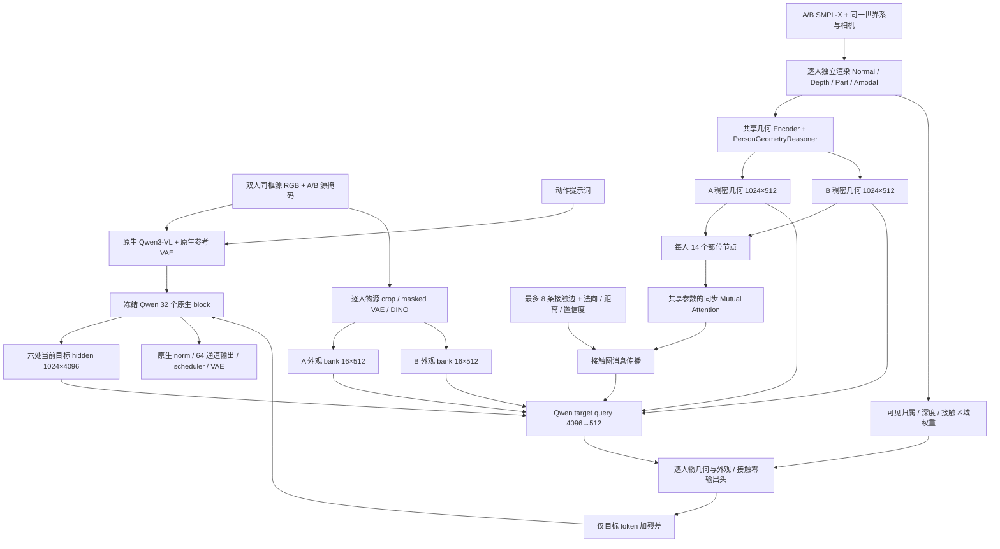

# Qwen-Image-2.1 双人分支升级设计

日期：2026-10-11。设计版本：`dual_v8`。状态：**用户已确认，模块实现与300步单样本验证已完成，完整双人质量尚未验收通过**。

本规格依据 `ssh sg:/home/shangguanrz/project/pic-edit` 的实际 Qwen 2.1 和 adapter 源码。研究证据与论文对应见 [审查报告](C:/Users/sg/.codex/worktrees/qwen21-dual-v8/pictureedit/reports/Qwen21_双人Adapter论文与代码审查_20261011.md)。以下保留确认时的设计目标；实际接口和验证范围以 [运行文档](C:/Users/sg/.codex/worktrees/qwen21-dual-v8/pictureedit/docs/experiments/2026-10-11-qwen21-dual-v8-pilot.md) 与 [实验报告](C:/Users/sg/.codex/worktrees/qwen21-dual-v8/pictureedit/reports/Qwen21_dual_v8_pilot_20261011.md) 为准。

## 1. 本阶段目标与约束

实现一张双人同框源图的动作编辑：保持 A/B 的身份、衣服及体型，依据动作文本和外部目标几何生成交互。以 512×512 为首轮验证分辨率。

需要证明三个增量：

1. 相比现有双人轻量/旧 full，逐人物外观绑定更稳定。
2. 关系和接触条件能改变生成的相对位置、接触部位及遮挡。
3. 主干原生接口保持兼容，控制关闭、单人旧调用、缓存及 CFG 不产生实现回归。

本阶段包含基本人物外观路由，不训练双人精细 Face/Hand 生成。手腕/手部作为身体部位和接触端点进入几何；低置信度手指不作为精确控制。独立两张源图、超过两个人、视频时序、联合姿态生成、Prompt Enhancer、主干 LoRA 不进入首版。

验证顺序：接口与梯度检查 → **一条配对过拟合** → 未训练条件诊断 → 决定是否扩展。没有默认全量训练任务。

## 2. 推荐的整体计算图



图中的 A/B 外观 bank 是 adapter 的条件，不增加原生参考图片数量。Qwen 内部文本与参考 latent 仍按原生槽位交错，目标图像在末尾。

### 2.1 三种方向的选择

| 方向 | 优点 | 代价 | 选择 |
|---|---|---|---|
| 继续旧 full 的 scene fusion 与 1536 核心，补 mask | 改动最少 | 保留跨模型 latent 桥和逐人读取不足 | 比较基线 |
| **复用几何权重，增加 Qwen hidden 查询及外部逐人路由** | 可解释、控制边界清楚、保留旧单人 | 新增少量 controller 和数据协议 | **首版** |
| 完整 16 层 Qwen ControlNet / 改文本调制与 RoPE | 容量较大 | 更大算力和原生能力回归面 | 后续容量消融 |

## 3. 与现有 full 的边界

新代码位于 `src/pose_control/qwen21_full/dual/`，由 full 的统一入口选择控制模式。

| 模式 | 行为 |
|---|---|
| 现有旧调用 / `single_v6` | 完全沿用当前 Body/Face/Hand 路径、旧加载协议和 32 层分组 |
| `legacy_dual_lite` | 沿用当前 `qwen21/dual_adapter.py` 的六层双人路径，作为比较 |
| `dual_v8` | 使用本设计的目标控制；不同时叠加旧 full 双人几何、interaction、detail |
| `native` | 不注册控制 hook，直接调用原生 pipeline |

旧 single 的参数与新 dual **不共享同一可变参数对象**。新 dual 的几何 warm start 是权重副本；训练新分支不会改变已有 single 检查点的行为。低层编码器可以结构共享，但 A/B 之间使用同一个新 dual 编码器实例。

兼容规则：旧检查点仍由旧 loader 加载。新检查点必须含 `architecture=dual_v8`、schema 版本、几何/appearance encoder 版本、注入索引和加载报告；不能把旧 300 步权重改名当作新版。只迁移形状和语义都一致的几何张量；旧输出头、1536 控制核心及不同约定的 global encoder 不做盲目转换。

### 3.1 已核实的 warm start

首版几何副本采用 `experiments/qwen21_iper_body/full_20k/checkpoint_best.pt`，文件中的实际 step 为 **19500**；`checkpoint_last.pt` 的实际 step 为 20000。两个 state dict 均与当前轻量 BodyAdapter 的键与尺寸一致。这是轻量单人 Body 检查点，不是 full 全分支检查点。

新 dual 可拷贝 `condition_injector.spatial_encoder` 的对应 stem/融合参数及 `reasoner.person_reasoner`，两组分别约 5.06M 与 15.22M 参数。两组在最佳检查点中分别有 141/141、36/36 个参数张量的 Adam 更新记录。RoleFiLM 使用同一已学 A 条件处理两个人；旧 reasoner 的 A role offset 若保留，也作为两人共享的同一个 offset，不能继承 A/B 两套不同向量。

该检查点的 relative encoder、contact encoders、cross-person reasoner、contact reasoner、dual fusion 均没有本轮单人训练的 Adam 状态。它们的张量存在不能证明其双人能力受过训练。新 global32、relative14、部位图关系、外观 resampler/controller 与零输出头仍按新参数初始化。已有几何输出桥及旧 single 的后处理层不进入新逐人物状态路径。

## 4. 数据契约

### 4.1 三类对象分离

`DualGenerationInput` 只含：

- 一张源 RGB、A/B 源人物掩码与源 UID；
- A/B 源形状及外观条件；
- 目标姿态、共同相机、相对位置和接触条件；
- prompt、seed、输出尺寸、控制强度。

`TrainingTarget` 单独含目标 RGB/目标 latent。`EvaluationTarget` 单独含目标 RGB、真值人物掩码和评价标注。生成函数不能接收这两种对象，也不能接收带目标路径的整条 dataset row。

已知目标几何可能离线从目标 RGB 拟合取得；这个任务必须标记为 `target_geometry_known=true`。其几何控制与“从文本预测目标姿态”不是同一任务。

### 4.2 身份对应

`person_uid` 以源帧的 actor 对应确定，映射到目标帧的同一 actor；不按目标左右重新编号。不使用全数据集人物编号的可学习 embedding，以降低记住 Hi4D 人物的机会。

A/B 槽位是存储与路由索引，不能让网络因槽位 A/B 获得两套不同能力。新几何路径不使用不对称的 A/B role embedding：复用旧空间编码权重时，两个人均使用旧 Person-A 的 RoleFiLM 参数副本。人物归属由 UID、逐人物特征和 bank 对应传递。动作中“发起者/接受者”等语义角色需显式跟随 UID，而不是依赖当前左右位置。

### 4.3 尺寸与坐标

`B` 表示 batch，`P=2`，`N=32×32=1024`，内部维度 `d=512`。

| 条件 | 尺寸 | 来源与含义 |
|---|---|---|
| Source RGB | `[B,3,512,512]` | 等比 letterbox，原生 pipeline 保留其正常颜色/alpha 处理 |
| Source mask | `[B,2,1,512,512]` | 仅源图人物分割，允许进入生成 |
| Normal | `[B,2,3,512,512]` | 每人独立渲染的 camera-space 法向；amodal |
| Depth | `[B,2,1,512,512]` | metric camera z；mask 外用 valid 位，不能把零当真实深度 |
| Part | `[B,2,14,512,512]` | 沿用项目 14 个身体部位语义，amodal 渲染 |
| Body heatmap | `[B,2,25,512,512]` | 项目约定的 18 body + 6 feet + midhip，非 OpenPose BODY_25 的任意替代排列 |
| Amodal mask | `[B,2,1,512,512]` | 独立渲染完整人体占据 |
| Visible owner | `[B,2,1,512,512]` | 两网格共同 z-buffer 得到可见归属 |
| Body joints 3D | `[B,2,22,3]` | 共同世界坐标，单位米 |
| Wholebody observations | 可选 `[...,134,3]` 与 confidence | 手/脸必须保留来源和多视角置信度，初版不作为完整精细真值 |
| Person valid | `[B,2]` bool | 显式缺失，禁止空 mask 静默当有效人物 |
| Dense geometry | `[B,2,N,512]` | 原 stem 缩小 8 倍至 64×64，再 person reasoner 缩小 2 倍 |
| Part nodes | `[B,2,14,512]` | dense 按 14 类 amodal part pooling，并融合三维部位几何 |
| Appearance bank | `[B,2,16,512]` | 源 VAE 八个 token + 源 DINO 八个 token |
| Contact edges | `[B,E≤8,...]` + mask | 端点节点、世界 anchor、法向、距离、置信度 |

SMPL-X 的 10475 顶点不能套用 SMPL 的 6890 顶点 part 索引。新渲染器以 SMPL-X skinning joint 语义生成并固定 14 类分区，导出分区 hash；用左右手、脚、上/下臂的可视化确认后才生成条件。

RGB、mask、normal、depth、part、2D pose 使用同一 letterbox 仿射。相机先用原始 `K,R,t` 做几何，再用仿射更新 `K_512`。法向插值后重新单位化；离散 part/owner 用 nearest 或覆盖面积采样，不混用 RGB 插值。

每个人的 shape 从源 actor 拟合固定；target pose/root 来自外部几何。源和目标是同一 actor 时形状共享。若将其他人体型的 pose 用在该 actor 上，应先固定源 beta 做离线 retarget/contact 修正，不能假设替换 beta 后接触仍成立。

### 4.4 新版全局和相对条件

新 schema 显式保存 typed 字段，避免复用名称相同、约定不同的旧 `global_26`：

- 每人全局向量 32 维：beta10、root rotation 6D、world root translation3、归一化 K4、camera rotation6D、camera translation3。
- 相对向量 14 维：身高归一化 camera translation delta3、相对旋转 `(R_A^T R_B)` 的 6D 表示、bbox center delta2、bbox log-size ratio2、归一化 root distance1。
- A→B、B→A 分别从 typed 变换计算；不将 axis-angle 的一个分量差当作一般 yaw。

坐标公式固定为 `X_cam = R_cw X_world + t_cw`。rotation 6D 按两列向量依次拼接 `[R[:,0], R[:,1]]`，恢复时按列做 Gram–Schmidt；不混用其他库的行拼接约定。K4 为 `[fx/512, fy/512, cx/512, cy/512]`。相对距离和 translation 使用两个人源 shape 的中立姿态身高均值归一化；bbox center/size 先除以 512，A→B 的 center 是 B−A，size 为 `log(size_B/size_A)`，反向重新计算。无效 bbox 字段由 validity 关闭，禁止除零。

新 global/relative encoder 是新参数。旧源数据可通过明确的 SMPL/SMPL-X schema converter 读取，但不能仅因字段叫 `smplx_global` 就认为已经是 SMPL-X。

### 4.5 缓存键

- Source bank：源 RGB/mask SHA、crop 规则、VAE/DINO 权重版本、person UID。
- Geometry：SMPL-X 参数 SHA、相机/letterbox、part 分区版本、接触抽取与 confidence 规则。
- 原生 VL/KV：原生参考图与 prompt hash、processor/encoder 版本；cond/uncond 分开。
- 运行记录：prompt 文本、动作标签、seed、几何 SHA、checkpoint SHA、代码 revision、target_geometry_known。

目标 RGB 不参与生成 feature cache key。训练 latent cache 与生成条件 cache 分目录。

## 5. 逐人物几何与关系模块

### 5.1 复用 shared Encoder，保留稠密状态

Normal/Pose/Part 沿用现有独立 stem 和融合结构，新 depth/visibility 接口在新分支内部增加。每人生成 `G_i∈R^{B×N×512}`，再按 part pooling 构成 14 个节点 `P_i`。

每个节点融合：稠密几何 pooling、anatomical part embedding、世界中心、部位朝向/对应关节、源 shape、观测置信度。不加入衣服颜色或人脸描述。这些节点负责几何关系；外观只在后面的独立 bank 读取。

14 部位 pooling 的空部位必须给 invalid mask，不允许全零 token 经带 bias 的 MLP 变成有效条件。遮挡部位的 amodal 网格节点可有效，但其图像外观可见度另行处理。

### 5.2 Mutual Attention 的实际升级

以两层、8 heads、head dim 64、FFN ratio 4 起步。每层共享同一参数，从上一层两人状态同步计算：

\[
P'_A=P_A+\operatorname{CA}(P_A,P_B;E_{A\to B}),\qquad
P'_B=P_B+\operatorname{CA}(P_B,P_A;E_{B\to A}).
\]

`E` 由相对变换和节点间世界距离产生 attention bias/value condition。对两个 14 节点 bank 交互，避免两幅 1024 token 网格之间的全连接 attention。节点更新按 part membership 回填稠密 `G_i`；A/B 的网格不会先合并为一个 scene map。

该模块升级的是**几何表示与运算位置**；原来已有双向注意力，不将其本身作为新发明。

### 5.3 Contact Graph

图有 28 个部位节点。人物内骨架邻接固定，跨人物边由显式接触关系给出。最多八条关系优先按不同 part-pair 聚合，不把距离最小的八个相邻顶点当八种接触。

每条跨人物边保存端点 `person_uid/part`、anchor position、单位法向、metric distance、接触类型、confidence。连续边特征 15 维：delta position3、distance1、normalA3、normalB3、normal dot1、signed gap1、confidence1、visibleA/B2。signed gap 只在几何侧判断可靠时启用，否则用 valid bit 关闭；不是简单无符号距离的另一个名字。

初版两层 512 维 edge-conditioned 图 attention：confidence 调整边权；端点消息聚合到对应 part，edge token 同时形成 `C∈R^{B×E×512}` 供目标 contact query 使用。所有跨人物接触无效时，接触图更新及 contact residual 为**精确零**；Mutual Attention 仍可传递非接触相对关系。

手部接触采用腕/手掌部位中心。拟合中仅先验决定的手指不会创建高置信度精细边。Hi4D 原 SMPL 接触映射到 SMPL-X 要记录最近对应误差，并在超过几何阈值时降低 confidence。

离线可优化 root/局部关节以满足接触，固定源 shape，权衡已观测姿态和接触。不能以接触项为零为理由允许手臂或躯干穿透。该步骤不训练图像 adapter。

## 6. 外观 bank 与空间读取

### 6.1 Source bank

保留原生同框参考图。adapter 额外从源 mask 派生每人的 bbox crop：

- VAE bank：源 64 通道 latent，用 mask coverage 作 pooling 的分母，得到八个 token，经 64→512 投影。
- DINO bank：冻结现有 DINO 特征提取器；采用独立人物 crop、背景弱化及 patch validity，经 1536→512 投影和两层 resampler 得到八个 token。
- 两者加 modality embedding，合成每人 16 个 token。

源图特征的 receptive field 可能含另一个人或背景；mask 不能在数学上保证彻底解耦。采用 crop、保守 mask/coverage、源人物排他性检查和衣服互换测试来降低并检测污染。source mask 面积过小或人物严重重叠时记录不可靠，不能借目标 appearance 补足。

本阶段不要求 ArcFace 必须检出才能生成。ArcFace 是身份评测工具，后续可复用现有 FaceContentEncoder 的身份 token，但不默认开启双人精细 face head。

### 6.2 目标只能读取对应人物 bank

每个目标位置的 controller query 来源于 Qwen 当前层输出，分别读取 A、B 的 geometry/appearance bank。appearance attention 的 K/V 不跨人物拼接到同一个可自由读取的池。

目标 token 可覆盖多个可见区域，因此按像素级 visible owner 在 16×16 token footprint 内做面积平均，得到 `v_A,v_B`。完全不可见的人物不提供该位置的外观残差；它的 amodal 几何仍通过节点关系影响接触布局。

没有任何有效 key 的查询直接返回零，不运行全 mask softmax。原生 Qwen 仍可读取整张参考；外部路由限制的是新增控制通道，不宣称约束了主干所有身份传播。

## 7. 针对 Qwen 的控制核心

### 7.1 注入位置与输入

首版只在 zero-based `(3,8,13,18,23,28)` 的原生 block 完整输出后注入。六处覆盖前/中/后层，这一选择便于与现有轻量路径对照；最优位置需要消融，不把它当作理论结论。

旧 full 单人仍沿用 32 层注入。双人 V8 不将一组残差复制加到连续五六层，也不在第 31 层直接改输出头。若六处明显控制不足，再比较 12/16 处，同时约束累计残差预算。

对当前层目标输出 `H_l^t∈R^{B×N×4096}`：

\[
Q_l=W_q\operatorname{LN}(H_l^t)+e_l+e_{xy}+\operatorname{TimeMLP}(t_{model},\sigma_{flow}),
\quad W_q:4096\to512.
\]

query projection 跨层共享，stage embedding 各自独立。`e_xy` 是 adapter 内按 32×32 网格计算的固定 2D sine/cosine 编码，不改原生 RoPE。native model timestep 与 scheduler flow sigma 均记录，不能用去噪循环序号代替它们。

### 7.2 三路条件输出

对每个人共享计算：

```text
U_geo_i = LocalFusion(Q_l, G_i) + CA(Q_l, PartNodes_i)
U_app_i = CA(Q_l, AppearanceBank_i)
U_contact = CA(Q_l, ContactEdges)    # 无有效接触边时直接为零
```

几何和 appearance 的处理权重分开，避免一个 appearance loss 把关系图变成外观混合池。层/时间/源外观可调制 adapter 内部 512 维状态，原生 Qwen 的 modulation 不变化。

首版 `LocalFusion` 明确定义为同位置的 `[LN(Q_l), LN(G_i)]` 拼接，经过 `1024→1024→512` 两层 MLP，中间使用 GELU。三种 cross-attention 均使用 8 heads、head dim 64、独立 Q/K/V 投影和 pre-LN；各路 attention 后接 `512→1024→512` FFN。geometry attention 的 key 是本人的 14 个节点，appearance key 是本人的 16 个源 token，contact key 是最多八条有效边。三个条件运算模块跨注入层共享参数，层位差异由 `e_l` 和独立输出头表达。无有效 bank/edge 时整条对应分支绕过 attention 与带 bias 的 FFN，直接返回零。

每层三类低秩输出头：`512→64→4096`，分别为 geometry、appearance、contact。A/B 共用每一类头；每个层位独立头。第一投影正常初始化，第二投影**零初始化**，不再叠加零乘法 gate。

仅六层三类输出头约 5.3M 权重，共享 query 约 2.1M；加几何、节点和 resampler 的完整参数量需实例化统计。本设计新增控制的初步预算为数千万级，不预先宣称精确总参数或显存。

### 7.3 遮挡与接触融合

由共同 z-buffer 决定像素 visible owner，面积平均为外观 token 权重 `v_i`。另生成只用于几何的 owner `u_i`：从可见 owner 向外扩张最多 RGB 8 像素以覆盖 mesh 与衣服边界差；扩张重叠处依据邻近有效表面的 camera depth 竞争，深度相同时用对称归一化权重，不能以 A/B 槽位打破平局。二者均满足各自的人物权重和不超过 1。接触区域 `c` 从可靠的 anchor/接触渲染栅格生成。权重定义：

\[
W_C=\min(c,u_A+u_B),\qquad
W_i^g=\frac{u_i}{u_A+u_B+\epsilon}(u_A+u_B-W_C),\qquad
W_i^{app}=v_i.
\]

令 `R_i^g,R_i^app,R_C` 为三类输出，融合为：

\[
\Delta_l=\alpha_l\big(W_A^gR_A^g+W_B^gR_B^g+W_CR_C
+\lambda_{app}(W_A^{app}R_A^{app}+W_B^{app}R_B^{app})\big).
\]

`W_A^g+W_B^g+W_C≤1`；appearance 单独受总残差预算约束，不把两类控制任意视为相同信号。联系区域保留各自可见外观，同时由共同几何 contact residual 处理交界。不能把后面人物的衣服颜色混到前面表面。

几何扩张不会扩大 appearance 读取区域；appearance 始终使用未扩张的实际可见 owner。报告必须保存 `u_i/v_i/W_C` 权重图。空 ROI 精确零，不能在归一化后扩散到全背景。

### 7.4 控制预算

初版记录每层、每路在有效 ROI 的 `RMS(delta)/RMS(H_target)`、最大值、非零 token 数和总累计注入。不得用全图平均掩盖局部异常。

初始可试 `5%` 的局部残差预算：训练增加软惩罚，推理可选比例上限；这是工程起点，需要验证集校准。零初始化附近不施加会截断学习的硬 zero gate。第一版层/时间门控从相同非零值开始，不先假设“早期几何、晚期身份”的特定强度曲线已被验证。

## 8. 原生能力保护、缓存与梯度

### 8.1 可保证的计算边界

- 原生 Transformer、VL、VAE 权重冻结，参数 checksum 不变。
- 原生参考图列表、文字、img_mask、img_shapes、RoPE、attention 和 modulation 不变。
- 新 residual 只 scatter 到目标后缀；参考/文本输出逐 token 不变。
- `native`/全部 strength=0 时不注册控制 hook，逐像素与原生同 seed 输出一致。
- B 无效时走旧 single 路径；新 interaction/contact/appearance-B 为零。

这些边界不保证打开控制时的背景或一般编辑质量不变。目标 token 之间的双向 self-attention 会传播局部修改；能力保护必须由生成回归数据证明。

### 8.2 初始化与训练梯度

冻结只使用 `requires_grad_(False)`，不能对整个 Qwen 去噪调用套 `no_grad()`，否则早层 adapter 不能经后续 frozen block 收到梯度。冻结 source encoders 可以用 `no_grad`；训练目标 VAE 编码也不需要梯度。

初始化测试要求：输出 residual 为零，真实 flow loss 对最终零投影有非零梯度；更新一次后上游 controller 有非零梯度。两个串联零映射或零 head×零 gate 均不允许。

hook 生命周期覆盖一次 forward 及其 backward。gradient checkpoint 重算不得读取被下一条样本覆盖的条件。初版每个 microbatch 使用不可变 prepared condition 和独立 context，完成 backward 后移除 hook，再进行下一次 forward。禁止在同一可变 context 下积累不同条件的多个未回传图。gradient accumulation 在 microbatch 完成 backward 后累加参数梯度，不保留多条 forward graph。

### 8.3 KV 和 CFG

训练初版不用 prefix KV 缓存。推理验证 `extract` 和 `cached`：cached block 输出只含目标，prefix 长度为零；控制仍依据 `img_shapes[-1]`，不能假设 cached 有原始前缀。

正/负 CFG 分支使用相同几何和 source bank，各自从实际 hidden 计算 residual；原生两个 KV 缓存分开。两分支的 residual 不一定相同，因此不能假设它们在 CFG 后完全抵消。保存 CFG 后 velocity 的 RMS/finite 诊断，测试 scale 1 和当前生产配置的 scale。

原生 KV key 可随源图/prompt 变化失效；adapter 只缓存与去噪无关的几何和外观 bank，不跨去噪步缓存从 `H_l^t` 算出的 residual。

### 8.4 对输入错误的处理

有效人空 source mask、geometry 坐标不匹配、duplicate UID、非有限 depth/normal、未版本化 global 向量都拒绝生成并给具体字段错误。无 contact 是正常条件；缺失 B 是兼容路径；没有目标 RGB 也是正常生成接口。

## 9. 训练目标

对已知目标 latent `x_0`、噪声 `epsilon` 和实际 flow sigma：

\[
x_\sigma=(1-\sigma)x_0+\sigma\epsilon,\qquad
v^*=\epsilon-x_0.
\]

首版训练目标为区域加权 flow matching，加 residual budget 与可用的背景 teacher 保持：

\[
L=L_{FM}+\lambda_{bg}L_{bg}+\lambda_{budget}L_{budget}.
\]

`L_FM` 对整图基本权重 1，body 区域附加权重 1，可靠接触区域附加 1；按有效面积归一化并记录各项，避免一个大人物占全部梯度。区域来自几何渲染，不读目标真值分割 mask。

背景保持 ROI **排除源人物位置与目标人物位置的并集及边界扩张**。否则人物移动后，保持项会错误地要求保留原人物。teacher 为同源图、prompt、噪声时间下的原生 Qwen velocity，且无 target reference。若原生动作编辑错误，不在人物区做全图 teacher distillation。

第一版不把 ArcFace/DINO/ONNX DWPose 分数作为可微训练项。后续若加入 source identity perceptual loss，应通过 `x_hat0=x_sigma-sigma*v_pred`、可微 VAE decode 和保持输入梯度的冻结 encoder，明确确认 adapter gradient。目标 RGB 的 FM 监督本身合法，teacher 与 source bank 均不得以目标 appearance 为条件。

输入 SMPL-X contact/SDF 可行性只用于离线几何优化。输出几何评价必须从生成 RGB 重新估计；不能拿控制网格的距离当生成结果的成绩。

## 10. 验证矩阵与验收

### 10.1 接口及计算测试

| 测试 | 必须满足 |
|---|---|
| 全部控制关闭 | 同输入/seed/采样参数输出逐像素一致，原生权重 checksum 不变 |
| 零初始化 | 各层 residual 为零，真实模型最终零头有非零梯度 |
| Target-only | extract 模式所有 prefix 输出不变；cached 模式仅 target 输入/输出 |
| B 缺失 | 旧 single 调用与旧 checkpoint 结果一致，新 B/interaction/contact 为零 |
| 空 contact | 无 NaN，contact 输出精确零，相对关系模块仍有效 |
| 空源 mask | 明确报错，不偷用 target mask/appearance |
| 交换存储顺序 | 同时移动 UID、几何、bank、边端点，空间输出一致，容许浮点 reduction 微小误差 |
| 只交换 source bank 对应 | 目标姿态保持，外观应按 bank 对应交换；不能按目标左右重绑定 |
| CFG / 缓存 | 正负缓存隔离；cache on/off 在固定 attention backend 下满足数值容差 |
| 目标数据替换 | 固定生成对象，替换训练/eval target RGB/mask，输出逐像素一致 |
| 控制切换 | 同源/prompt/seed 下，改变目标姿态/接触，控制 bank 与输出都变化 |
| 真实 forward/backward | 一次双人 flow loss 可回传，无主干梯度，新输出头非零梯度 |
| checkpoint 重算 | 与无重算的梯度方向/范数在 BF16 容差内一致，条件未被覆盖 |

数值容差分层：关闭控制要求同 backend 下 exact；FP32 小型集成用 `atol=1e-6/rtol=1e-5`；BF16 真实 cached/checkpoint 比较记录绝对与相对误差，初始 `atol=1e-2/rtol=1e-2`，若差异造成可见输出变化则继续定位，不能仅放宽阈值。

### 10.2 单样本试验

先用已拟合的 `pair14 / talk14 frame32 → hug14 frame62` 做新版 overfit，最多先跑 300 步，与旧 300 步权重分目录。按 §3.1 使用已核实的单人 body 几何权重副本初始化；global/relative、router、graph 和输出头作为新参数。全程冻结 Qwen 和旧 single。

首轮训练 controller/新 global-relative/appearance/graph；复用的几何编码先冻结。若新头已学到且姿态仍不足，才以低学习率开放新 dual 几何副本。记录每个参数组梯度与实际更新，不能称旧单人 checkpoint 为已训练双人参数。

生成均为 512×512、40 步、seed 42/43/44。native 用详细动作提示词，新 adapter 用短动作文本；同时保留相同详细 prompt 的公平对照，避免把提示词差异误归因于网络。

当前只完成 talk32/hug62 的 SMPL-X 拟合。若要加入 hug34 切换，先拟合该帧并使用同一 actor shape/camera；不能把已有两帧结果错标为第三帧。

### 10.3 消融

| 编号 | 条件 | 要检验的作用 |
|---|---|---|
| E0 | 原生 Qwen + 详细 prompt | 原生能力基线，无目标几何 |
| E1 | 旧双人轻量，原配置 | 已有六层控制基线 |
| E2 | V8 共享 geometry + 各自 appearance routing，无 mutual/contact | Qwen hidden 查询与绑定是否有效 |
| E3 | E2 + 部位 Mutual Attention | 相对姿态协调增量 |
| E4 | E3 + Contact Graph | 具体接触部位、肢体交界增量 |
| E5 | E4 + 深度 visible fusion | 遮挡与外观串扰增量 |

为隔离 E5 的作用，E2–E4 的融合权重使用 A/B amodal mask 的对称归一化重叠，E5 才切换到 §7.3 的共同深度 owner。其余 bank、参数容量、prompt 和采样设置保持一致。这个归一化 mask 基线仍按 UID 读取各自 bank，但不具备深度遮挡保护；不能把 E2–E4 与 E5 都配置为同一 owner 后声称测到了遮挡增量。

先在一条样本验证计算，再用未参与训练的配对诊断记忆/控制效应。单样本消融不能证明泛化或论文创新。跨 pair/identity 的质量结论必须等多样本训练、独立 validation 选权重后得出。

### 10.4 输出质量与原生能力回归

逐例保存源、目标、pose/depth/owner/contact、生成图、A/B crop、可见 weight 和残差热图。目标 RGB 由 evaluator 独立读取，图板标注各组是否拥有目标几何。

报告逐人 body/wholebody PCK、A/B source face 与衣服相似度、交换率、检出人数/第三人率、具体 part-pair 接触距离、遮挡关系、背景误差。用生成 RGB 的冻结 Multi-HMR 几何补充 anatomy/penetration 代理指标，记录模型版本与尺度归一化。

脸不可见、关键点漏检、网格少于两人时记为 NA/重建失败，分母与失败率单列；不能仅报告幸存样本的均值。身份匹配先参考几何/人物对应，再计算原对应与交换对应的 similarity margin，避免 Hungarian 事后重排掩盖交换。

旧 single 回归使用固定 iPER 验证样本，正常 single 调用应完全一致。新增 dual 打开时检查人物数量、自然纹理、背景、源图文字/标志及提示词动作遵循。关闭时 exact 不能代替打开时质量验收。

若姿态/接触不改善、交换率增加或背景明显恶化，停止扩大训练并查模块消融、条件可信度与局部控制预算。只有单样本 loss 下降不足以验收。

## 11. 实施位置与交付

以下是确认设计中的新增/改动文件；本轮实现已提供这些入口：

| 文件 | 职责 |
|---|---|
| `qwen21_full/dual/conditions.py` | source/target-geometry 强类型对象、UID、confidence、版本验证 |
| `qwen21_full/dual/geometry.py` | 共享 geometry 副本、14 部位 pooling、typed global/relative |
| `qwen21_full/dual/reasoner.py` | 同步节点 Mutual Attention 与 Contact Graph |
| `qwen21_full/dual/appearance.py` | source-only crop/VAE/DINO bank、cache |
| `qwen21_full/dual/routing.py` | visible owner、面积权重、无 key/无 contact 处理 |
| `qwen21_full/dual/controller.py` | 4096→512 target query、三类零输出头、预算统计 |
| `qwen21_full/dual/context.py` | 六层 hook、target suffix、CFG/cache/checkpoint 生命周期 |
| `qwen21_full/dual/checkpoint.py` | 版本化加载、warm start 报告、checksum |
| `src/data/hi4d_smplx_dataset.py` | SMPL-X 新条件读取与 source/监督/eval 分离 |
| `scripts/precompute/precompute_hi4d_smplx_controls.py` | 独立渲染、part、owner、接触与质量标记 |
| `scripts/train/train_qwen21_dual_v8_pilot.py` | 显式单样本训练入口 |
| `scripts/infer/infer_qwen21_dual_v8.py` | 仅生成对象推理，不读目标 RGB |
| `scripts/eval/eval_qwen21_dual_v8.py` | 独立读取真值、消融与质量报告 |
| `tests/test_qwen21_dual_v8_*.py` | 本规格的接口、梯度、泄漏、交换测试 |

修改现有 `qwen_adapter.py` 仅做模式分发与新 context 接口；single 的数值路径不改。数据 runtime 不将 Hi4D 双人塞进现有 single-only builder 的隐式字段。

计划输出目录：`experiments/qwen21_dual_v8/pilot_pair14_<run_id>/`，包含配置、manifest、输入/模型/代码 hash、日志、checkpoint、逐例图板和报告。完成后交付真实训练、推理、评测命令与 checkpoint 路径；在入口未实现前不提供看似可运行的命令。

## 12. 当前完成状态与审阅重点

已完成：Qwen 源码/配置核查、旧双人和 full 差异映射、七篇研究与相关公开实现检查、VideoX-Fun 2.1 接口核实、SMPL-X 两帧数据可用性检查、完整计算图与验证门槛设计。

实施进展：V8 模块代码、真实 V8 前后向、300步单样本训练、12张生成对照、数据边界审计与独立重评分已完成。姿态/外观漏检、接触覆盖仅1/3及控制切换伪影见实验报告；尚不能声称完整双人质量或跨样本泛化达标。

用户已确认的核心选择是：**保留旧单人 full，在新双人分支中采用部位关系 + 独立外观 bank + 六处 Qwen hidden 查询控制**。本轮只实施一个单样本实验，没有扩大到全量训练。
