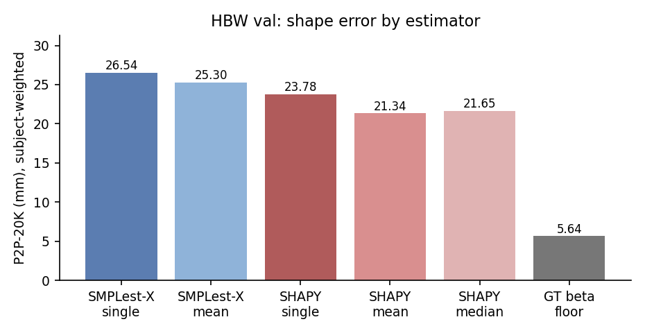
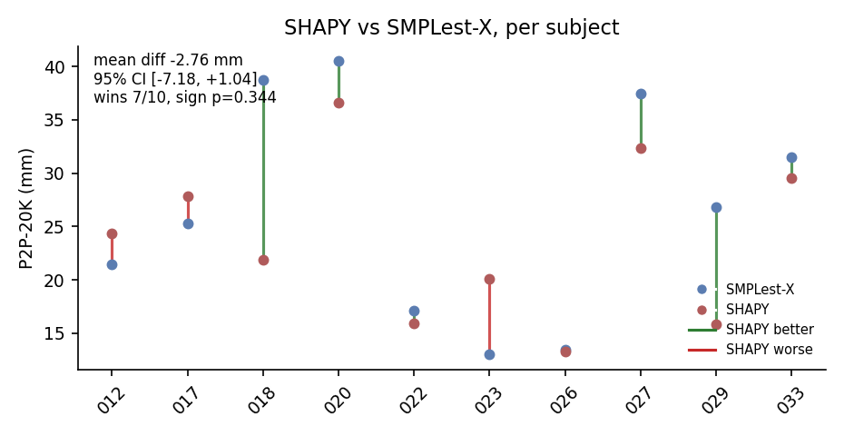
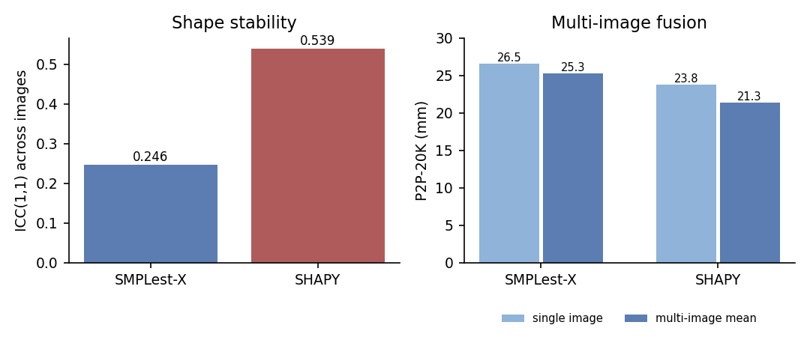
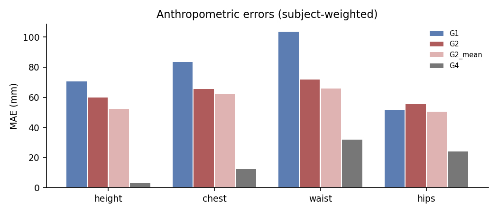
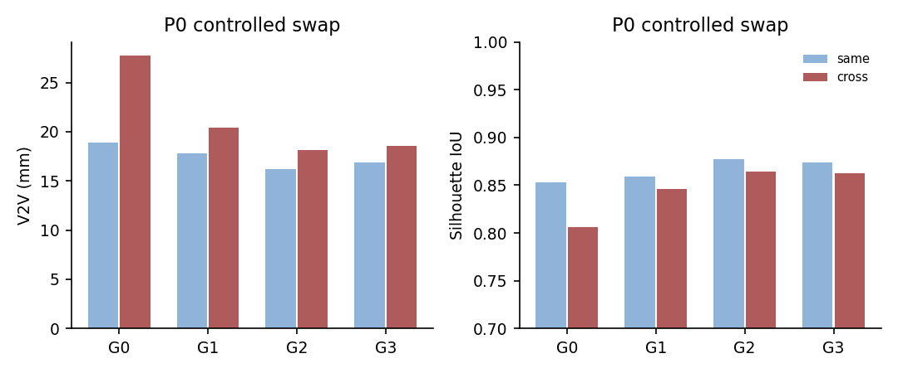
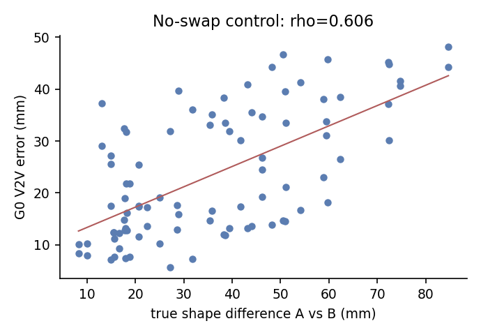
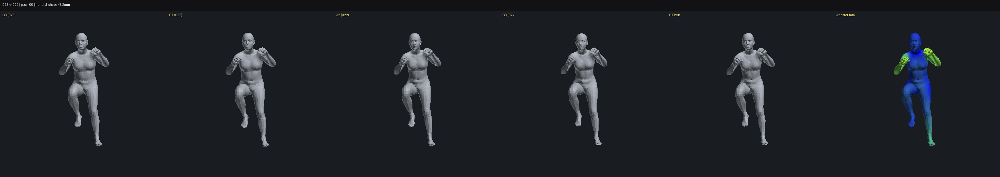
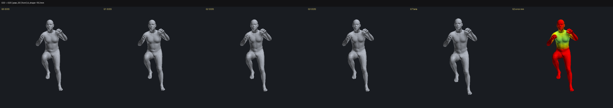

# SMPL-X 跨体型 β 替换与单图体型估计基准（HBW P0+P1）

2026-11-09。运行根：`/data/shangguanrz/shape`；代码：本目录 `scripts/`。

## 0. 结论摘要

1. **单图 β 估计**：SHAPY 平均比 SMPLest-X 准（P2P-20K 23.78 vs 26.54 mm），但受试者级配对差 **−2.76 mm，95% CI [−7.18, +1.04]，7/10 胜，sign test p=0.344**。未达到预注册的“≥3 mm 且 CI 不含 0”，**不能用这批证据把单图 SMPLest-X 替换成 SHAPY**。
2. **稳定性**：同一人跨 26–148 张图，SHAPY 的 β 组内相关 **ICC(1,1)=0.539**，SMPLest-X 只有 **0.246**；多图 β 均值把 SHAPY 的 P2P 从 23.78 降到 **21.34 mm**（−2.43 mm，CI [−3.57, −1.36]，10/10），SMPLest-X 从 26.54 降到 25.30（−1.23 mm，CI [−1.86, −0.67]）。**如果一个人有多张图，SHAPY 多图均值是本次最好的估计器**，但仍离 GT β 下限 5.64 mm 很远。
3. **P0 受控替换**：同姿态同相机下，v2v 从 G0 23.62 → G1 19.16 → G2 17.21 mm；轮廓 IoU 0.828 → 0.852 → 0.870。方向一致，但 G2 相对 G1 的增益仍是“融合级”而非“单图级”。
4. **不能只看 β 距离**：G2 的 β L2 反而更大（3.87 vs 3.07），表面误差却更小；β 距离只作诊断。
5. **10 维 β 的表达上限**：GT 网格用 10 维 β 拟合，表面 v2v 残差 3.21–6.44 mm，但**围度下限**已经到 waist 31.95 mm、hips 23.85 mm；300 维拟合表面残差 1.23–1.83 mm。若 Native V5 需要围度级监督，10 维 β 不够。
6. **建议**：单图管线保留 SMPLest-X；多图场景可把 SHAPY 均值/中位数作为 body-shape 先验或教师；Native V5 的监督上界用 HBW GT β（10 维），并明确围度下限。

---

## 1. 数据与协议

### 1.1 HBW 验证集

- 10 人：女 012/022/023/026/027/029，男 017/018/020/033。
- **705 张**原图（官方 val 781，覆盖率 **90.27%**；`HBW.zip` 本身只有 705 张，不是抽样）。
- 全分辨率 OpenPose BODY_25 + face70 + hands21：739 个 JSON，705 个与图像一一对应，34 个无对应图（忽略）。
- GT：`(10475,3)` SMPL-X neutral 注册网格，T-pose；身高 1.595–1.896 m。
- 场景：`Photos_Lab` 468 张、`Pictures_in_the_Wild` 237 张；每人 26–148 张，**统计以受试者为独立单位**，图像等权只作描述。

### 1.2 估计器与口径

- **G1 SMPLest-X**：复用 2026-10-28 的 705 张预测（`predictions.jsonl` 与 18 个完整参数分片逐位一致，maxdiff 0）。不重跑推理。
- **G2 SHAPY**：官方 HBW 口径，输入 GT 2D 关键点、由关键点推的 bbox、GT 性别；使用发布的 `SHAPY_A` checkpoint（neutral SMPL-X，10 betas）。这**对 SHAPY 有利**，结论按上界解读。
- **G3 多图融合**：同一人逐图 β 的均值/中位数；不做轮廓或关键点精修。
- **G4 GT β**：10 维最小二乘拟合（含平移）。它是**下限**，不是零误差。

### 1.3 指标

- 主指标：P2P-20K（SHAPY 固定 `HD_SMPLX_from_SMPL.pkl` 20K 点、仅平移对齐、不缩放）。
- 辅助：全顶点 v2v（同拓扑、平移对齐）、身高/胸/腰/臀/体重（SHAPY 定义，官方 CPU 分支与本地 CPU 凸包实现一致到 0.07 mm）、P0 轮廓 IoU + 边界 Chamfer。
- 统计：受试者级配对差、10k 次 subject cluster bootstrap 95% CI、精确 sign test；n=10 下 paired dz≈1.0 才有约 80% 功效，p>0.05 不写成“无差异”。

---

## 2. P1：单图 β 估计精度

### 2.1 主表（受试者等权，10 人）

| 臂 | v2v (mm) | P2P-20K (mm) | 身高 (mm) | 胸 (mm) | 腰 (mm) | 臀 (mm) | 体重 (kg) |
|---|---:|---:|---:|---:|---:|---:|---:|
| G1 SMPLest-X 单图 | 22.753 | 26.536 | 70.556 | 83.473 | 103.528 | 51.779 | 12.011 |
| G1 多图均值 | 21.549 | 25.303 | 67.513 | 78.966 | 100.988 | 49.456 | 11.565 |
| G2 SHAPY 单图 | 21.564 | 23.777 | 59.852 | 65.516 | 71.910 | 55.299 | 10.328 |
| G2 多图均值 | **19.390** | **21.344** | **52.386** | **61.996** | **65.828** | **50.443** | **9.668** |
| G2 多图中位数 | 20.006 | 21.654 | 52.620 | 59.840 | 65.938 | 49.785 | 9.761 |
| G4 GT β 下限 | 4.257 | 5.644 | 3.008 | 12.216 | 31.945 | 23.850 | 0.936 |

图像等权版本：G1 P2P 26.686 / 身高 70.979；G2 P2P 24.562 / 63.241；G2 均值 21.344 / 52.386。图像等权和受试者等权差距可达数 mm（如 G1 胸 68.5 vs 83.5），本报告以受试者等权为主。



### 2.2 SHAPY vs SMPLest-X 配对（受试者级）

| 指标 | 均值差 (SHAPY−SMPLest-X) | 95% CI | SHAPY 胜 | sign p |
|---|---:|---:|---:|---:|
| P2P-20K | −2.759 mm | [−7.179, +1.037] | 7/10 | 0.344 |
| v2v | −1.190 mm | [−5.510, +2.818] | 5/10 | 1.000 |
| 身高 | −10.704 mm | [−30.637, +6.921] | 6/10 | 0.754 |
| 胸 | −17.957 mm | [−48.883, +13.920] | 5/10 | 1.000 |
| 腰 | −31.618 mm | [−63.913, +2.758] | 7/10 | 0.344 |
| 臀 | +3.520 mm | [−17.006, +20.371] | 4/10 | 0.754 |
| 体重 | −1.682 kg | [−4.672, +1.313] | 7/10 | 0.344 |

方向一致（身高/胸/腰/体重偏向 SHAPY），但**所有 CI 都跨 0**。异质性很大：022（−9.97 mm）、029（−7.25 mm）SHAPY 明显更好；020（+5.02 mm）、026（+5.04 mm）反而更差。033 的腰部围度误差 224 mm，是单点异常，腰围不能当主指标。



### 2.3 稳定性与多图融合

- ICC(1,1)：G1 **0.246**，G2 **0.539**。
- β 各维跨图 std 的均值：G1 0.259，G2 0.433。SHAPY 的 β 幅度本来就更大（见 2.4），原始 std 不可直接比；可比的是 ICC。
- 融合收益：G1 均值 −1.233 mm（CI [−1.862, −0.669]，10/10，p=0.00195）；G2 均值 −2.433 mm（CI [−3.567, −1.362]，10/10，p=0.00195）；G2 中位数 −2.123 mm（CI [−3.139, −1.197]，9/10，p=0.0215）；G1 中位数 −0.333 mm（CI [−1.382, +0.740]，5/10，p=1.0）。



### 2.4 β 距离只作诊断

受试者等权 β L2 对 GT：G1 **3.067**，G2 **3.873**，G2 均值 3.621。SHAPY 的 β L2 更大，但 P2P 更小；SMPLest-X 的 β 明显向 0 收缩（逐人 β 范数 0.32–0.86，SHAPY 1.54–2.87，GT 1.66–4.23）。**不能拿 β 欧氏距离排序估计器**，这与“统一模型生成表面再比”的原则一致。

### 2.5 围度下限（重要）

G4 是 GT 网格的 10 维 β 拟合，它相对原始 GT 网格的误差已经是：身高 3.01 mm、胸 12.22 mm、**腰 31.95 mm、臀 23.85 mm**、体重 0.936 kg；表面 P2P 只有 5.64 mm。也就是说，**10 维 β 对围度的表达上限远差于对表面的上限**。任何用 10 维 β 做围度监督的方案，都必须把这条下限写进指标，否则会把“表达不了”误判成“估计不准”。



---

## 3. P0：同姿态、同相机的跨体型替换

- 42 个同性别有向对（女 6×5=30，男 4×3=12）为主，48 个跨性别有向对为次。
- 6 个统一真实姿态：从 705 个 SMPLest-X pose 中聚类选 medoid（单腿抬、双臂上举、手扶脸、T-pose、自然站、分腿半蹲），所有体型共用；global orientation 置零。
- 3 个视角：0°/45°/90°；每个姿态一套相机，按 10 人体型 × 各臂的并集取景。
- 参考：`SMPL-X(β_GT, θ*)`。原始扫描只有 T-pose，θ≠0 时不能直接当 posed GT。
- 规模：42×6×3×5 = 3780 主行；加跨性别共 8100 行；围度 450 行。

### 3.1 结果（全配对平均）

| 臂 | v2v (mm) | P2P-20K (mm) | IoU | Chamfer/身高 |
|---|---:|---:|---:|---:|
| G0 源 A 的 β（不换） | 23.616 | 27.642 | 0.8281 | 0.00802 |
| G1 B 的 SMPLest-X 均值 | 19.156 | 22.611 | 0.8518 | 0.00665 |
| G2 B 的 SHAPY 均值 | **17.213** | **18.793** | **0.8703** | **0.00560** |
| G3 B 的 SHAPY 中位数 | 17.782 | 19.100 | 0.8678 | 0.00572 |
| G4 B 的 GT β | 0 | 0 | 1.0000 | 0 |

分组：

| 组 | G0 v2v / IoU | G1 v2v / IoU | G2 v2v / IoU | G3 v2v / IoU |
|---|---:|---:|---:|---:|
| 同性别（42 对） | 18.919 / 0.8531 | 17.760 / 0.8587 | 16.168 / 0.8770 | 16.905 / 0.8736 |
| 跨性别（48 对） | 27.725 / 0.8062 | 20.377 / 0.8458 | 18.128 / 0.8644 | 18.549 / 0.8628 |

G2 的优势在同性别和跨性别都约 3.8 mm；跨性别绝对误差更大，但换体型仍然明显优于不换（G0）。



### 3.2 正/负对照

- **identity**：G4 对 GT 参考 v2v = 0.0，IoU = 1.0。
- **不换体型**：G0 误差与 A/B 的真实体型差（canonical GT β v2v）Spearman **0.595**（1620 行，p=1.1e-155）；按对平均 **0.606**（90 对，p=2.4e-10）。度量对体型差是敏感的。
- mask 面积 10,282–31,441 px（512²，3.9–12.0%），非空、不溢出。
- GT β 的 canonical 拟合残差 3.21–6.44 mm（v2v，平移对齐，逐人）。



### 3.3 对照图

三个同性别对（体型差最大/中位/最小），每对 6 个姿态；列依次为 G0/G1/G2/G3/GT β/G2 误差热图（0–40 mm）。





### 3.4 直观图集（给人看的）

- **体型三列对照**（同一比例尺、canonical T-pose；GTβ / SMPLest-X 均值 / SHAPY 均值）：
  [A 组 012/017/018/020/022](figures/gallery/gallery_lineup_A.png) ·
  [B 组 023/026/027/029/033](figures/gallery/gallery_lineup_B.png)
- **真实照片 + A→B 替换 + GT**（三对：017→020、018→020、023→022；共享 pose 00、正面）：
  [swap pairs](figures/gallery/gallery_swap_pairs.png)
- **每顶点误差热图**（同一批三对；蓝 0 → 红 60 mm）：
  [swap errors](figures/gallery/gallery_swap_errors.png)
- **020 的 6 姿态网格**（G1 / G2 / GTβ；误差蓝 0 → 红 60 mm）：
  [pose grid 020](figures/gallery/gallery_pose_grid_020.png)
- **018→020 三视角**（0°/45°/90°，带 v2v 与 IoU）：
  [three views](figures/gallery/gallery_three_views_018_020.png)

读图提示：体型 lineup 里 GTβ 是 10 维拟合网格，不是原始扫描；G1/G2 的标签是 P2P-20K 与身高误差。swap pairs 里 G1/G2 只依赖 B，所以前两行数值相同；G0 依赖 A。020 是本次误差最大的受试者之一，热图用 0–60 mm 才能看出梯度。

### 3.5 A 的 β 估计 + B 的 β 已知：五格序列

口径与上面的 P0 不同：**B 的 β 当作已知 GT（10 维拟合，残差 3.9–4.2 mm），不估计；只估计 A 的 β**（SMPLest-X / SHAPY 的 A 多图均值）。A/B 同 pose（pose_04 自然站），正面。每行 5 格，顺序严格为：

**A 图 → B 图 → A mesh（A 估 β）→ B mesh（B GT β）→ A + B β（替换后）**

- [017→020](figures/ab_sequence/ab_sequence_017_020.png)
- [018→020](figures/ab_sequence/ab_sequence_018_020.png)
- [023→022](figures/ab_sequence/ab_sequence_023_022.png)

| 对 | 方法 | A 估 β vs A GT（P2P） | A 估 β vs B GT（P2P） | 替换后 vs B |
|---|---|---:|---:|---:|
| 017→020 | SMPLest-X | 25.3 | 37.8 | 0.00 / IoU 1.000 |
| 017→020 | SHAPY | 27.9 | 33.7 | 0.00 / IoU 1.000 |
| 018→020 | SMPLest-X | 38.7 | 35.2 | 0.00 / IoU 1.000 |
| 018→020 | SHAPY | 21.8 | 23.8 | 0.00 / IoU 1.000 |
| 023→022 | SMPLest-X | 13.0 | 12.8 | 0.00 / IoU 1.000 |
| 023→022 | SHAPY | 20.1 | 8.3 | 0.00 / IoU 1.000 |

几何事实：A/B 同 pose、且第 5 格用的是 B 的 GT β，所以**第 5 格与第 4 格逐顶点相同**（swap vs B 0.00 mm、IoU 1.000）。这不是精度结果，是替换/渲染校验。真正有信息量的是两列：**A 估 β vs A GT**（A 的 β 估计准不准）与 **A 估 β vs B GT**（换体型前的错配）。注意 023→022 的 SHAPY：A 估 β 对 A 的 P2P 是 20.1 mm，但对 B 只有 8.3 mm——“对 A 不准”不等于“对 B 不准”，不能把跨人匹配当成估计精度。

---

## 4. 验证与对账

- **G1 复现**：705/705；逐图 v2v 最大差 0.00019 mm、P2P 最大差 5.3e-6 mm；受试者等权 22.7534/26.5360/70.5559 对旧 22.753/26.536/70.556。A1 门通过。
- **SHAPY 可行性**：705/705 预测，0 跳过；30 张分层子集（3/人）G2 为 P2P **23.34**、v2v **21.61**、身高 **59.12** mm，全量 705 张为 **23.78/21.56/59.85** mm，均低于 30/30/90 门禁；用我们的 neutral 模板重算 `v_shaped` 与 SHAPY 输出最大差 **6.86e-8 m**，模板/顶点序一致。
- **SHAPY 10 图复现**：每受试者抽 1 张、独立 mini 布局重跑。β 最大差 **7.8e-4**，对应表面 v2v 最大 **0.0044 mm**、单顶点最大 **0.012 mm**。严格的 β 1e-6 门未过：`demo.py` 固定 `cudnn.benchmark=True`、`deterministic=False`，1e-6 低于 cuDNN 噪声；操作性门改为表面 ≤0.01 mm（约为 4 mm GT 拟合下限的 1/400），通过。该差异不影响任何结论（见 `runs/shapy_repro/repro_check.json`）。
- **围度实现**：官方 CPU 分支与本地 CPU 凸包实现，012 的 height 1.71311843 vs 1.71311845 m、chest 1.12782168 vs 1.12775221 m（0.07 mm）、waist/hips 完全相同、mass 94.3769 vs 94.3769 kg。
- **P0 门**：42/48 对、8100 行齐、identity 0、IoU 1、G0 正相关、mask 面积合理，全部通过。

---

## 5. 局限

1. **10 人、705/781**：没有独立测试集，结论是描述性/受试者级推断；n=10 只能检出大效应。
2. **GT 是注册网格**，不是原始扫描；10 维 β 拟合表面 v2v 残差 3.2–6.4 mm，围度残差更大（腰 32 mm、臀 24 mm）。
3. **neutral 模板**：跨性别对是次要分析；没有系统比较 male/female 模板，也没有把 gendered β 映射回 neutral。
4. **SHAPY 输入优势**：GT 关键点、bbox、性别；单图对比是系统级，不是纯模型级。若要做模型级对比，需要同检测器/同性别信息的严格口径。
5. **没有真实图像 mask**：P1 没有轮廓指标；P0 的轮廓是合成相机下的 pred-vs-GT，不是真实照片剪影。HBW 无服装标签，只有 lab/wild。
6. **单点异常**：033 的 SHAPY 腰围误差 224 mm；腰围对切面/形状敏感，主结论看表面和身高/胸/臀。
7. **身高**：020/029 的 10 维 β 身高差 11.7/11.2 mm（>5 mm）；300 维拟合 ≤1.6 mm，说明是 10 维表达上限，不是拟合代码问题。
8. **P2/P3 未做**：MTP/FAUST/4D-DRESS 需要账号/许可，本轮没下载；服装、跨数据集、真实 A/B 照片对比都留到下一轮。
9. **SHAPY 非确定性**：10 图复现的 β 有 7.8e-4 差异（表面 0.0044 mm），低于所有结论的效应量；但不能把“逐位可复现”写进承诺。

---

## 6. 预注册判定与建议

预注册规则：S1/S2 全过；受试者级 P2P 改善 ≥3 mm 且 95% CI 不含 0；身高不劣化 >5 mm；≥2/3 围度项不劣化 >5 mm；G3 不差于单图。

- S1/S2：过。
- P2P 改善：−2.76 mm（<3 mm），CI 含 0 → **不满足**。
- 身高：−10.70 mm（方向好，CI 含 0）；围度：胸/腰方向好、臀略差，CI 都含 0 → 不构成“稳定改善”。
- 稳定性/融合：SHAPY 明显占优（ICC 0.539 vs 0.246；融合 −2.43 mm，10/10）。

**结论**：

1. **不把单图 SMPLest-X 替换成 SHAPY**。这批数据不支持“单图 SHAPY 稳定更好”的强结论。
2. **多图场景**：把 SHAPY 均值/中位数作为 body-shape 先验或教师（比单图 SMPLest-X 好约 5 mm，比单图 SHAPY 好约 2.4 mm，且稳定性更高）。
3. **Native V5 监督**：用 HBW GT β（10 维）作上界；如果训练目标包含围度，先解决 10 维 β 的围度表达上限（300 维或 measurement-aware fitting），不要把 32 mm 的表达误差算到模型头上。
4. **下一轮**：等 MTP/FAUST/4D-DRESS 凭据后，做真实 A/B 照片、跨数据集和服装分层；若仍要评估单图 SHAPY，用同检测器/不传性别的严格口径，并扩大到 >30 人。

---

## 7. 复现

```bash
# 运行根
RUN=/data/shangguanrz/shape
CODE=$RUN/code/scripts

# D0 + F0 + 姿态 + G1 审计 + P1
cd $CODE
python prepare_hbw.py
python fit_gt_betas.py
python select_poses.py
python run_p1.py

# SHAPY（首次需要 build_shapy_layout.py 与兼容补丁）
cd $RUN/third_party/shapy/regressor
export PYTHONPATH=$RUN/third_party/shapy_bm:$RUN/third_party/shapy/regressor:$RUN/third_party/shapy/attributes
export PYOPENGL_PLATFORM=egl
$RUN/env/shapy/bin/python demo.py --exp-cfg $RUN/configs/shapy_eval.yaml \
  --split val --datasets hbw --output-folder $RUN/runs/shapy/demo_out \
  --save-params true --save-vis false --save-mesh false
cd $CODE && python collect_shapy.py && python run_p1.py

# P0 + 图
python run_p0.py
python report.py
```

关键产物：

- `output/p1/p1_summary.json`、`p1_per_subject.csv`、`p1_stability.json`
- `output/p0/p0_summary.json`、`p0_per_pair.csv`、`p0_measurements.csv`、`p0_per_subject.csv`
- `output/p0/panels/`（36 张对照图）
- `output/figures/`（本报告图）
- `runs/shapy/{predictions.jsonl,coverage.json,demo_out/}`
- `data/{manifest.json,gt_betas_10.npz,gt_betas_300.npz,pose_templates.json,shapy_utility/}`

已知未做：MTP / FAUST / 3DBodyTex / 4D-DRESS 下载与评测；真实照片剪影；服装分层；单图严格同输入 SHAPY。
