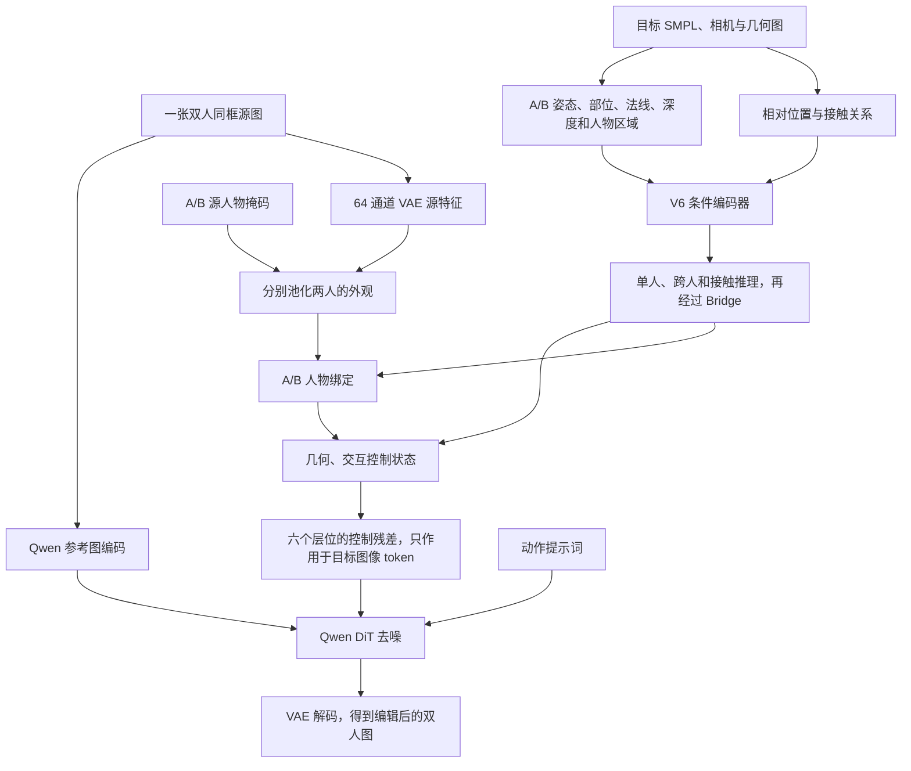

# 双人架构与 Hi4D 数据输入审计

核查日期：2026-10-11。远端：`ssh sg`，项目 `/home/shangguanrz/project/pic-edit`。

本次读取当前代码、配对清单、真实 NPZ 与缓存，运行了 CPU 只读数据检查；没有启动训练、生成图像或解压归档。

## 1. 当前双人架构

### 三个名字需要区分

| 名称 | 实际含义 | 当前状态 |
| --- | --- | --- |
| `Qwen21DualAdapter` | 旧 `qwen21` 的双人扩展 | Hi4D 的实际训练、推理入口仍使用它；已有 300 步单样本检查点。 |
| 推理模式 `full` / full dual | 旧双人 adapter 打开几何、接触交互和显式外观绑定 | 它是控制模式名称，不是 Full 架构名称。 |
| `Qwen21FullAdapter` / `qwen21_full` | 完整 V6 控制核心迁入 Qwen | 保留双人结构，但当前数据构建、训练参数分组仍未接通 Hi4D 双人。 |

`train_hi4d_qwen21_dual.py:24` 仍导入 `src.pose_control.qwen21.dual_adapter.Qwen21DualAdapter`。旧版在 Qwen 的第 3、8、13、18、23、28 号 block 注入控制残差，adapter 内部主要宽度为 512，输出映射到 Qwen 的 4096 维 hidden。

Full 则保留原 V6 的完整控制核心，geometry、interaction、detail、face、hand 五类分支通过六个阶段映射到 32 个 Qwen block。它要求第二个人有效时显式提供 `[batch, 2, N, 64]` 的两人源外观 latent。

当前 Full 的 `build_condition_bundle` 只构造人物 A 的空间、全局条件；`execution.prepare` 没有传入双人源外观 latent；Body 参数分组没有覆盖跨人、接触专用模块和 interaction 输出桥。近期联合训练代码也明确设定 `interaction_strength=0`。因此不能把单人 Full 检查点直接当作已训练的 Full 双人模型。

10 月 10 日另有 `hi4d_native_binding_20261010` 实验，锁定记录为 `project_adapters=False`，属于原生 Qwen 的人物到姿态对应排查，也不是 Full 双人训练。

### 已运行旧双人分支的流程



提示词由动作标签和源人物掩码的左右关系确定。例如 adapter 使用 `Make the two existing people hug. Preserve their appearance and background.`。提示词不从目标 RGB 提取描述；本轮没有 Prompt Enhancer。

### 架构判断

两人的几何、相对位置、接触和外观槽位都有明确结构，适合开展双人控制实验。仍需关注：

- 旧版源外观先压为每人 8 个 token，最终将每人的绑定结果汇总成一个融合向量，再铺到目标人物区域。它能表达 A/B 对应关系，但对衣服纹理、脸等局部细节的约束较弱；这是从代码作出的结构判断，尚未由本轮消融实验验证。
- 几何、外观和交互残差使用目标人物区域；遮挡重叠处的两人外观会合并。身份交换和身体融合仍需要专门评测。
- 已有结果以单样本过拟合、控制切换和数据边界排查为主。旧 300 步检查点的未训练配对排查，未证明双人姿态或接触优于原生模型；遮挡时 B 和接触指标大量缺失。

建议保留 Full 作为后续主架构，先明确单人身份保持，再补 Full 双人数据及优化器接入，做一个双人过拟合样本和少量未训练样本排查。双人脸、手细节沿用此前约定留到下一阶段。

## 2. Hi4D 当前有哪些数据

### 原始归档与已提取资产

| 位置 | 内容与状态 |
| --- | --- |
| `/data/shangguanrz/pic-edit-datasets/Hi4D-origin` | 32 个 `.tar.gz`，约 358.217 GiB，覆盖本地保存的 20 组人物。未全部展开。 |
| `datasets/Hi4D-origin` | 指向上述数据盘目录的软链接。 |
| `datasets/Hi4D_pilot_v1/raw` | 已按需提取 10 组人物的序列、帧及相机资产，当前约 1.4 GiB；不是这 10 组原始归档的完整展开。 |
| `datasets/Hi4D_pilot_v1/final_assets_v4_2` | 当前源图、目标图和控制资产的统一入口，多数为指向既有文件的软链接。 |
| `datasets/Hi4D_pilot_v1` | 整个 pilot 目录约 17 GiB，包含多版预处理和配对。 |

抽查 `pair01.tar.gz` 的归档头，包含相机文件及 `frames_vis` 中的 mesh、atlas 文件。已提取序列还包含 `images`、`seg`、`smpl`、`meta.npz`。本轮没有遍历全部 32 个归档，也没有做归档完整性校验。

### 原始标注、项目派生输入与监督

| 内容 | 用途与来源 |
| --- | --- |
| 源双人 RGB | 保留两人的外观和场景；当前主配对的资产为 940×1280。 |
| A/B 源掩码 | 从同一源图分别提取两人的外观，用于人物绑定。 |
| 目标 DWPose A/B | 项目提取的关键点；抽样 NPZ 每人 134 点及置信度，当前 adapter 使用前 24 点加 mid-hip，生成 25 通道热图。 |
| 目标 SMPL | 原始三维人体标注：两人的形状、姿态、位置、网格、关节及接触顶点。 |
| 相机 | 抽样包含 8 台相机的 ID、内参、外参和畸变参数；按配对中的相机 ID 选择。 |
| 法线、深度、渲染 A/B 区域 | 项目从人体网格、相机生成的控制图。 |
| 14 类部位图 | 转换器使用 SMPL 网格、蒙皮权重和 `nvdiffrast` 派生。 |
| 接触图及关系 | 由已有几何和 SMPL 接触顶点组织，用于交互控制。 |
| 遮挡信息 | `front_owner`、双方遮挡方向、重叠区域等已保存在几何 NPZ，但当前双人 adapter 未显式消费全部字段。 |
| 目标 RGB | 训练监督与评测图板、指标；不进入生成输入。 |
| 目标真值 A/B 人物掩码 | 评测用途；生成控制使用渲染几何区域，不能将二者混用。 |

**Hi4D 实际提供的是 SMPL，不是 SMPL-X。** 抽样网格为 `[2,6890,3]`，关节为 `[2,24,3]`，体型参数 `[2,10]`。代码名称 `smplx_global_a/b` 沿用统一接口，其内容在这里由 SMPL 与相机打包，不能据此认为已有 SMPL-X 的精细手部、面部参数。

### 当前 adapter 实际接收的控制形状

以下不含 batch 维：

| 字段 | 每人或每场景形状 |
| --- | --- |
| `normal_a/b` | 每人 `[3,512,512]` |
| `pose_heatmap_a/b` | 每人 `[25,512,512]` |
| `part_onehot_a/b` | 每人 `[14,512,512]` |
| `human_mask_a/b` | 每人 `[1,512,512]`，来自目标渲染区域 |
| `depth_a/b` | 每人 `[1,512,512]` |
| `smplx_global_a/b` | 每人 `[26]`：形状 10、根旋转 3、位移 3、相机内参 4、外参旋转 3、外参平移 3 |
| `relative_geometry` | `[11]`，位置差、图像区域关系、尺度和朝向关系 |
| `contact_raster` | `[2,512,512]` |
| 接触关系 | 最多 8 条：人物槽位、部位、距离和有效标志 |

源 RGB、源掩码及目标控制统一等比填充到 512×512。A/B 槽位对应数据中的人物身份，不能简单等同于左人、右人。

这一任务是“**源双人图＋动作文本＋已知目标几何 → 编辑图**”。目前不是仅输入“拥抱”文字就自动预测全部目标三维姿态的系统。

## 3. 当前配对和验证结果

| 划分 | 配对条数 | 人物组 | 唯一源图 | 唯一目标图 |
| --- | ---: | --- | ---: | ---: |
| 训练 | 1312 | pair01、09、10、12、14、16 | 46 | 774 |
| 验证 | 822 | pair22、28 | 24 | 274 |
| 测试 | 606 | pair00、02 | 18 | 330 |
| 合计 | 2740 | 10 组 | 88 | 1378 |

1362 条为跨动作配对，1378 条为同动作的不同帧。当前任务保持同一组人物和相机，以较少接触的源帧编辑成目标交互状态。配对数不等于独立图像数量。

CPU 只读检查通过的项目：

- 三份 manifest 引用的源 RGB、源掩码、目标 RGB、评测掩码、DWPose、SMPL、相机、几何文件全部存在。
- 三份划分的人物组互不交叉。
- 当前所需 1378 份 `hi4d_qwen21_dual_v2` 控制缓存全部存在，缺失数为 0。
- 一个训练样本在 `load_target=False` 下正常读取两人源掩码和姿态热图，未创建 `tgt_image` 张量。

上述检查证明文件可访问和抽样可读取，不证明全部文件语义正确，也不替代生成质量评测。生成边界的白名单还会排除 `row` 中保留的目标文件路径。

接触标注需单独检查：共有 92 条配对的目标接触顶点计数为零，训练/验证/测试分别为 28/60/4 条。抽样 `hug01/frame48` 的缓存接触有效关系数也为 0。因此属于交互采样段的帧，不一定含有效的逐顶点接触；不能把空关系当作接触成功。

## 4. 现在需要解压吗

**当前 2740 条配对的小实验不需要重新解压。** 所需原始片段、派生资产和控制缓存已经存在。

如果扩展到尚未提取的人物组、动作、帧或视角，再从相应归档按需提取，并重新生成派生控制和配对清单。仅解压不能自动得到 DWPose、深度、法线和 adapter 格式。

新增提取目录应放到 `/data/shangguanrz/` 的数据盘。本次读取到该盘约 21250 GiB 可用，pilot 所在根分区约 77 GiB 可用；不适合将全部数百 GiB 归档展开到当前 pilot 所在分区。原始归档保留即可。

## 5. 如何复查和使用

### CPU 只读复查

在本机 PowerShell 执行：

```powershell
Get-Content -Raw -Encoding utf8 'D:\codeplus\pictureedit\research\hi4d_dual_audit_20261011\audit_hi4d.py' |
  ssh sg '/home/shangguanrz/nihaochen/envs/qwen21/bin/python -'
```

输出各划分数量、文件缺失数、缓存缺失数、抽样 NPZ/张量形状及检查项。全部 `checks` 为 true 时退出码为 0。该命令不占用 GPU、不修改远端数据。

### 可选：旧双人检查点的单例验证推理

以下命令使用现有动作提示词版本的旧双人检查点，只取验证集一例，不代表 Full 双人实验；本轮没有运行该命令。

```bash
ssh sg
cd /home/shangguanrz/project/pic-edit
/home/shangguanrz/nihaochen/envs/qwen21/bin/python eval_hi4d_qwen21_dual.py \
  --checkpoint experiments/qwen21_hi4d_dual/single_pair14_action_v2_overfit/checkpoint_best.pt \
  --pairs datasets/Hi4D_pilot_v1/final_assets_v4_2/manifests/main_pairs_val.jsonl \
  --output experiments/hi4d_dual_audit_20261011/one_val \
  --max-samples 1 --steps 40 --seed 42 --allow-val
```

生成原生、仅几何、完整双人三组。原生只接源图和文本；后两组具有目标几何，图板与指标需据此解释。遮挡漏检时记为无法评估。

## 6. 本次产物与证据

- 本机只读审计脚本：`research/hi4d_dual_audit_20261011/audit_hi4d.py`。
- 本机新运行的结果：`research/hi4d_dual_audit_20261011/audit.json`，含当前关键代码 SHA256、清单 SHA256、检查项和抽样结构。
- 远端实际代码：`src/data/hi4d_qwen21_dataset.py`、`src/pose_control/qwen21/dual_adapter.py`、`dual_inference.py`、`action_prompts.py`；Full 对应的 `qwen_adapter.py`、`execution.py`、`data_runtime.py`、`joint_training.py`。
- 旧实验记录：`experiments/qwen21_hi4d_dual/prompt_audit_pair14_v2/report.md`、`action_prompt_v2/completion_status.json`。
- 当前资产入口：`datasets/Hi4D_pilot_v1/final_assets_v4_2/manifests`。
