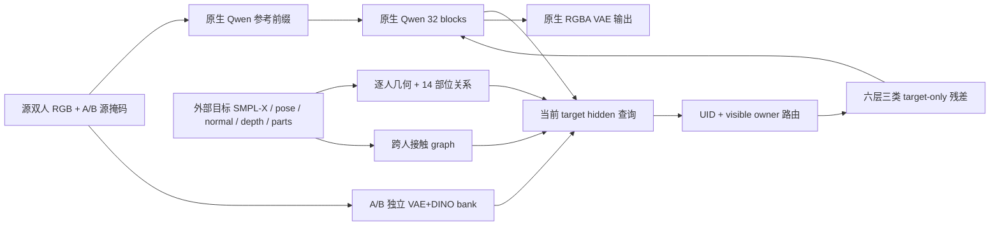

# Qwen-Image-2.1 双人 V8：实现和单样本验证

## 当前状态

已实现独立 `dual_v8`，完成真实 7B Qwen 前向/反向、300 步单样本过拟合、12 张正式对照、生成边界审计与独立重评分。生成链路检查通过；双人质量尚未验收通过，缺失与伪影均保留在结果中。没有启动全量训练。

论文与原代码调研见 [研究报告](C:/Users/sg/.codex/worktrees/qwen21-dual-v8/pictureedit/reports/Qwen21_双人Adapter论文与代码审查_20261011.md)。完整命令和输入边界见 [运行文档](C:/Users/sg/.codex/worktrees/qwen21-dual-v8/pictureedit/docs/experiments/2026-10-11-qwen21-dual-v8-pilot.md)。

## 1. 实际实现与旧 full 的区别

| 环节 | 新 V8 实现 | 为什么这样接 Qwen |
|---|---|---|
| Qwen 边界 | 原生 32 层、hidden4096、32×128 heads、64 通道输入输出、RoPE16/56/56 保留 | 所有控制从 post-block target suffix 进入，不改原生 attention/位置编码/前缀 |
| 源人物外观 | 每人 8 个 VAE token + 8 个 DINO token，各自独立 bank；带 VAE/DINO 模态 embedding | 原生源图继续进入 Qwen；adapter 不把两个人的外观混成无归属 token 集 |
| 几何 | 共享单人空间编码和人物 reasoner 的副本；新 global32、relative14、深度/可见性 | 源身份 beta 固定、目标动作几何独立，避免把 B 的身材直接当 A 的身材 |
| 部位关系 | 每人 14 个部位节点；26 维 descriptor + 14 类部位 embedding；两层 8-head mutual attention、FFN4 | 双人对应部位保留到控制器，几何距离和有向相对量可影响相互读取 |
| 接触 | 最多 8 条跨人物边；两层 edge-conditioned graph，邻接/端点/距离/法向/置信度明确 | 空接触输出严格为零，接触区域单独注入 |
| 查询与路由 | 当前 Qwen target H 经 LN4096→512，加 layer/timestep/真实 scheduler sigma；按 UID 查询自己的几何和 appearance | 控制器读实际生成状态，A/B bank 与目标区域对应；共同 depth owner 处理遮挡 |
| 注入 | 第 3/8/13/18/23/28 层分别使用 geometry/appearance/contact 的 512→64→4096 零输出 heads | 原 native prefix 不变，新增控制初始为零；每层及累计 ROI 残差均记录和约束 |

旧 full 保留原来的 DeepGen 控制核心及 single 数值路径；V8 是独立双人模式，不在一次生成里叠加旧 full 双人残差。统一 `create_control_context` 分发；B 缺失要求原 single context，不能把 SMPL-X32/relative14 随意截成旧 26/11 维来冒充迁移。

## 2. 数据与监督边界

- 本条样本是 Hi4D pair14，源 talk14/32，目标 hug14/62，camera4，512 等比填充。
- 使用此前拟合的 **SMPL-X**，不是把 Hi4D 原始 SMPL 改名。两个人的 source/target beta 相同，源人物形状固定；拟合和目标几何已知。
- 控制包括每人 normal3/depth1/part14/pose25/amodal1/visible owner1、global32、relative14、部位位置/朝向/关节/置信度、接触边和接触栅格。
- A/B source features 只由源图和源掩码生成，并验证 source RGB/mask SHA、UID、裁剪策略、DINO 编码记录和 PT SHA。保留旧数据 v1/v2，v3 使用已验证的编码；旧 VAE 权重 SHA 没有历史记录，不能补写成当时已验证。
- 目标 RGB 用于 FM 监督，目标 GT masks 留在监督/评测对象中；控制和源 bank 不读取它们。推理签名只有源图、源 bank、外部几何、prompt、seed 和控制强度。
- 目标 pose 对没有可靠观测的点使用 confidence0.25 拟合先验，评测排除这些点。SMPL 原接触索引核实为 1-based opposite-vertex，再转移到 SMPL-X；这是拟合代理，不是官方 SMPL-X 接触真值。
- v3 监督验证 pair/action/frame/camera、UID、geometry 与 sidecar SHA、RGB/mask 内容 SHA，生成对象可在没有监督清单时独立加载。

短提示词固定为：`Make the two existing people hug. Preserve their appearance and background.` 详细原生提示词明确两人靠近、躯干接触、双臂环绕肩背并保留身份与场景；其左右关系来自源图。四组比较均记录原文，不读取目标 RGB 来生成文本；不使用 Prompt Enhancer。

## 3. 初始化和训练约束

实际 warm start 为 iPER body `full_20k/checkpoint_best.pt`，source step19500，SHA `9c2a274a2a10c94f4632f7f24f291868346975da71367dd7745d9390141b6a54`。

| 冻结导入部分 | 完整覆盖 |
|---|---:|
| 空间编码器 | 141/141 张量 |
| 人物 reasoner | 36/36 张量 |
| 共享 role | 1/1 张量 |
| 合计 | 178/178，20,281,376 个参数值 |

其他 180 个旧 checkpoint 张量按语义跳过。新增双人模块和新输出 heads 从新初始化学习，不称为已经训练过的双人权重。完整覆盖、source step、shape 与 finite 均在修改 adapter 前校验。

Adapter 共 60,805,440 个参数；其中新训练 40,524,064 个，冻结 20,281,376 个。Qwen 与导入部分冻结。AdamW lr1e-4、weight decay0.01、有效 batch4，目标为区域加权 FM + 0.1 背景 teacher + 0.01 残差 budget。teacher 背景排除源/目标人物区域并集与扩张边界，不能强求人物移动后保留原人物。

本次只做 300 steps。每 50 步验证同帧三个留出噪声种子并保存 best/last；不是多样本验证集，不支持泛化结论。真实门槛的两次更新后重新初始化，避免隐藏计入训练。

V8 checkpoint 使用安全的 tensor/basic-container 读取；旧 body 仅临时允许实际存在的 `PosixPath`。续训严格绑定模型、源码闭包、库版本、prompt、seed、数据实际内容、cache tensor 内容、LR 和 optimizer moments；日志步数与 checkpoint 必须一致。

## 4. 已完成的真实模型门槛

证据：`experiments/qwen21_dual_v8/pilot_pair14_v8_300_v1/real_model_gates.json`。

| 检查 | 结果 |
|---|---|
| 真实零初始化 | native 与 controlled 完全一致 |
| 关闭全部控制 | native 与 disabled 完全一致 |
| 非目标 prefix | 注入前后完全一致 |
| 第一次更新 | 最终零 heads 梯度非零，范数0.008074 |
| 第二次更新 | query/global/relative/mutual/contact/appearance/depth 梯度均非零 |
| 主干 gradient | 无；更新前后 SHA 不变 |
| 缓存/extract | 原生与非零 adapter 均按 atol=rtol0.01 通过 |

主干 SHA 为 `4b40da9b51ddcb44bc4cae009242f7f29936883bbd9fd05b16da789519848d5e`。第二次更新的 gradient norms：query0.000309、global0.0000104、relative0.00000393、mutual0.0000983、contact0.000261、appearance0.000836、depth0.000290。

缓存诊断曾发现原生模型也不通过容差：默认 BF16 reduced precision reduction 下，native mean abs0.003744，非零随机 adapter mean abs0.004097。只关闭该 reduction 后分别约0.00000462/0.00000368，原定容差通过；没有放宽阈值或换 attention。最终真实 gate 的非零 adapter mean abs0.00000490，max abs0.015625；大幅值位置由 rtol 覆盖。随机头诊断仅解释数值问题，不是训练质量证据。

## 5. 已完成的训练与测试

300 个 optimizer steps 完成，退出码 0，训练耗时 2775.56 秒（不含加载与真实门槛）。主干 SHA 与训练前一致。每次验证使用同一图像的三个固定留出噪声，以下数值不是跨样本成绩。

| Step | 固定噪声验证 flow loss |
|---:|---:|
| 50 | 0.101835 |
| 100 | 0.088754 |
| 150 | 0.078161 |
| 200 | 0.074646 |
| 250 | 0.071432 |
| 300 | 0.070400 |

best checkpoint 实际为 step300，567,957,785 bytes，SHA `6a74ca71f755d466cf979fa57311014e7c5e7febfc2bbda88839d6b46a1c8eb9`。位置：`experiments/qwen21_dual_v8/pilot_pair14_v8_300_v1/checkpoint_best.pt`。

最新远端完整回归 **218 passed / 26.78秒**，包括新增重评分边界；此前本地完整回归 **191 passed / 3 CUDA skips**，新增评分 CPU 套件 **53 passed**。真实 7B 门槛另有前述 JSON 证据。训练最后 microbatch 的第 28 层累计 ROI 残差比例为 **12.38%**，全程同项最大 **17.03%**；5% 是软惩罚目标，不能称为严格上限。打开控制后的背景与外观结果见下节。

精确执行代码快照为训练目录内 `implementation_snapshot_v1.zip`，SHA `e4773ca8a11956fd700df581e86ce9a848e4efcfad3db14626e40efb30e978c8`。其 77 个训练依赖文件与 run manifest 一致；镜像保留继承的未提交基线，Git 提交只收录本轮新实现及限定改动。

评分修复后的代码快照为同目录 `implementation_snapshot_v2.zip`，374个源码/README文件，SHA `07cb4ade147f489568857706098cdbae002151af2359d4005ae3f86da6c4197b`。77个训练依赖仍全部一致；v1及原生成签名保留，不把 v2 评分代码改写成原图的生成代码。

## 6. 正式图像与审计结果

训练结束后，使用 best step300 比较四组×三个种子，每张 512×512、40steps、CFG1、cache 开启、控制强度1，无推理硬残差上限。原生短/详细无目标几何；V8短/详细拥有外部目标几何。生成与评测退出码均为0，但首轮 MultiHMR 指标因 Qwen 环境缺 `roma` 而全部失败，接触为 NA；退出码不代表所有指标成功。独立重评分会使用现有 MultiHMR 环境并保留首轮失败记录。

### 6.1 生成边界与原生数值行为

| 检查 | 实际范围与结果 |
|---|---|
| 替换目标 RGB/GT masks | 40steps、seed42，实际改变 evaluator 内存对象后重新生成；逐像素完全一致，max error0 |
| 控制切换 | 40steps、seed42，同源图/源特征/提示词改用真实 talk32 几何；geometry bank 改变，193,940 个像素改变，通道平均差11.465/255 |
| 全部控制关闭 | 4steps，native 与零控制逐像素完全一致 |
| cache on/off | 4steps，解码通道平均差0.19277/255、max15/255；不是逐像素完全一致；真实 velocity gate 使用前述0.01容差 |
| CFG1/4 | 各4steps，实际速度有限，原生 `uncond + scale*(cond-uncond)` 公式误差均0；CFG4条件/无条件两路都执行 |
| Qwen 主干 | 声明/实际生成前/生成后 SHA 均一致 |

`hard_probe_failures=[]` 只说明上述硬检查未失败，不是质量验收。目标替换排除了本次推理入口读取 evaluator RGB/masks 的影响；本次训练与评测仍是同一帧，近似 GT 的输出可能来自单样本记忆，不能据此宣称泛化或排除训练记忆。

切换后两人位置明显改变，说明控制确实影响生成；但肩部出现残留手/手臂伪影。这项实验只能判定控制链路有效，新姿态的图像质量没有通过。此时仍使用 hug 文本，几何与文本冲突也是待定位因素。

### 6.2 姿态、外观与背景

以下是原始12张 PNG 的生成 RGB 评测。A 为源图男方，B 为源图女方；身体 PCK 对照外部 pose 控制中的可靠目标点，衡量控制遵循；wholebody 对照实际相机观测，排除拟合手部先验。PCK 距离按512画布对角线归一化，0.05约为36.2像素，0.02约为14.5像素。不能把仅 B 可计分的 V8 数值称为双人 PCK。

| 组别（每组3张） | A 身体 PCK@0.05 | B 身体 PCK@0.05 | 身体可计分/全部有效关节 | 检出两人 | B DINO 外观代理 | 背景 MAE（0–1） |
|---|---:|---:|---:|---:|---:|---:|
| 原生短提示词 | 44/63 =0.6984 | 50/69 =0.7246 | 132/132 | 3/3 | 0.7618（3/3） | 0.01781 |
| 原生详细提示词 | 44/63 =0.6984 | 42/69 =0.6087 | 132/132 | 3/3 | 0.7464（3/3） | 0.01712 |
| V8短提示词＋目标几何 | NA（3张均漏检） | 68/69 =0.9855 | 69/132 | 0/3 | 0.6810（3/3） | 0.01397 |
| V8详细提示词＋目标几何 | NA（3张均漏检） | 68/69 =0.9855 | 69/132 | 0/3 | 0.6810（3/3） | 0.01378 |

背景每组分母均为433,350个有效背景像素；生成检测第三人均0/3。人工图板仍可见两人，检测统计应读作检测器结果。对真实 GT 用同一 DWPose 做 evaluator-only 校准也仅检出 B，A 漏检，说明此拥抱遮挡存在检测局限；这不用于补全生成检测或改变失败分母。若将缺失关节一律计失败，V8 身体命中率为68/132=0.5152，不能藏掉 A 的失败。

可靠 wholebody 观测只有 B，A 无可靠目标观测。B wholebody PCK@0.05 为原生短0.8072、原生详细0.8457、V8短0.9862、V8详细0.9972，分母各363。它同样不能代表两人的手脸质量。

V8 的 B 外观代理比原生低；其检测区域包含遮挡人物时也会污染裁剪，因此不能把 DINO 当作脸部身份或直接认定服装发生交换。A 外观和双人交换率为 NA。原生 ArcFace raw swap为1/3，但余弦分数很低，不能作为可靠交换判定。

### 6.3 独立重评分：人脸与接触代理

首次评测的 MultiHMR import 失败与人脸双槽位连带失败均保留在 v1。修正 evaluator 后，只复制并评分原12张 PNG，**没有再次调用 Qwen 或重跑生成探针**。新目录为 `experiments/qwen21_dual_v8/eval_pair14_v8_300_rescore_v2`，新评分代码/模型/环境 SHA 单列；旧 configuration、生成源码 SHA、原 PNG/逐例记录及探针 SHA 仍绑定原始生成。冻结生成源码75个文件核对 checkpoint 的77文件训练闭包一致。

MultiHMR 使用现有 `add/envs/multihmr/bin/python`，本地 DINO/SMPL-X/权重，请求内只读取生成 PNG，一次加载模型处理12图；参数/输入及导出数组为 float32，既有 `forward_model` 在 CUDA 内部使用 FP16 autocast。父进程校验 raw NPZ、LBS 分区和 provenance，再用预测网格计算距离；没有用控制网格的距离代替生成成绩。最终 `metric_model_failures={}`，但单图重建不足两人的失败仍保留。

| 组别 | B ArcFace 余弦（有效/全部图） | A / 双人身份交换 | 接触距离÷平均网格Y高度 | 有效边/预期边 | 可重建并匹配两人/全部图 |
|---|---:|---|---:|---:|---:|
| 原生短 | 0.06266（3/3） | 两人可提取脸；raw swap1/3，低分不可靠 | 0.012676 | 24/24 | 3/3 |
| 原生详细 | 0.12832（3/3） | 两人可提取脸；raw swap1/3，低分不可靠 | 0.022746 | 24/24 | 3/3 |
| V8短＋目标几何 | 0.33562（3/3） | A NA，双人 swap NA | 0.011363（**仅seed42**） | 8/24 | 1/3 |
| V8详细＋目标几何 | 0.35588（3/3） | A NA，双人 swap NA | 0.012268（**仅seed42**） | 8/24 | 1/3 |

V8 seeds43/44 的 MultiHMR 各只返回1个人，接触失败为 `fewer_than_two_generated_meshes`，不能计作成功。对共同可评的 **seed42**，原生短/详细距离比分别为0.013933/0.030128，V8短/详细为0.011363/0.012268；这是同种子的局部接触代理改善，不能把1/3覆盖的均值与原生3/3均值作为整体改善证据。距离是无符号表面距离，较小可能包含穿模；没有得到有符号穿透或真实3D接触判定。

B 人脸现在可计分，余弦代理高于原生；仍没有设定或验证“身份通过”的阈值，A 与双人身份绑定不能验收。人脸裁剪仍来自生成 DWPose 区域代理，不能把遮挡带来的缺失自动补全。

### 6.4 本次质量结论

可检出的 B 姿态对已训练 hug62 更贴合，背景误差较低，B 人脸及共同可评 seed42 的接触代理有所改善；A 姿态/身份缺失、双人身份交换率不能可靠计算，接触覆盖仅1/3，控制切换还出现手臂伪影。**本次尚不满足完整双人质量验收，不启动全量训练。** 主干冻结和零控制一致性证明关闭控制时的数值边界；打开控制后的原生能力保护仍需多样本独立评测，5%软预算也没有形成硬上限。

下一步待定位的问题是遮挡下的 A 可评性和控制切换的手臂伪影；hug 文本/talk 几何冲突及单帧记忆是可能因素，尚未确定原因。原12图、探针、新评分记录及失败分母均保留，可据此做后续诊断。

## 7. 已知验证范围

本轮只有一条同框双人样本；独立两张人物源图、跨 pair 泛化与双人精细脸手不在验证范围。现有 Qwen lite body checkpoint 足以提供语义匹配的几何初始化，但没有找到完整训练好的旧 full single checkpoint；已验证旧源码前缀逐字节不变和原类/dispatch 兼容，尚不能声称生产 iPER full 图像数值回归完成。
