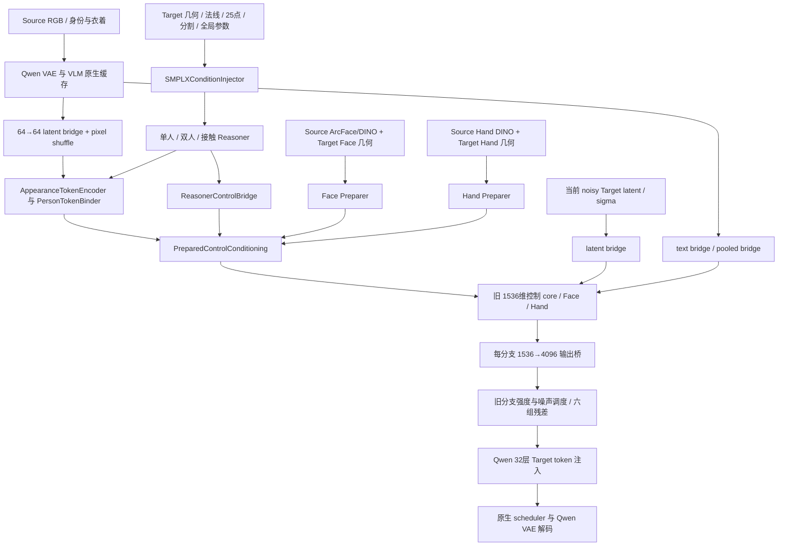

# Qwen-Image-2.1 Adapter 架构审查与 DeepGen 对照

审查日期：2026-10-02。远端：`ssh sgrzhh`，项目：`/home/shangguanrz/project/pic-edit`，Git HEAD：`b1a00c2a3b2955779af40ab19b5bab71ac19539a`。Qwen 相关文件多数尚未提交，因此本报告以远端工作目录的实际源码、检查点和运行环境为准。

**判断：`qwen21_full` 的 DeepGen 控制结构迁移基本完整，接口、零初始化、梯度和身份条件边界通过检查；默认训练协议和功能启用存在实质不足。不能由“47 个文件相同、测试通过”推出“双人交互与精细手部已经可用”，也不能由模型能够反向推出人脸质量已达标。**

没有改动项目源码、检查点或训练记录。本次产出是本地源码快照、审查报告、复现脚本和检查结果；远端仅另存 `/tmp/pictureedit_adapter_audit_20261002_runtime*.json` 验收记录。

## 1. 优先处理的问题

| 优先级 | 问题 | 证据与影响 | 现状 |
|---|---|---|---|
| P1 | 默认 Face 辅助监督输入范围错误 | 默认 `legacy` 将 `[0,1]` 图像送入要求 `[-1,1]` 的 ArcFace/VGG 包装器；身份和感知目标因此发生偏移 | 已有 `normalized` 选项，但普通入口未默认启用 |
| P1 功能缺口 | 完整版的交互、细节、手部分支未训练并未接入默认入口 | 当前交付检查点三类输出头非零元素都是 0；Body/Face 优化器不选择这些分支；默认数据只构造单人，手部显式关闭 | 结构存在、合成接口可以工作；实际训练与双人/手部端到端验收尚缺 |
| P2 训练协议 | 默认 Face flow 使用全图平均，小脸目标被稀释 | 6/1024 个脸 token 时，同一脸 token 的 ROI flow 梯度是全图 flow 的约 170.67 倍 | 已有 `roi` 选项，仍需显式启用 |
| P2 跨分辨率 | 默认允许 512 Face 检查点直接在 1024 原生网格散射 | 原有对比图可见绿色斑点与重影；CLI 默认 `native`，没有自动按训练分辨率选择 Face 网格 | 已有 `checkpoint` 映射选项；仅单案例质量证据 |
| P2 训练/推理覆盖 | 默认采样进度与训练进度不同 | 训练 `1-sigma`，采样 `step/(steps-1)`；默认采样在 sigma 约 0.738、0.709、0.680 时启用未在此噪声范围训练的 Face 分支 | 已有 `sigma` 选项；这一差异也已被历史记录注明 |
| P2 工程边界 | 原生缓存没有绑定实际加载的模型与编码器实现 | 缓存键采用固定 `MODEL_REVISION`，命中后不检查 `pipe`；选择另一模型仍返回旧 latent/embedding | 换模型或编码器预处理实现时，需要独立缓存目录和实际版本指纹 |

这里的 P1/P2 指影响优先级。“功能缺口”和“训练协议”与代码执行错误分开记录；后两项并不证明某一视觉异常的唯一根因。

### 1.1 Face 输入范围：默认配置会继续使用错误监督

[训练入口第 49 行](D:/codeplus/pictureedit/research/adapter_audit_20261002/remote_snapshot/train_iper_qwen21_full.py:49) 默认 `--face-evaluator-range legacy`；默认每 4 步执行一次身份/感知辅助监督。`execution.run_loss` 解码和裁剪后得到 `[0,1]` RGB，仅当 `normalized_face_evaluators=True` 才执行 `image * 2 - 1`。

[辅助损失实现](D:/codeplus/pictureedit/research/adapter_audit_20261002/remote_snapshot/src/pose_control/qwen21_full/execution.py:323) 已在注释里明确写出：ArcFace TorchScript 消费归一化 RGB，VGG 包装器内部将 `[-1,1]` 映回 `[0,1]`。本次直接加载远端已保存的两个 TorchScript，检查其真实 forward，而不只相信构建脚本的说明。VGG 的实际第一步是 `(x + 1) * .5`；传入 `[0,1]` 会把像素改成 `[.5,1]`。ArcFace wrapper 不会补做输入归一化。

历史独立对齐检查也支持这一判断：同一源脸，正确归一化 TorchScript 与 ONNX 的 embedding cosine 为 `1.0`，旧 `[0,1]` 输入为 `0.9552813`。这是已有检查记录，本次没有重新做 ONNX 对齐实验。

建议把普通新实验的默认值改成 `normalized`；继续历史实验时显式指定历史设置，避免悄悄改变恢复训练的损失定义。目前可以使用 `--face-evaluator-range normalized`；`--diagnostic-probes` 也会设为 normalized。

### 1.2 完整版的双人和手部能力没有形成训练闭环

[完整数据构造](D:/codeplus/pictureedit/research/adapter_audit_20261002/remote_snapshot/src/pose_control/qwen21_full/data_runtime.py:91) 只传 `normal_a / pose_heatmap_a / part_onehot_a / smplx_global_a / human_mask_a / task_id`。其底层 iPER reader 固定单人任务。`execution.prepare` 只提供整张 Source latent 和可选 Face，没有传双人 `source_person_latents`、双人几何/接触，或手部条件/参考。

[训练参数选择](D:/codeplus/pictureedit/research/adapter_audit_20261002/remote_snapshot/src/pose_control/qwen21_full/execution.py:94) 的 Body 白名单与 Face 白名单均不包含交互分支、独立 Hand 分支、旧 Detail 分支及它们的输出桥。训练与[评估入口](D:/codeplus/pictureedit/research/adapter_audit_20261002/remote_snapshot/eval_iper_qwen21_full.py:139) 都显式 `hand_strength=0, hand_mode='off'`。

本次 mmap 读取默认交付的 `face_512_100/checkpoint_last.pt`，不是根据模块名称推测：

| 检查点分支输出头 | 张量数 | 非零元素数 |
|---|---:|---:|
| Geometry | 12 | 14,164,992 |
| Interaction | 12 | **0** |
| Detail | 12 | **0** |
| Face | 12 | 4,727,808 |
| Hand | 12 | **0** |

因此，这份完整版权重即使构造了双人条件，独立 interaction 残差仍为零；即使另行传入手部参考，独立 hand 头仍不提供已学习的控制。Geometry 和原生 Qwen 仍可能生成交互动作，不能把这种结果算作已验证的 interaction/hand 分支能力。

也检查了相反的可能性：用非零合成头直接经过 **完整 Qwen bridge**，双人 interaction 产生非零残差，V6.6 Hand 在 on/off 之间产生非零差异；省略双人 source person latent 会按设计拒绝。这证明代码中的结构没有被删掉。缺的是训练入口、实际权重和对应质量验收。

简化版 `train_hi4d_qwen21_dual.py` 属于另一套 `Qwen21DualAdapter`，不能作为完整版权重的双人验收证据。后续应为 Full 增加双人/Hand 数据和参数选择，以及接触、角色交换、手指、遮挡、人物归属的实际推理验收。

### 1.3 Face 全图 flow：存在可量化的目标稀释

[训练入口第 50 行](D:/codeplus/pictureedit/research/adapter_audit_20261002/remote_snapshot/train_iper_qwen21_full.py:50) 默认 `global`。[损失实现](D:/codeplus/pictureedit/research/adapter_audit_20261002/remote_snapshot/src/pose_control/qwen21_full/execution.py:207) 虽记录 `face_mean`，但默认优化的是 `squared.mean()`。小脸对 flow 目标的贡献随面积下降，Face 参数也可能通过改变其他区域改善总误差。

复现使用 32×32 token 网格中的 6 个脸 token，脸占比 `0.005859375`；ROI 与全图 flow 对同一脸 token 的梯度比为 `170.66667`。这个比例只针对 flow 项，不能说整个联合损失或所有参数梯度都缩小 170 倍。身份、感知和脸外约束仍有各自贡献。

这项设计沿用了旧 DeepGen Face 损失，不是 Qwen 迁移时删除某模块造成的。原有修复实验与本次查看的对比图也表明：继续旧目标到 2000 步仍有明显脸部异常，改为脸区目标的 300 步候选更合理；这仍是单案例证据。

新 Face 实验可显式选择 `--face-flow-loss roi`；改变损失定义应以 `--init-checkpoint` 开新输出目录，现有 resume 校验会拒绝改变训练损失配置。

### 1.4 512→1024：应检查 Face 散射坐标，而非只检查张量尺寸

[评估入口第 42 行](D:/codeplus/pictureedit/research/adapter_audit_20261002/remote_snapshot/eval_iper_qwen21_full.py:42) 默认 `--face-scatter-grid native`。512 检查点可直接在 64×64 的 1024 token 网格上散射 Face residual；默认路径不因训练分辨率为 512 而提醒或自动改用 32×32。

Face 本地 ROI 是 16×16，连续脸框映射到全图 token 的采样点、覆盖和高频模式在 32×32 与 64×64 网格上不同。原有修复实现提供了 [训练网格到目标网格的映射](D:/codeplus/pictureedit/research/adapter_audit_20261002/remote_snapshot/src/pose_control/qwen21_full/qwen_adapter.py:34)：先按训练网格散射，再双线性映射到目标网格，重新约束到有效脸框内；其他分支仍使用实际网格。

本次查看下列原有 1024 对比图，未修网格的中间列有明显绿斑与重影，修正网格的右列没有同等程度的异常。图是历史生成结果，本次没有重新执行完整出图。


512 Face 检查点用于 1024 时，可先用 `--face-scatter-grid checkpoint` 对照。它是已存在的缓解方案；历史记录的可靠 1024 身份共同样本数为 0，不能据此宣布 1024 身份质量已验证。Face 仍然偏糊。

### 1.5 训练和采样进度不同，会改变 Face 的噪声覆盖

训练 `run_loss` 默认以 `progress=1-sigma` 控制 Face/texture；普通 Face sigma 采样在 `[0,.65)`，辅助步骤在 `[0,.35)`。评估入口默认 `progress_mode='step'`。

本次以真实 scheduler 配置复算 512、30 步时间表：

| 从 0 计数的采样步 | sigma（FP32） | 训练进度 | 默认采样进度 | 训练 Face multiplier | 默认采样 Face multiplier |
|---:|---:|---:|---:|---:|---:|
| 11 | 0.737913 | 0.262087 | 0.379310 | 0 | 0.005009 |
| 12 | 0.709324 | 0.290676 | 0.413793 | 0 | 0.023579 |
| 13 | 0.679766 | 0.320234 | 0.448276 | 0 | 0.055351 |
| 14 | 0.649190 | 0.350810 | 0.482759 | 0.000004 | 0.099446 |

GPU BF16 还会有额外量化差异。历史记录同样注明了这一覆盖不一致。**这证明分支被施加到训练未覆盖或强度明显不同的噪声位置，尚未证明它是彩斑的唯一原因。**

可以用相同检查点、图片、seed、steps 比较 `--progress-mode sigma` 和 `step`，分别记录 Face 局部幅值、身份、姿态及背景指标，再决定统一协议或扩展训练覆盖。

### 1.6 缓存/模型版本绑定不足

[缓存键](D:/codeplus/pictureedit/research/adapter_audit_20261002/remote_snapshot/src/pose_control/qwen21_full/qwen_runtime.py:37) 使用固定常量 `MODEL_REVISION`、prompt、kind、resolution 和图片 RGB bytes。入口却允许 `--model` 指定另一目录；缓存命中路径直接 `torch.load`，不会检查实际 `pipe`、text encoder 实现或 VAE 配置。

复现先存入缓存，再用标记为 `different-model` 的 pipeline 对象请求同一图片，仍返回旧 reference latent，完全不访问新 pipeline。这是缓存身份边界的合成复现，未实际替换远端模型。

另外，[完整检查点加载](D:/codeplus/pictureedit/research/adapter_audit_20261002/remote_snapshot/src/pose_control/qwen21_full/execution.py:60) 核对 architecture 和 state schema，但没有核对保存的 `model_revision` 与实际加载模型。固定同一基座时不触发问题；换模型、更新 encoder normalization 或维护多版本时可能静默混用。

建议缓存 namespace 加入实际模型/编码器/预处理指纹，保存并核对 entry metadata；检查点与当前基座版本也应显式验证。暂时按模型与运行时版本使用独立 `--cache` 目录。

## 2. 项目架构和调用链

项目有 DeepGen V6 主干控制器、Qwen 简化控制器、Qwen 完整迁移三条路径。训练入口、检查点格式和实验目录不同，不能混用。

| 路径 | 核心类 | 训练/推理入口 | 实际定位 |
|---|---|---|---|
| DeepGen V6 / V6.5 / V6.6 | `UnifiedSMPLXAdapterV6` | `train_iper_v6_native.py` 与各 Face/Hand 入口 | 原控制架构与迁移参考 |
| Qwen 简化单人/人脸 | `Qwen21BodyAdapter` + `Qwen21FaceAdapter` | `train_iper_qwen21_body.py`、`train_iper_qwen21_face.py` | 复用部分几何编码，另建较轻的 Qwen 控制头 |
| Qwen 简化双人 | `Qwen21DualAdapter` | `train_hi4d_qwen21_dual.py`、`eval_hi4d_qwen21_dual.py` | 加入接触与 A/B source mask 绑定，仍属简化架构 |
| Qwen 完整迁移 | `Qwen21FullAdapter` 包装复制的 V6 | `train_iper_qwen21_full.py`、`eval_iper_qwen21_full.py` | 保留完整控制模块，适配 Qwen I/O 和残差坐标 |

完整版调用链如下。Target RGB 仅用于训练监督和离线比较；生成条件读取 Source 外观与 Target 几何。



当前 Full 入口中 Hand 的输入边为空，双人的 B 几何/绑定也未由 `data_runtime` 构造。

**关键形状：**

- Qwen VAE latent 是 `[B,N,64]`，512 时 `N=32×32`，1024 时 `N=64×64`。
- 恒等初始化的 64→64 1×1 卷积后 `pixel_shuffle(2)`，得到旧控制器需要的 `[B,16,2h,2w]`；旧 patch=2 后 token 数仍为 `h×w`。
- V6 几何推理保留 256维条件与 512维 reasoning，控制 core 保留 1536维；Qwen 原生 hidden 是 4096维。
- 4096维 Qwen 条件经 text bridge 进入旧 4096维上下文输入；有效条件均值经新 pooled bridge 变成 2048维条件。
- 六组残差的 Qwen 注入层分别为 `0–5 / 6–10 / 11–15 / 16–21 / 22–26 / 27–31`。六组总共注入 32 层。

官方 Qwen 原生逻辑把 Source latent 放进 VLM image slots，Target 位于序列尾部，因果条件前缀可以缓存；因此并非始终是简单的“Source tokens 紧接 Target tokens”。本次检查实际安装源码，并用原生小尺寸 32 层模型核对了 full sequence 和 KV cache 路径。[官方 Transformer 实现](https://github.com/huggingface/diffusers/blob/main/src/diffusers/models/transformers/transformer_qwenimage21.py)、[官方 Pipeline 实现](https://github.com/huggingface/diffusers/blob/main/src/diffusers/pipelines/qwenimage21/pipeline_qwenimage21.py) 也说明了这些约定。

## 3. 与原 DeepGen adapter 的差别

| 项目 | DeepGen V6 | Qwen 简化版 | Qwen 完整版 |
|---|---|---|---|
| 几何 encoder / reasoner | 完整 | 复用 encoder / reasoner / bridge | 47 个原文件逐字节保留 |
| 动态控制 core | 共享 SD3 block，六次递归，CrossNorm，独立 Geometry/Interaction/Detail | 当前 Qwen block hidden + 几何 + sigma 经 MLP，六个注入点 | 原 core 保留；加 latent/text/pooled/output 坐标桥 |
| 单人 Source 外观绑定 | `AppearanceTokenEncoder` / `PersonTokenBinder` | 单人 Body 没有旧专用外观 token 路径；依赖原生 Source 条件；Dual 另做 source mask 绑定 | 原外观绑定保留；双人要求显式 person latent |
| Face 内容 | ArcFace + DINO patches、resampler、identity/texture/geometry tokens | ArcFace + RGB CNN 的全局 code；没有旧 DINO/resampler/ROI attention 架构 | 旧 Face 内容 encoder 与 attention 完整保留 |
| Face 几何 | 72点、jaw、expression、ROI 空间特征 | target box 与位置编码 | 原 Face 几何完整保留 |
| Hand | 旧 Detail 路径与可选 V6.6 独立分支 | 没有同等精细手部模块 | 文件/模块存在，当前 Full 默认训练与评估关闭 |
| 注入层 | 24层中 23层；六组为 4/4/4/4/4/3 | 六个点 `3/8/13/18/23/28` | 32层；六组为 6/5/5/6/5/5 |
| 零初始化 | 各分支零头 | 六个新的零头 | 已训练旧头配零输出桥；未训练零头配非零输出桥 |
| 权重继承 | 原始权重 | 按键名和形状选择性加载，旧 core/Face 不能等同迁移 | Body/Face 严格分开加载；新的 Qwen 坐标桥必须训练 |

**简化版不是完整 DeepGen adapter 的等价改名。** 尤其 Face 从 ROI attention 与 DINO patches 改为 CNN 全局 code，并减少了 Target face 几何。已有较好简化版结果不能证明完整架构有相同表现；反过来，完整版保留了旧文件也不能证明新的语义空间已经对齐。

完整版 `pixel_shuffle` 初始值可逆，只证明坐标数据重排没有丢失信息；Qwen VAE 的通道语义与 DeepGen VAE 仍不同。text bridge 初始为恒等，也不能证明两个 VLM 的 4096维向量语义相同。新增桥的适配质量需要多样本训练和实际生成验收。

原六组残差在 Qwen 上重复注入次数增加，且没有针对重复次数做显式归一化。同一数值 strength 在两个主干上不代表相同的累计控制效果；这属于需要校准的迁移设计。本次没有将它认定为已证明的 bug。

本次实例化真实完整 adapter 的参数计数：**373,099,568**，其中 legacy **316,466,160**，新桥 **56,633,408**。Body 阶段选择 **201,357,754** 参数，Face 阶段选择 **49,244,374**；这些不是所有分支都训练的证明。

## 4. 已确认正确或未发现故障的部分

- 47 个 V6 Python 文件与 Full 副本的 SHA256 相同。相同权重下 reasoner、控制 core、外观绑定、强度、Face、Hand 的前向/梯度对照通过，且使用了非零输出头。
- Body 继承加载 477 个张量；Face 继承加载 242 个张量，并忽略 538 个非 Face donor 张量，避免 Face checkpoint 覆盖 Body。缺键、额外未知键、形状和非有限 legacy 值有预检查。
- 旧头已学习时将新输出桥置零；旧头仍为零时将输出桥设为 Xavier，避免“零头接零桥”导致两个位置都无法学习。现有测试确认桥首先收到梯度，更新后梯度能到旧 core。
- 真实 512 Qwen 检查：初始化/关闭控制与原生预测相同，Face 关闭/失效会回退 Body；非零 Face residual 在有效 ROI 外严格为零。
- 改掉 Target RGB 并把干净监督 latent 换成 NaN，不会改变 static conditioning。本次真实运行验证了这一边界；这不等同于审查了所有数据采集来源。
- 原生小尺寸 32 层 Qwen：非零控制确实改变 Target，prefix 逐位不变；KV cached 与 uncached 的 Target 差值为 0；开启 checkpointing 后输出桥梯度非零。
- 混合 batch 中不同 sigma 的 Face 活跃/关闭行为正常。合成双人/Hand 经 Full bridge 的控制行为正常。
- 一次/两次 forward 后 backward 的线性骨干复现中，checkpoint 与 eager 梯度相同；本次未把可变 context 状态认定为已经发生的重算错误。这不是对任意并发调用或 reentrant checkpoint 的保证。

## 5. 本次验证范围和结果

| 检查 | 本次结果 | 范围 |
|---|---|---|
| 现有 Qwen / 架构 / reasoner 测试 | **152 passed，16.21秒** | 14 个测试文件；两条 SWIG 弃用 warning；交付复测脚本已实际运行 |
| 快照与远端 SHA256 | **114 个源码文件一致** | 两套 Qwen、V6 和主要入口/数据文件 |
| 真实 512 GPU 前向/反向 | **通过** | 1 对验证样本；Body/Face 各一次 backward；不做 optimizer step |
| 真实 1024 GPU 前向/反向 | **通过** | 同上；512 Face 检查点在 1024 的工程边界 |
| 原生小尺寸 Qwen32 / 缓存 / 梯度 | **通过** | 合成输入与随机小模型；不代表生成质量 |
| Full 双人/Hand bridge | **通过合成接口检查** | 人工设非零输出头；不是已训练效果 |
| 历史 512/1024 Face 对比图 | **已查看** | 单案例；本次未新生成图像 |

真实 512 的 Body/Face 反向峰值分配分别约 **19.46 / 17.06 GiB**。所有检查结束后 adapter 权重 hash 不变，Qwen 主干冻结且没有参数梯度；Face 阶段检查点的 734 个非 Face 张量保持 Body 值。

真实 1024 的 Body/Face 反向峰值分配分别约 **30.14 / 21.08 GiB**；两种分辨率下参数组均收到有限、非零梯度，未选分支和 Qwen 主干没有越界梯度，adapter 权重 hash 均保持不变。

**本次没有**训练新权重、进行新一轮完整采样、验证 1024 VAE+身份/感知辅助 loss 反向，或运行最终 50 对测试集。现有工程通过与单案例修复不能替代跨人物、转头、遮挡、双人接触和手部质量验证。

## 6. 如何复测和使用已有选项

远端必须使用 Qwen 环境：`/home/shangguanrz/nihaochen/envs/qwen21/bin/python`。本次确认 DeepGen conda 环境不能导入 `QwenImage21Pipeline`，不要混用。

本地直接复测本报告的边界探针（CPU、小模型；不训练）：

```powershell
Get-Content -Raw 'D:\codeplus\pictureedit\research\adapter_audit_20261002\reproduce_adapter_boundaries.py' |
  ssh -o ClearAllForwardings=yes sgrzhh 'cd /home/shangguanrz/project/pic-edit && PYTHONDONTWRITEBYTECODE=1 /home/shangguanrz/nihaochen/envs/qwen21/bin/python -'
```

重跑相同 152 项测试，可运行同目录的 `verify_remote.ps1`。它将日志保存在本地审查目录，远端禁用 pytest cache 和 pyc 写入。

真实 GPU 验收（不更新权重，GPU 空闲时运行）：

```bash
cd /home/shangguanrz/project/pic-edit
PY=/home/shangguanrz/nihaochen/envs/qwen21/bin/python
$PY scripts/verify_qwen21_full_runtime.py \
  --checkpoint /home/shangguanrz/nihaochen/qwen21_full/face_512_100/checkpoint_last.pt \
  --resolution 512 --max-samples 1 \
  --output /tmp/pictureedit_adapter_audit_runtime512.json
```

把 `--resolution` 和输出文件分别改成 `1024` 即可复测 1024 工程边界。

继续使用已有 Face 修正时，配置应显式表达实验目的：

- **新 Face 训练实验：** `--face-evaluator-range normalized --face-flow-loss roi`。若采用已生成的 Target 五点监督，也可选择 `--face-aux-alignment five_point`。使用新输出目录，以 `--init-checkpoint` 启动；不覆盖原训练记录。
- **采样协议对照：** `--progress-mode sigma` 与 `step` 使用相同 seed、图和 steps，输出到不同目录。
- **512 Face 权重用于 1024：** 使用 `--face-scatter-grid checkpoint` 对照原生网格；显式指定候选 Face 检查点。入口默认仍指向旧 100 步权重，不会自动选择后续 repair 候选。
- **换基座或编码器实现：** 使用独立 `--cache`；当前代码尚不能自动验证缓存身份。
- **双人或精细手部：** 不要依赖默认 Full 入口宣称能力已经完成。需接入相应数据/绑定、选择和训练分支参数，再做端到端验证。

后续工作的优先顺序是：纠正 Face 默认监督范围与目标定义，固定模型/缓存/采样协议，再接通 Full 双人和 Hand 的数据及训练，最后做有明确保留指标的多人物验证。

## 7. 证据索引

- [本次验证汇总](D:/codeplus/pictureedit/research/adapter_audit_20261002/verification.json)
- [152 项测试日志](D:/codeplus/pictureedit/research/adapter_audit_20261002/unit_tests_fresh.log)
- [边界复现结果](D:/codeplus/pictureedit/research/adapter_audit_20261002/boundary_probe_results.json)
- [真实 512 GPU 验收](D:/codeplus/pictureedit/research/adapter_audit_20261002/runtime512_fresh.json)
- [真实 1024 GPU 验收](D:/codeplus/pictureedit/research/adapter_audit_20261002/runtime1024_fresh.json)
- [真实参数与检查点头部核对](D:/codeplus/pictureedit/research/adapter_audit_20261002/parameter_inventory_fresh.json)
- [源码快照清单](D:/codeplus/pictureedit/research/adapter_audit_20261002/source_manifest.json)
- [历史输入对齐审查](D:/codeplus/pictureedit/research/adapter_audit_20261002/existing_evidence/alignment_audit.json)
- [历史单案例修复结论](D:/codeplus/pictureedit/research/adapter_audit_20261002/existing_evidence/final_review.json)
- [历史迁移差异记录](D:/codeplus/pictureedit/research/adapter_audit_20261002/existing_evidence/migration_changes.json)
- [历史权重继承交付记录](D:/codeplus/pictureedit/research/adapter_audit_20261002/existing_evidence/delivery.json)：工程检查通过，但未建立稳定整体质量改善，默认 checkpoint 未替换。

源码快照是审查证据；运行测试仍需远端原项目、依赖、数据和模型，不把快照当成可独立运行的 checkout。
