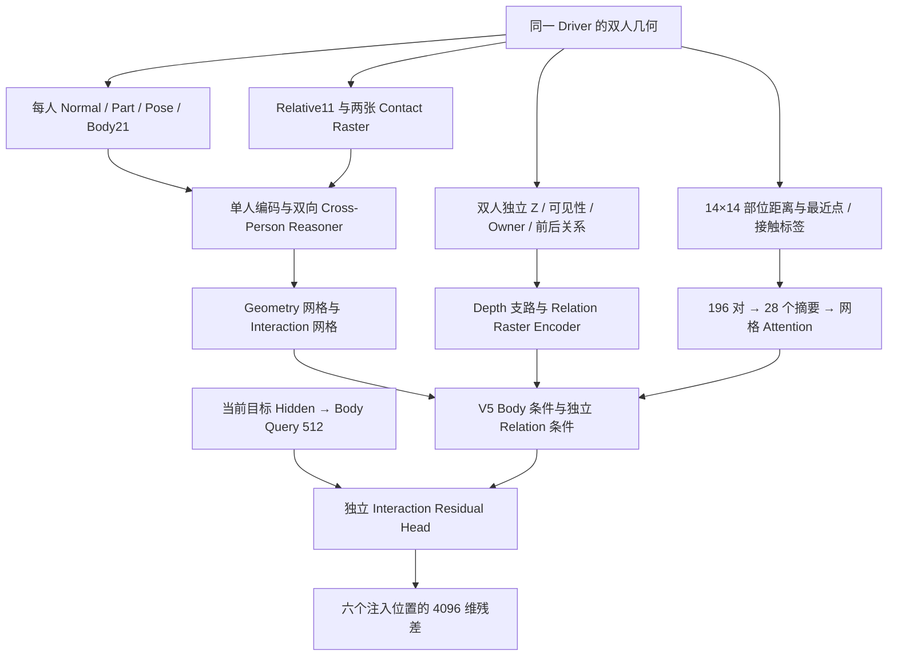

# Native Full V5 双人交互几何：现状、缺口与改造建议

审查时间：2026-11-07（Asia/Shanghai）。对象：`ssh sg` 上 `/home/shangguanrz/project/pic-edit` 的当前工作树。远端 HEAD 为 `bbc729d006ed6b2301e81f5cda8033f4f8b74ca0`，本地 HEAD 为 `d4265fb`；远端有未提交的空间加权监督改动，因此结论按文件 SHA 固定，不仅按 Git commit 固定。证据见 [audit-evidence-v2.json](audit-evidence-v2.json)。

**建议保留 V5 的 Native 注入主体，优先补强“有方向的接触边、接触位置和生成时读取边的能力”。已有的 Relative / Contact 模块应升级，不能按尚未实现从零重建。** 用户提供的文本在方向上有价值，但部分现状假设、loss 的梯度路径和实施顺序需要调整。

## 1. 当前双人分支实际做了什么

远端工作树的链路如下。代码位置均为本次远端快照的行号：

| 已有能力 | 当前证据 | 对方案的含义 |
|---|---|---|
| Root 相对关系 | `dual_depth_geometry.py:147`，11 维含共同身高归一化的 root 位移、bbox 中心差、尺寸比、距离、相对朝向和前后符号；`token_encoders.py:205` 编为 2×256 Token | Relative Geometry 并非空白；但不是完整相对 SE(3)，也没有显式跨人物关节对编码 |
| 双向人物推理 | `reasoning/cross_person.py:10`，共享权重、同步 A↔B 更新；已有 Relative Token 与 Contact Reasoner | 不必再平行堆一套功能重复的双人 Transformer |
| 独立几何图层 | `dual_depth_geometry.py:88` 和 `dual_depth_condition.py:55`，保留每人 Z / Normal / Part / projected / visible，以及 overlap、front、tie、Owner | 用户文本中“不能只保留合成图”的要求已基本做到；这是每人独立的相机表面图，并不等于完整 mesh 的所有背面都可见 |
| 表面距离与接触 | `dual_hi4d_geometry.py:92` 用 FCL 三角面距离；缓存存 196 对最近点、官方顶点接触对应和两张投影 Contact Raster | 不是简单的关节中心距离；已有资产可以继续利用 |
| 结构化关系编码 | `native_dual_depth.py:116`，196×256 → 28×256 行列摘要 → 512，按部位覆盖率加 Attention bias | 已有语义部位对，但空间定位主要到“整个部位”，没有显式定位到“此处接触斑块” |
| 独立 Native Interaction 注入 | `native_v5/frontend.py:97` 附近分离 relation；`runtime.py:21` 使用动态 Query；`integration.py:47` 起读取当前 Hidden | 已有独立 Interaction 残差；目前动态 Head 是逐位置调制/MLP，没有让当步目标 Query 直接 Attention 到原始边集合 |
| 训练目标 | `native_v5/training/objective.py:19`，FM velocity、局部 Face/Hand、可选 ID/Perceptual；当前未提交代码另支持 body/joint/hand 空间加权 | 没有现成的生成结果 Contact / Normal / SDF 监督；空间 FM 加权可以作为接触区域监督的近邻实现 |

一个重要边界：关闭独立 Interaction gain，只消除了该残差路径。Body 的 Geometry 来自已经进行 cross-person/contact 推理的共享 Reasoner，因此不能把这个开关当作“所有交互信息全部关闭”的严格消融。

另外，`native_full_data.py:156` 起的通用双人 SMPL-X 路径可声明 FCL 距离可用，但默认将 Contact Raster / Contact Relations 置空，注明 `unavailable; not_negative_labels`。所以 **Hi4D 官方接触监督和一般 SMPL-X 拟合数据的接触监督并不等价**；不能看到 SMPL-X / Depth / Normal 文件就认为已具备 Contact GT。

## 2. 用当前缓存与 CPU 探针确认的缺口

本次只抽查既有 fixedpair 的两个 target：`pair12/highfive12/camera4/000082` 与 `000112`。两份缓存 SHA 都匹配 manifest；这不是全数据集质量统计。

| 实测项 | frame 000082 | frame 000112 |
|---|---:|---:|
| 每人模型与顶点数 | SMPL，6890 | SMPL，6890 |
| 尺度声明 | `model_unit / model_scale` | 同左 |
| 原始有方向接触记录 | 2616 | 0 |
| 正接触部位对 / 196 | 3 | 0 |
| 正/负已知标注 | 3 个 known positive，0 个 known avoid | 均为 unknown |
| 有效部位距离与 witness | 196 / 196 | 196 / 196 |
| 独立投影的重叠像素 | 2439 | 0 |
| 表面相交部位对 | 0 | 0 |

第一帧官方对应点距离的中位数为共同身高的 `0.00456`，95 分位为 `0.01019`。它说明“标为接触”也不意味着参数人体表面距离严格为零；不能据此换算毫米，因为这里没有声明 metre 标定。缓存的相机 mesh 复原误差约 `3.5e-7～4.8e-7` model unit，只证明几何变换自洽，不证明拟合人体等于真实衣物表面。

**缺口 A：旧 Contact Token 没有可靠绑定人物和部位。**

`StructuredContactRelationEncoder` 将 `person(src) + part(src) + person(dst) + part(dst) + type + distance` 相加。交换两端部位、保留人物槽与距离时，在代数上表达相同。例如 `A.left_hand→B.torso` 和 `A.torso→B.left_hand`，实测最大差 `1.79e-7`，在 `1e-6` 容差内相同。这是旧 8 条桥接 Token 的局部歧义。新的 PartRelation 用不同的 `part_a` / `part_b` embedding，仍可提供有方向的区分，不能将此扩大为整个 Adapter 都无法区分人物。

建议将端点写成有序的 `(src_person, src_part)` 与 `(dst_person, dst_part)`，拼接或分别投影后再融合。只给人物加槽 embedding、随后与无方向的 part embedding 求和，不能保证端点绑定。

**缺口 B：最近点“在哪”没有直接进入 PartRelation，法线也没有。**

当前 9 维 numeric 是：距离 1、最近点差向量 3、接触状态 4、witness_valid 1。它不含最近点中点、投影坐标、两侧局部法线或接触面积。固定 Geometry/Interaction 输入，仅修改 raw contact indices 或 normals，PartRelation 输出差都为 0；将两个 witness 同时平移，输出差仅 `3.73e-7`；修改距离的正对照使输出差达到 `0.00814`。

这里的限定很重要：Normals 仍经过其他 Geometry 支路，Contact Raster 也经过其他 Reasoner 支路；探针证明的是 **PartRelation 本身没有直接消费这些字段**，没有证明整套模型不使用它们。196→28 是可学习汇总，也不能仅凭压缩比例断言所有边信息必然丢失；实际风险是缺乏精确位置绑定与当步边选择。

**缺口 C：碰撞、接触、未知需要分别保留。**

Hi4D exporter 存了 `surface_intersection`，但它没有成为现有 typed condition 的独立模型输入。FCL 对相交部分将距离置为 0、witness 无效；这种记录不能称为“零距离的良好接触”，也不能把它当成 penetration depth。当前 `part_contact` 已有 positive/known/avoid/avoid_known 四通道，这个三态原则应保留：没有官方接触记录是 unknown，不应全部作为负样本。

**缺口 D：模型家族、有效性与细粒度语义。**

当前 Hi4D 是 SMPL；混合分支中 Hand45/BPS 缺失时仍无效，不能用零值冒充手指几何。14 个大部位中 torso 没有前胸/后背/肩/腰的独立类别；最近点的 canonical 位置或表面 patch 可以补充这种区分，不一定先增大整套 part 字典。`relative_orientation_valid` 在 producer 中生成，但未传入 Relative Token encoder；后续升级应让每项可靠性真正参与编码。

## 3. 论文和方法能借什么

以下是原论文、官方项目页或作者公开材料；“对本项目的建议”均为本次推论，不是这些论文对 Qwen V5 的实验证明。

| 工作 | 已核实的方法 | 对本项目的建议与边界 |
|---|---|---|
| [Hi4D，CVPR 2023](https://yifeiyin04.github.io/Hi4D/) | 提供独立人物 mesh、接触及实例标注 | 优先使用已有官方对应关系作监督；区分衣物表面与参数人体，避免重新把官方接触全部阈值化 |
| [BUDDI / Generative Proxemics，CVPR 2024](https://muelea.github.io/buddi/) | 联合建模两人的 SMPL-X 分布，并作为单图重建优化先验 | 拟合几何不可靠时，可借鉴联合精修/质量置信度；它是上游几何先验，不是图像 Adapter 的现成 loss |
| [InterGen，IJCV 2024](https://arxiv.org/html/2304.05684v3) | 共享权重双分支、mutual attention、共同世界坐标，以及 masked 跨人关节距离和相对朝向监督 | 借共同坐标与显式关节对关系。我们已有双向 Reasoner；其 motion-space loss 不能直接搬到图像 velocity 上 |
| [ContactGen：Interactive 3D Human Generation，AAAI 2024](https://ojs.aaai.org/index.php/AAAI/article/view/27962) | 根据伙伴人体与交互类别估计潜在接触区域，并指导人体生成 | 接触区域应成为条件的一部分；输入拟合不确定时用概率与可靠性，不先硬判接触 |
| [ContactGen：Grasp Generation，ICCV 2023](https://openaccess.thecvf.com/content/ICCV2023/html/Liu_ContactGen_Generative_Contact_Modeling_for_Grasp_Generation_ICCV_2023_paper.html) | 接触位置、接触部位与接触方向分开表示 | 可借表面 patch 的位置/语义/方向编码；这是手物抓取论文，与上一项同名但不是同一工作 |
| [ContactField，NeurIPS 2024](https://proceedings.neurips.cc/paper_files/paper/2024/hash/435422305988b73c6cc00bcb29ba2531-Abstract-Conference.html) | 隐式联合表示 occupancy、instance ID 和 contact field，研究多视角交互几何重建 | 借实例归属、接触和空间占据共同表达的思想；首版不必引入完整 3D neural field，也不应将它描述为 Qwen 接触监督模块 |
| [InteractDiffusion，CVPR 2024](https://openaccess.thecvf.com/content/CVPR2024/html/Hoe_InteractDiffusion_Interaction_Control_in_Text-to-Image_Diffusion_Models_CVPR_2024_paper.html) | 给 T2I diffusion 增加交互控制 | 语义主体/客体绑定有参考价值，但其交互控制不等于精确的表面接触或防穿插 |
| [HUG3D，CVPR 2026](https://arxiv.org/html/2604.05436v1) | group/instance 多视角生成与几何优化结合，处理遮挡和交互 | 借全局交互与每人实例信息并存、优化约束与生成先验协同。任务是重建，不必照搬其正交相机和多视角流水线；项目页当前标注代码 Coming Soon |
| [PeopleComposer，SIGGRAPH 2026](https://cornell-vailab.github.io/PeopleComposer/) | 联合 pose/image 表示，按角色绑定文本、pose 与图像区域，逐步构建多人场景 | 借 role-aware 对齐和交互问答评估；第一阶段保留既有 Qwen token 契约，优先在 Adapter 内绑定角色，不先重写主干 RoPE |

这组证据支持“个体几何 + 相对关系 + 有实例归属的接触位置”联合表达。它不支持“输入越多、loss 越多，V5 效果一定越好”的结论。

## 4. 三种改造路线与推荐选择

| 路线 | 改动 | 取舍 |
|---|---|---|
| A：只加接触图通道 | 扩充 raster 的 contact、normal、collision 等通道 | 快，但有向部位关系仍容易在空间编码中被混合；适合作为小基线 |
| **B：有向边 Token + 接触位置图 + 动态读取** | 利用现有缓存生成显式边和 patch；保留 Body 和 Native 输出 Head，让目标 Query 读取关系集合 | **推荐。** 能直接解决已定位的编码缺口，变动限制在 Interaction 条件与读取路径，消融也容易解释 |
| C：完整 3D field 与可微几何监督 | 加 occupancy/SDF 网络，或生成图→可微人体估计→几何 loss | 成本与上游误差更大；适合后续研究，当前没有证据表明必须先做 |

### B 路线的具体表达

统一用共同场景坐标，令 `h=(hA+hB)/2`、`c=(rootA+rootB)/2`。相机坐标负责投影与前后关系；可同时提供 A 局部坐标下的关系，但不得分别归一化后丢掉相对变换。`model_scale` 下用身高比，只有显式标定为 metre 的数据才能使用毫米阈值。

1. **Relative 条件升级。** 保留已有 Relative11；补相对旋转的完整表示及有效位、跨人关节向量 `(jointB[j]-jointA[i])/h`、距离和可靠性。当前 SMPL 数据从已有 22 个 joint 开始，不虚构 SMPL-X 手指。先选躯干/双手/肩/骨盆等语义组合，再和完整 22×22 条件做消融。
2. **有向 Edge Token。** 每条边保留有序的两个人物—部位端点、共同坐标中点 `(xA+xB-2c)/(2h)`、差向量 `(xB-xA)/h`、距离、各自投影、两侧法线、接触状态/来源/置信度，以及独立的相交标志与有效位。相交时没有可信 witness 就保持无效，不能补伪方向。
3. **Surface patch。** 对真实接触或高置信近接触区域聚类，保留多个 patch，而非每个 torso 对只有一个最近点。用面片面积权重估计接触面积；不要用顶点数量冒充面积。优先采样已知接触，再采近接触/相交，最后补远距负证据；不截掉低置信但可能重要的边而不记录。SMPL 和 SMPL-X 可共享语义区域与 canonical 位置，不能直接混用两种拓扑的 vertex ID。
4. **Contact Map。** 继续保留每人接触图，增加 patch 的实例归属、方向和可靠性。分别标记“被另一人遮挡”和“本来就没有可靠几何”；独立渲染不能推回本人的不可见背面法线，隐藏接触面的属性要从 mesh/patch 取得。
5. **Native Query 动态读取。** 当前 Head 只拿到位置对齐的 `r_n`。候选改为 `q_n→Attention(K_edge,V_edge; projection_bias)→现有残差 Head`，加入 layer/sigma 调制。保持 4096→512 的 Body Query、六组输出和 FP32 融合；不要把所有关系压成一个 Global Vector。Body 和 Interaction 仍独立开关。

第一版建议边集合上限 64，另做保留 196 个部位对的对照；64 是待验证预算，不是已证明最优值。原生 `80×60=4800` 网格上，每层 Query×64 为 307200 对，Query×196 为 940800 对；这里只是 Attention 配对数，显存和速度必须实测，不能按这个数承诺训练成本。

部位覆盖率可作宽范围 bias，接触两端投影/patch 可作局部 bias。不要把空间支持硬锁成一个 16×16 cell，也不要让不可见人物的纹理通过交互分支覆盖前景 Owner。Person/Source 的稳定 ID、Qwen guide 顺序、SourceBank 映射与全部 edge 端点要共用一张绑定表。

所有新增字段放在新的 versioned sidecar 中，固定 Driver、相机、共同尺度、Canvas、person IDs、几何 SHA、接触来源与阈值。旧 V3/V5 缓存和 checkpoint 原样保留；新模块需要显式迁移，不能仅换类名后严格加载旧权重。

### 训练目标如何真正产生梯度

当前 Adapter 输出图像 velocity，不输出人体顶点。直接在固定输入 mesh 上计算

`L_contact(meshA_input, meshB_input)` 或 `L_penetration(meshA_input, meshB_input)`

对 Adapter 参数的梯度为 0；它们只适合作为数据审计、离线精修目标或条件标签。增加 loss 名称不能建立缺失的梯度路径。

首阶段建议仍用 FM：给可信的接触 patch 和附近手/边界增加空间权重，按有效权重总和归一化并设置上限，避免大接触区域或高分辨率主导 loss。现有 `spatial_weights.py` 只有 body/joint/hand，需要显式扩展 contact component 并固定 provenance，不能声称当前已经有接触加权。

再按证据选择辅助监督：

- 对低噪声预测的 `x0` 做可微解码，再接可靠的 differentiable pose/contact/normal 网络。先验证梯度能回到 Interaction 参数，并评估估计器的遮挡错误；ONNX/外部拟合不能默认当作可微链路。
- 在目标图像特征上预测接触图/部位对，可作为辅助任务；若 head 直接读条件 graph，很容易复制输入标签，不能将其准确率当作生成图接触正确的证明。
- 有衣物和拟合误差时，用 soft contact、可靠性和容差带。外法线相反可作弱证据，不是必要条件；参数人体相交也不是严格的衣物穿插。法线一致性和深度一致性分别建模。
- 真正的 SDF 穿插监督需要可信的有符号场、闭合人体与输出依赖。分割出的开放部位 mesh 和 FCL 的负返回值不能直接充当 signed penetration depth。

## 5. 如何验证与分步落地

**第一步：补齐数据证据与表达缺口。** 从现有缓存开始，审计 contact 的 positive/unknown/avoid、模型家族、共同尺度、相机重投影、patch 位置与法线；只对缺失字段进行离线派生。建议先选 60 个不同场景帧：击掌/牵手、拥抱/搭肩、遮挡/无接触各 20 个，并人工核对。数字是建议样本预算，尚未执行。不要只在同一 pair 同一动作的邻帧上得出效果结论。

**第二步：做条件与模块测试。** 对几何包检查 A/B 互换时，边端点转置、root 位移反号、旋转取逆、前后关系互换；各项 valid 和来源同步换位。整套模型含 slot/role embedding，因此不能简单要求任意换槽后的图像位级相同。对单人/全 unknown/no-contact/null geometry 分别验证；“无 contact 标注”不能导致整条双人相对关系分支失效。

新增 Head 保持零初始化时，第一次反向 encoder 梯度为 0 是预期，先检查输出 Head 有梯度；Head 非零后再检查 edge encoder 和 Query 的梯度。已有对应 CPU 测试，本次已选跑，详见验证记录。

**第三步：最小训练消融。** 统一训练数据、初始化、步数、sigma/seed、native grid 和评测图；先冻结已训练 Body，仅训练 Interaction 及明确选择的条件编码参数，再决定是否 Joint。做以下对照：

| 对照 | 回答的问题 |
|---|---|
| V5 当前实现 | 同条件基线 |
| V5 + 接触区域 FM 加权 | 收益是否主要来自把监督聚焦到接触位置 |
| V5 + richer edge/patch，静态对齐 | 新表达本身是否有效 |
| V5 + richer edge/patch + 动态 Query 读取 | 去掉静态条件瓶颈是否有额外收益 |
| 上项 + 接触区域 FM 加权 | 表达、读取与监督是否互补 |

先按“主体/场景/动作序列”分 held-out；同一视频的相邻帧或不同机位不能同时进入训练和验证。当前两个 fixedpair 只能验证工程链路与过拟合，不能证明泛化。不得改变几何条件后仍用不相容的原 target RGB 算 paired loss；仓库已有这条保护，应继续保留。

**生成结果评估。** 分开统计每人 pose PCK、身份交换、手部质量、已知接触部位对正确率、可见接触点偏移、前后/遮挡一致性，以及人体重建失败率。接触 F1 只能在有足够 positive/negative 标注的子集上计算；本次缓存大部分是 unknown，不能全部作真负例。3D 穿插只能在生成图重建可靠的子集上评估，并报告筛除比例；输入 mesh 的碰撞率不能代替生成图碰撞率。

还应进行条件反事实检查：同噪声/seed 改变有向接触端点或接触 patch，观察生成图对应区域是否随之变化。此项只作控制响应测试，除非有相容 GT，否则不拿原图做监督。将独立 Interaction gain 置零是残差消融；要审查全部交互信息，还需分别控制共享 Reasoner 中的 relative/contact/cross-person 输入，明确消融范围。

首轮晋级规则应围绕相同 held-out 样本的配对比较：接触/遮挡改善、身份与姿态指标不退化、未知标注不被当作负例、训练和显存成本可接受。具体门槛在测完基线后固定；本次没有编造性能增益或训练所需时长。

## 6. 本次完成范围与复核结果

已完成远端工作树和 19 份相关源码的 SHA 审计（18 份由探针 AST 解析，另 1 份 exporter 已读取源码）、两个 target 几何缓存核验、两组编码器探针及 Relative11 交换检查，并选跑 8 项已有 CPU 回归测试。结果与命令见 [verification.json](verification.json)。研究中确认的现状和建议没有写入 Adapter 或训练配置，也没有运行生成、训练或修改既有图片/缓存/权重。

远端审查过程的一次 `nvidia-smi` 返回 NVML driver/library mismatch；本次检查使用 CPU，没有据此推断 GPU 可训练或修改环境。完整训练速度、显存与生成质量仍需单独验证。

可以直接使用本目录 README 中的命令复跑只读探针。后续最小实现边界建议是：**有向端点编码与 valid 修正 → versioned 接触 patch/边侧车 → Native Query 读取边 → 接触区域 FM 消融**。更重的 3D field 与可微重建监督，放在上述证据成立之后。
