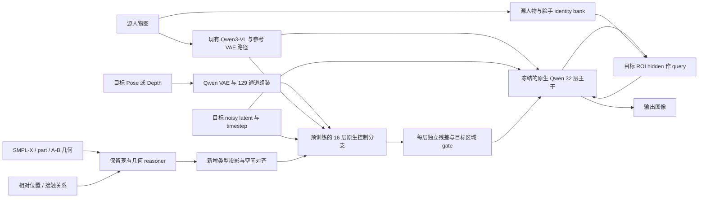

# Qwen 2.1 条件控制与 ControlNet Union 移用研究

日期：2026-10-15，Asia/Shanghai。结论基于 `ssh sg` 的当前磁盘、已安装 Diffusers 源码、公开源码和权重文件头。**完成的是架构研究；没有新的出图效果、训练收敛或 GPU 显存实测结果。**

## 1. 结论与证据边界

“现有 Adapter 还不够贴合 Qwen”有明确的结构依据，尤其适用于 Full 版。但不能仅凭结构断言它已经导致了某项指标下降：现有实验中的条件质量、数据量、优化策略和推理设置，也可能影响控制效果。

我的建议是：**保留我们的人物几何、接触、身份绑定和脸手特征系统，逐步用原生 Qwen 控制块替换 DeepGen 控制核；优先利用 Union 的现成预训练权重，采用小模块 / LoRA 适配。** 先建立原样官方基线，再处理参考图身份路径和 target-only 注入；不先从零训练另一个 37.75 亿参数控制器。

来源边界：链接中的模型是 **Alibaba-PAI / VideoX-Fun 发布的 Qwen 2.1 扩展**。它有自己的 Transformer 子类和 Pipeline，不能理解为给我们当前 Diffusers Pipeline 加一个 `controlnet=` 参数就能使用。

本次固定版本：

| 对象 | 审计依据 |
|---|---|
| 服务器项目 | Git HEAD `17991d3`，另有未提交修改；本报告以文件 SHA256 为准 |
| 本地项目 | Git HEAD `72e418e`，与服务器存在漂移；未同步或覆盖双方主树 |
| VideoX-Fun | `13bb3c625e8b1e457d7124d92207b49e00e4a6fe` |
| Union HF 仓库 | `8a4702014d4dabb5f896fcba917e2ee0a961465f` |
| 当前运行环境 | torch `2.8.0`、diffusers `0.41.0.dev0`、transformers `5.17.0` |
| 证据位置 | 本目录 `remote_audit.json`、`source_snapshot/`、`manifest.json` |

服务器 `nvidia-smi` 返回码 18，报 `Driver/library version mismatch`，NVML library `580.178`。这是本次设备查询结果，不等同于已验证所有 CUDA 程序均无法运行。没有修改驱动、安装依赖或占用 GPU 做本任务的推理。

## 2. Qwen 2.1 的原生控制接口应该服从什么

服务器实际配置是 **32 层 single-stream DiT、hidden=4096、32 个 attention heads、head_dim=128、SwiGLU MLP ratio=3**。基座 Transformer 文件头实测 7,115,124,736 个参数。这里不是旧 Qwen-Image 的双流接口，也不是 DeepGen 的 1536 维 JointTransformerBlock。

必须保留的四个契约：

1. **Latent 与空间坐标**：Qwen VAE latent 是 64 通道、空间下采样 16 倍；512×512 对应 32×32=1024 个 latent token。Transformer 本身 `patch_size=1`。VLM 的一个图像 slot 会展开为 2×2=4 个 latent token，不能把 slot 数当 token 数。原生 Pipeline 还要求宽高对齐到 32；模型卡“16 的倍数”的简述不足以覆盖当前代码的取整行为。
2. **文本与图像联合序列**：源图先由 Qwen3-VL 提供图文条件，再由 VAE latent 填入相应图像位置，目标噪声图像在末段。序列中可能是文本和参考图交错，不能随手假设所有前缀位置都是文本。
3. **Block-causal attention**：同一图像块内全注意力，跨块遵守因果顺序。目标能读取前面的文本和参考图；前缀不能反过来读取后面的目标状态。修改注意力规则会改变身份条件的含义。
4. **原生时间调制与 RoPE**：共享 `modulation` 给所有 block；`causal_condition=True` 时文本和参考图使用 t=0，目标使用当前 t。RoPE 三轴维度为 `[16,56,56]`。控制侧需要同样的坐标、有效 token mask 与时间语义。

可核对的服务器源码快照：[Transformer](source_snapshot/remote_20261015/diffusers/transformer_qwenimage21.py)，重点为 `QwenImage21TransformerBlock`、`build_token_metadata`、`forward`；[本项目原生 I/O](source_snapshot/remote_20261015/qwen21_full/qwen_runtime.py)，重点为 `source` 和 `transformer_inputs`。

## 3. 现有 Adapter 的具体问题在哪里

### 3.1 简化版 / Dual 版与 Full 版要分开判断

| 维度 | 当前简化版 / Dual | 当前 Full | Union |
|---|---|---|---|
| 生成控制残差的核心 | 512 维融合 MLP | 1536 维 DeepGen/SD3 控制核，单 block recurrent 执行 6 个 stage | 16 个独立的 4096 维原生 Qwen block |
| 对主干状态的读取 | 每个 hook 读取该层当前 target hidden | 每次 Transformer 调用前，用 noisy target latent 计算全部 6 组残差 | 用主干初始联合 embedding 启动独立控制链 |
| 注入位置（从 0 开始） | `[3,8,13,18,23,28]` | 全部 32 层；同组复用同一残差 | `[0,2,4,...,30]`，每处对应独立控制残差 |
| 输出范围 | 目标图像 token | 目标图像 token | 整个 joint sequence |
| 参考图身份路径 | 保留现有 Qwen 路径 | 保留现有 Qwen 路径 | 发布的 control pipeline 没有沿用这条路径 |
| 人物 / 接触语义 | 已有显式模块 | 已有显式模块 | 公布的控制输入不包含这些项目专有语义 |

**不能说我们所有版本都不读取 Qwen hidden。** 简化版 `residual()` 明确读取当前层 target hidden，这是它值得保留的设计。它的限制是 512 维瓶颈和 token 级融合层没有原生 attention；对提示词、参考图的了解主要经主干 hidden 间接传入。

### 3.2 Full 版的 32 层注入并不等于 32 层原生控制

`qwen_adapter.py` 第 32 行定义分组，第 585 行取 `residuals[6 * layer // 32]`。实际六组为：

```text
0–5 | 6–10 | 11–15 | 16–21 | 22–26 | 27–31
```

同一 denoising step 中，一组残差会被连续写入 5 或 6 个主干 block。它不是给每层重新计算一次，也不是每个位置独立学习的 Qwen block。重复写入可能使局部修正过强，或与不同深度的主干特征错配；**这是要做消融的机制假设，不是已证明的失败原因**。由于各层之间还有非线性变换，最终影响也不能简单视为乘 5 或乘 6。

Full 版每个 denoising step 会重新读取 noisy target、prompt 和时间，因此它并非跨所有采样步都不变的静态控制。它与官方同样可以“先算控制链，再跑主干”；问题重点是控制链本身的表示、坐标和层级参数共享方式。

### 3.3 Full 版仍在运行 DeepGen 的控制计算图

证据在 [control_core.py](source_snapshot/remote_20261015/qwen21_full/control_core.py) 的 `from_deepgen_config` / `_run_branch`：创建 `SD3ControlNetModel(num_layers=1)`，提取一个共享 block，循环六次，附加 stage embedding / 低秩 stage adapter / zero head。

[qwen_adapter.py](source_snapshot/remote_20261015/qwen21_full/qwen_adapter.py) 则做边界转换：

- Qwen 64 通道 latent 经 `Conv2d(64,64,1)` 和 `pixel_shuffle(2)`，成为 DeepGen 控制核所用的 16 通道格点。
- Qwen 条件 embedding 经 text / pooled bridge 进入旧控制核。
- 几何、交互、细节、face、hand 的 1536 维残差经各自 `Linear(1536,4096)` 输出到 Qwen。

这些变换可以训练，pixel shuffle 本身也不丢信息；**维度不同不等于接口错误**。但只在出入口投影，不会自动让中间的 SD3 attention、位置编码和时间调制变成 Qwen 的原生计算。已有 DeepGen 权重经验是否能有效迁移，需要更多数据弥补，不能视为天然等价。

还有一处文档与实际不同：`QwenFullControlOutput.block_controlnet_hidden_states` 只是属性名。本机安装的 Qwen21 `forward` 没有这个入参；目前实际注入靠 `register_forward_hook`。后续不能据这个名字认定官方控制接口已经接好。

### 3.4 身份和接触能力值得保留，但输出方式可改

Full [face/adapter.py](source_snapshot/remote_20261015/qwen21_full/face/adapter.py) 的 `forward` 从准备好的 spatial features、face tokens 和 timestep 生成 ROI 残差，不读取当前 Qwen target hidden。可试验改成：当前脸部 target hidden 作 query，源脸 ArcFace / 纹理 token 作 key/value，再散射回目标 ROI。这样每层可根据“目前已生成的脸”决定修正量。它是候选方案，尚不能承诺改善 ID。

Dual 的 `PersonTokenBinder`、A/B source indices、human masks、相对几何与 contact relations 是项目已有的结构信息。Union 的 Pose/Depth 不会自动取代人物身份绑定、接触端点、遮挡归属和手指语义。应保留这些模块的输入契约和有用特征，而非把整个系统换成一张控制图。

## 4. 官方方法真正可移用的部分

### 4.1 核心是 Qwen 同构控制链与已训练的控制先验

简化表示为：

```text
X0 = Qwen 的原始图文联合 embedding
C0 = X0 + before_proj(scatter(control_img_in(U)))
C(i+1) = QwenControlBlock(i)(C(i), 原生 modulation / RoPE / mask)
R(i) = after_proj(i)(C(i+1))
X(2i+1) = QwenBaseBlock(2i)(X(2i)) + scale * R(i)
```

这里的 `2i+1` 指经过第 `2i` 个主干 block 后的状态；中间未挂控制的主干 block 照常运行。控制链只在开头合入 `X0`，**不是在每个 stage 重新读取同深度的主干 hidden**。它复用原生块定义、共享调制、RoPE、block-causal mask，输出 16 份独立残差。[固定版本控制源码](https://github.com/aigc-apps/VideoX-Fun/blob/13bb3c625e8b1e457d7124d92207b49e00e4a6fe/videox_fun/models/qwenimage21_transformer2d_control.py)

当前 loader 对基座中缺失的 control 参数作初始化，然后重新置零 before/after projection；代码里没有自动把每个主干 block 的权重复制到 control block。**新实例初始化行为不代表发布权重的训练历史。** 实际移用要加载发布的 Union checkpoint，不能误把“使用同一种 block 类”当成“已继承控制预训练权重”。

### 4.2 129 通道的含义不能随意重解释

输入为 `64 control latent + 1 keep-mask + 64 masked-image latent`。普通 Pose/Depth 控制时，后 65 通道为零；局部重绘时，用户 mask 白色表示重绘，内部 latent mask 反转成 1=保留、0=重绘。RGB 输入补不透明 alpha，再用 Qwen VAE 编码并按其均值/标准差归一化。

Union 的含义是同一权重支持多种控制图；官方列出 Canny、Depth、Grayscale、HED、Lineart、MLSD、Pose、Scribble。不能由此推断它已经学会“同时输入 normal + part-onehot + contact + 多人身份”。第一轮应分别用标准 Pose、Depth 对照，新的类型与多条件融合另行训练和评估。[模型卡](https://huggingface.co/alibaba-pai/Qwen-Image-2.1-Fun-Controlnet-Union)，[输入配置](https://github.com/aigc-apps/VideoX-Fun/blob/13bb3c625e8b1e457d7124d92207b49e00e4a6fe/config/qwenimage21/qwenimage21_control.yaml)

### 4.3 三个不能照搬的实现细节

**身份输入**：当前官方 control pipeline 显式设置 `input_images=None, vae_images=None`。`image` 被用作 inpaint 底图，经 mask 后放入 129 通道；不会像我们现有路径一样进入 Qwen3-VL 和参考图 latent 序列。因此它的生成 / 重绘示例不能直接证明它能完成源人物身份保持。

**注入范围**：官方把 skip 加到整个 joint sequence，包含文本及参考位置。这遵循其训练实现，不是程序错误；但移用到本项目后，与现有“保持前缀、只写目标”的行为不同。需要将“参考图 + joint 注入”和“参考图 + target-only 注入”作为两个明确实验条件。

**KV cache**：示例虽设 `use_kv_cache=True`，实际 control pipeline 的条件为 `use_kv_cache and causal_condition and control_context is None`；而该流程会构造 control tensor，所以控制生成时实际不启用这条 cache 路径。不可根据示例开关报告已获得缓存加速。移用初版也先关闭，之后分别验证主干和控制分支的缓存一致性。[固定版本 Pipeline](https://github.com/aigc-apps/VideoX-Fun/blob/13bb3c625e8b1e457d7124d92207b49e00e4a6fe/videox_fun/pipeline/pipeline_qwenimage21_control.py)

### 4.4 权重规模已经核实

通过 HTTP Range 只读 8 字节长度和 20,280 字节 JSON header，未下载 tensor 数据：

| 项 | 文件头结果 |
|---|---:|
| BF16 tensor 数 | 180 |
| 参数量 | 3,775,479,808 |
| tensor 数据量 | 7,550,959,616 bytes = 7.0324 GiB |
| control blocks | 16 |
| `control_img_in.weight` | `[4096,129]` |
| 主干 + control BF16 权重 | 20.2853 GiB，仅两部分权重 |

控制块中的 Q/K/V/O、QK norm 和三组 SwiGLU 权重，共 16×9=144 个 shape，全部与服务器主干 block 的对应 shape 一致。**这证明结构兼容的必要条件，尚未验证全权重载入、数值一致性或人物编辑效果。**

## 5. 推荐方案：保留条件系统，改为 Qwen 原生控制

有三条可行路线，建议按 B→C 推进，A 保留为低成本诊断。

| 路线 | 具体做法 | 优点与限制 |
|---|---|---|
| A：修补现有 Full | 降低同组重复注入增益；增加每层 gate / projection；Face 引入当前 target query | 改动较小，可检验过强注入假设；仍保留 DeepGen 控制核，没有利用官方控制权重 |
| **B：预训练原生 Union + 我们的语义条件** | 移植原生控制分支、加载全部发布权重；保留源图路径；新增几何 / 接触投影和人物 ROI 读取；先小模块 / LoRA 适配 | 推荐起点，利用已有控制先验；需要处理 reference 和注入范围的分布变化，计算量增加 |
| C：4～8 块原生学生控制器 | B 验证有效后，蒸馏或训练较浅的独立 Qwen 控制块 | 更省计算；少层不等于可以无损删掉官方部分层，仍须训练和质量验证 |

### 5.1 建议的数据流



图中 ROI query → 主干的回路表示某个注入层的局部读写，不是再次运行整个去噪流程。

**基础结构控制**：第一轮让现成 Union 只接熟悉的 Pose 或 Depth。不要把 25 通道 pose heatmap、part-onehot 或 normal 数值强塞进它已经训练好的 129 通道含义里。

**项目专有控制**：继续用当前 condition injector / reasoner 产生 geometry_scene、interaction_scene，再以新的有类型投影写入控制流的目标位置。可以表示为：

```text
control_state += Z_geometry(align(geometry_features))
               + Z_contact(align(interaction_features))
```

新的输出边界可零初始化，已有 Union 权重保持其学习值。若新模块内部还有上游零输出，则须避免“两个连续全零线性映射、没有旁路”导致梯度无法启动。官方 before/after 都从零开始仍能训练，是因为第一层有 `+ X0` 非零旁路，不能把它机械复制成两层相乘的零分支。

**身份保持**：保留现有源图的 Qwen3-VL / VAE 参考输入。需要加强时，使用按人物分开的 source identity bank，并让目标人体 / 脸 / 手 ROI 的当前 hidden 查询自己的 bank；通过 A/B source index、区域 mask 和可见性避免混淆。目标帧 RGB、目标 ArcFace / DINO 只能作为训练监督，不能流入条件编码器或推理输入。

**角色重叠**：A/B mask 重叠处不能无条件平均人物特征；采用已有深度 / 可见性结果确定可见主体，把接触位置交给关系分支。错误几何仍会给模型错误约束，因此训练时需保留条件有效性与 dropout，而不是把所有条件都赋予强权重。

### 5.2 target-only 改造怎样保持边界明确

建议把下列两件事分开做：

1. **控制特征对齐**：我们的输入 latent 是 `[reference_latents, target_noisy_latents]`。官方 scatter 覆盖所有图像 token，因此长度必须对应 `N_reference + N_target`。目标控制图仅对应目标坐标，不能直接用长度 `N_target` 的 tensor 填满所有 image slots。
2. **残差写回范围**：推荐候选版仍让控制链读取完整原生 joint sequence，但 `R(i)` 写回前乘 `target_token_mask`；文本 / 参考图输出残差严格为零。这样保留目标对 source 的读取能力，同时维持现有主干前缀边界。

目标控制特征也应在 affine projection **之后**应用 target mask，或者只把目标 projection scatter 到目标位置：将参考位置的 129 维输入填零，不保证 `control_img_in(0)=0`，因为该层有已训练 bias。

这两项都是针对我们编辑任务的改造，**target-only 版不与官方发布权重的原始训练行为完全相同**。必须保留 full-joint 版本作对照；若 target-only 版需要适配训练，不能只比较它的零样本结果就宣称架构无效。

初版在完整 joint sequence 上运行控制链，关闭 KV cache。未来即使主干前缀不变，也不能直接把它的 cache 借给拥有不同权重的 control blocks；要分别缓存、验证固定条件与动态 gate 的条件，并检查 CFG 正负分支。

### 5.3 条件强度要按空间、层和采样步分开

当前 Full 的 body / face / hand 已有 schedule，移用应保留可消融的控制入口，而不是所有分支共用一个旋钮。候选分解为：

`残差强度 = 分支强度 × 层增益 × 采样步增益 × 空间 mask × 有效性 gate`。

候选策略：Body 在确定构图和骨架的阶段较强；Face/Hand 在相关 ROI 仍可修改的阶段介入；晚期降低不必要的全局几何扰动。具体分界和增益须扫参，不在没有实验时指定“某一 sigma 最优”。新控制器先只启用 geometry，然后逐项增加 contact、identity、face、hand，避免多分支同时开而无法定位贡献。

若尝试局部重绘，移动人物需要考虑旧人体区域与新人体区域的并集，以及接触物体 / 遮挡区域。只重绘目标人体 ROI 可能留下原位置的人；保留不动的背景也不能靠简单保护旧人体外区域来实现。masked source 也可能丢掉本来用于保持身份的脸，所以 inpaint 通道不能代替 reference identity 通道。

### 5.4 权重怎么复用、哪些不能硬搬

| 部分 | 处理方式 |
|---|---|
| Qwen base Transformer、VAE、Qwen3-VL | 使用现有锁定版本，初期冻结参数 |
| Union `control_img_in` + 16 个 `control_blocks` | shape / key 全量核验后加载发布权重；不能在加载后再次 zero-init |
| geometry / interaction encoder、reasoner | 可保留已训练特征，重新学习它们到 Qwen 控制流的投影 |
| PersonTokenBinder / source indices / visibility / contact validity | 保留数据与绑定契约；维度改变时按 shape 重建投影 |
| ArcFace / 纹理 / 手部特征提取 | 复用输入特征和身份监督，必要时重训注入头 |
| DeepGen shared block 与 1536→4096 旧输出桥 | 不属于原生 Union 权重；保留为基线或蒸馏参考，不能 reshape 后伪称继承 |

`strict=False` 不是完整性校验。先加载 base，再加载 Union；允许缺失的是已由 base 提供的主干 keys，**control keys 必须 180/180 覆盖、shape 全匹配、无非预期 key**。本次只核对文件头，没有执行这次完整载入。

官方当前从头训练脚本使用 flow matching，`z_t=(1-sigma)x+sigma*noise`，目标 `noise-x`，只训练被选中的 control 参数，并对控制图做随机 dropout。本项目也应沿用同一输出目标与 latent 标准化；不要把采样步序号、模型 timestep 和 scheduler 物理 sigma 混用。训练脚本把变量 `latents_std` 预先设为标准差倒数，因此它的乘法与推理中的除法一致，不能仅凭变量名判断不一致。[固定版本训练源码](https://github.com/aigc-apps/VideoX-Fun/blob/13bb3c625e8b1e457d7124d92207b49e00e4a6fe/scripts/qwenimage21_fun/train_control.py)

## 6. 在我们仓库的落点与算力选择

以下是建议模块，**尚未创建实现目录，也没有对应可运行的新 CLI**：

| 建议落点 | 负责什么 | 从现有哪里借用 |
|---|---|---|
| `src/pose_control/qwen21_native/control_transformer.py` | 原生 control chain、16 份残差、target / joint 注入开关 | 已安装 `QwenImage21TransformerBlock`；固定版本 VideoX 控制实现 |
| `src/pose_control/qwen21_native/conditioning.py` | 129 通道、typed geometry/contact feature、reference/target slot 对齐 | 现有 condition injector、reasoner、bridge |
| `src/pose_control/qwen21_native/runtime.py` | 保留 reference 图文与 VAE 输入、原生 target grid | `qwen21_full/qwen_runtime.py`；不再经过 `latent_to_legacy` |
| `src/pose_control/qwen21_native/identity_adapter.py` | 当前 target ROI query、每人 source bank、脸手局部增量 | PersonTokenBinder、Face/Hand 特征及 ROI 工具 |
| `src/pose_control/qwen21_native/checkpoint.py` | base/Union/增量权重分离、shape/key 硬检查、版本记录 | 本次 header 审计规范 |
| `scripts/train/`、`scripts/eval/` | 标准训练与对比入口 | 现有数据 split、采样和评估逻辑 |

原生 block 的 port 应适配当前安装的 Diffusers，而不是直接导入整个 VideoX 包并升级依赖。它的主仓还包含许多不相关模型，照搬全套环境可能扰动 `qwen21`。保留第三方版权声明与固定 revision。`qwen21_full/`、`qwen21/` 保持可复现实验基线，不做目录迁移。

### 6.1 首先选择参数高效适配

冻结 Union 的大权重并训练新增 projector / identity 模块；如需适配它的控制行为，在 control blocks 上加 LoRA。不是先给冻结 base 也加全局 LoRA，否则很难判断改进来自控制器还是主干改写。

由实测 tensor shape 可推算：16 个 control block 的 Q/K/V/O 与三组 SwiGLU 全部使用 rank=32 LoRA，约 **41,943,040** 个参数；若 before/after projection 也都加同 rank LoRA，总计约 **46,399,488** 个参数。这不含新的 geometry/identity 模块，也不代表已经训练过的最优 rank。

冻结并不等于对整个网络使用 `torch.no_grad()`。如果输入投影或 LoRA 可训练，梯度仍需穿过冻结 control/base block 回到它们。可用 checkpointing、预计算 VAE/VLM 条件和合理 offload 控制内存；不盲目切断梯度。

### 6.2 内存预算的正确口径

主干 + Union 纯 BF16 权重是 **20.29 GiB**，不含 Qwen3-VL、VAE、activation、attention workspace、梯度和优化器。

若全训 Union，按 BF16 参数 2 bytes + BF16 梯度 2 bytes + FP32 Adam m/v 8 bytes，即 12 bytes/参数估算，仅“冻结 BF16 主干 + 可训练 control 的参数/梯度/状态”约 **55.45 GiB**；若再保留 FP32 master weights 则约 **69.51 GiB**。实际 optimizer dtype 策略不同会改变这些数字；两者都不是显存峰值实测。

因此不能根据 85GB 显卡就保证全量训练、1024 分辨率和双人多参考图能同时跑通。先用预计算源图条件、512 尺度、batch=1、小模块 / LoRA 和 checkpointing 做单步显存测量。即使只训练 LoRA，冻结大分支仍有前向计算与必要的反向激活成本。

## 7. 怎么验证，才能决定是否替换现有架构

### 7.1 先做接口门禁

这些是后续实施应完成的测试，**本次尚未运行**：

- 控制关闭时：相同 base 权重、seed、输入和 dtype 下，与原生 Qwen 预测一致；FP32 小模型测试应使用严格容差，BF16 实机记录最大/平均差异并预先设阈值。
- 新分支零初始化时：旧行为不变；训练一小步检查非零输出头、上游梯度和新增参数是否实际更新，避免“可训练但无梯度”。
- target-only 版本：前缀位置残差严格为零；source/reference token 的层输出与对应无控制计算一致。测试多个参考图、不同源/目标宽高、文本 padding。
- 权重载入：180 个 control keys 全覆盖；记录 SHA256、dtype、missing/unexpected keys。不得只看 loader 没报错。
- 条件敏感性：同 seed 换目标骨架应改变目标姿态；换源人物应改变身份；只改提示词应保留应有的文本响应。包括 A/B 人物索引置换和无效人物输入。
- 训练/推理隔离：推理数据对象不含 target RGB、目标身份 embedding；遮掉或替换 GT 不应改变实际条件。Dropout / 有效性关闭应真正关闭对应支路。
- CFG、gradient checkpointing 和可选 KV cache 分别验证。Cache 开/关只有在数值等价后才计入性能结果。

### 7.2 先区分“官方复现”与“编辑任务比较”

**官方复现**：在同样不提供参考身份输入的条件下，比较 Qwen base、Union Pose、Union Depth，验证控制权重与预处理正确。选择 8 个明确姿态案例、2 seeds，每组 16 张；采样步数、prompt、分辨率一致。不要拿这个无 reference 的官方结果直接评价身份保持优劣。

**人物编辑比较**：固定源图、目标条件、prompt、噪声与 scheduler，做下面五臂：

| 臂 | 输入 / 模型 | 要回答的问题 |
|---|---|---|
| E0 | 现有 Qwen 原生参考图路径，无 Adapter | 基座自身能做到什么 |
| E1 | 当前 Body 或 Full 的固定 checkpoint | 现有真实基线，Body 与 Full 分开报 |
| E2 | 原生 Union + 相同参考图路径，joint skip | 预训练结构控制能否迁入编辑路径 |
| E3 | E2 改 target-only，给两者相同适配预算 | 保留前缀边界的收益和代价 |
| E4 | E3 + typed geometry/contact / identity 条件，逐项加 | 我们的专有条件是否带来额外价值 |

所有 E2/E3/E4 都需明确标注零样本或训练后。若新增参考图路径引起分布变化，先以 16 对训练样本做短过拟合门禁，再扩展到持出身份；过拟合结果只用于确认能学，不可作为泛化结论。

正式候选比较可固定 24 个 held-out 案例：单人 8、双人交互 8、强遮挡/脸手困难 8，每例 3 seeds，即每臂 72 张。训练样本、验证样本、最终测试分离，双人 A/B 绑定与单人 replay 都要覆盖。样本数与训练步数在开跑前锁定；这里是建议实验规模，不是已完成结果。

### 7.3 同时看结构、身份、局部质量和代价

- **姿态**：PCK，明确阈值和归一化尺度、关键点可见性及漏检处理；建议同时报严格/宽松两档，不能只挑较好的一档。双人逐人关联后打分。
- **身份与衣服**：源人物 ArcFace 相似度、人物 crop 的外观/衣服指标；单独报检测成功率。不能把检测失败的难例全部丢弃；双人要报 swap 和漏人率。
- **接触与遮挡**：关键接触点二维距离、目标遮挡次序、接触可读性的盲评。没有可靠的图像到 3D 重建时，不能把二维距离命名成“真实网格穿透率”。
- **脸手与背景**：脸/手局部质量、已验证的局部关键点指标；背景在排除新旧人物区域后比较。ROI 指标和全图指标一起报，避免全图平均掩盖局部退化。
- **条件因果性**：关闭 / 打乱 geometry、contact、identity 各支路；同 seed 比较结果和残差 RMS。能否遵守正确控制与能否响应错误控制，要和输入条件本身的质量一起解释。
- **成本**：采样总耗时、每步耗时、峰值显存、可训练参数、控制分支时间占比。参考图预计算耗时另列，别与无预计算方法混算。

是否替换现有架构，应看同一持出集的成对变化、检测失败和盲评，而非单张好图。先确定可接受的身份/衣服/背景退化容差，再判断新增姿态收益是否值得；有候选显著改善后，再用 B 做 teacher 探索 4～8 块学生。

## 8. 已完成检查与复核办法

本次已完成：服务器源码审计、28 个项目源码快照哈希核验、37 个 Python 文件 AST 解析、180 个控制权重 tensor header 核对、144 个原生 block 核心 shape 对照，以及参数 / 权重体积 / LoRA 参数预算计算。**没有执行 GPU inference、forward/backward、加载完整 Union 权重或验证生成质量。**

本地仓库根目录执行：

```powershell
python research/qwen21_controlnet_transfer_20261015/scripts/verify_audit.py
```

它默认只读并打印 JSON。预期 `status: PASS`，同时列出上述计数、六组注入层和参数预算。它验证保存的证据，不能证明服务器之后没有变化；正式实施前须重新运行远端审计并与本次 SHA256 比较。

本次远端只读审计的可重跑命令（输出到终端，不覆盖本次 JSON）：

```bash
ssh sg '/home/shangguanrz/nihaochen/envs/qwen21/bin/python /data/shangguanrz/pic-edit-research/qwen21_controlnet_transfer_20261015_005429/audit_remote.py'
```

审计脚本已经在服务器 `py_compile` 通过。完整证据包副本放在同一目录的 `bundle/`，可直接阅读 `bundle/REPORT.zh-CN.md`。没有修改生产 Adapter、训练环境、图片/视频或既有实验产物，也没有提交、推送或启动训练。

## 9. 与 10-11 研究的关系

10-11 的双人研究已识别 VideoX 的 16 层同构控制接口，并出于轻量化考虑把完整分支留作后续探索。本次不把那份设计当成当前运行事实，而是重新读服务器代码、当前公开实现与发布权重文件头。

新增的决策依据是：现成 Union checkpoint 具有 37.75 亿参数的结构先验，**复用它并适配少量参数，与从头训练 16 个完整控制块是不同成本路线**；同时，实际 pipeline 的 reference 输入与 KV cache 行为必须单独处理。新的推荐因此是先验证预训练原生控制的收益，再决定为部署蒸馏轻量版，而不是继续仅扩大旧 1536 维控制核的注入覆盖。
