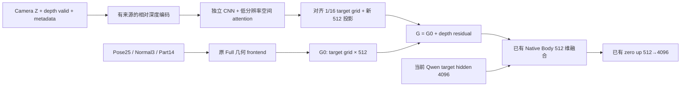

# Qwen 2.1 Full / Native：Depth 编码与 CHAMP 融合研究

核对时间：2026-10-23（北京时间）。本次由当前智能体独立研究，没有派 subagent。结论来自固定版本论文/代码、官方 Depth checkpoint 和服务器实际资产；没有修改模型、数据 loader 或训练配置，没有启动图像训练/推理。

## 1. 建议采用什么

继续保留 Full 已学到的 Pose25 / Normal3 / Part14 编码和 Native 的 512 维几何接口。借鉴 CHAMP 的 **独立条件编码、低分辨率空间 attention、投影后残差相加**，增加一个可关闭的 Depth 分支。

先处理深度数据的来源、方向、有效性和坐标，再比较编码器。建议首个实验输入为 **relative depth + depth valid 两通道**，保留原始 camera Z 与元数据；不立刻增加七通道、跨模态 MoE、部位深度层和新的控制主干。

官方 CHAMP Depth encoder 很小：本次下载核对的文件是 10,654,373 字节，全部 tensor 共 2,649,456 个元素。它值得作为 warm-start 对照，但不能直接加载到我们现有的 `champ` wrapper，也不能据此推定适配 Qwen 后有效。

## 2. CHAMP 实际怎样编码、怎样融合

论文：[CHAMP, ECCV 2024](https://arxiv.org/html/2403.14781v2)。代码固定到 [4d0cad2](https://github.com/fudan-generative-vision/champ/tree/4d0cad2ca23990a26a0c2f69d4ecb1b55f5df140)，本次 GitHub 查询的 master 也指向这个 commit。

| 环节 | 官方代码实况 | 对我们的含义 |
|---|---|---|
| 条件来源 | SMPL 渲染 Depth、Normal、Semantic；DWPose 为另一条件 | Depth 是人体几何的二维投影，不是 RGB 单目深度大模型 |
| 输入 | 每个条件独立读取为 RGB；guidance 用 `ToTensor()`，即 0..1 | 灰度 Depth 是三份相同数值，不是三个深度语义通道 |
| CNN | 3→16；随后三组同宽卷积和 stride=2 卷积，通道依次 16→32→96→256；SiLU | 输出空间分辨率是输入的 1/8；不是多尺度输出列表 |
| attention | 构造了多级 attention，实际 `forward` 只执行 `attentions[-1]` | 当前公开运行路径是最后 1/8 特征上的一次空间 attention |
| attention 细节 | 256 维、8 heads；每帧 flatten H×W；cross-frame / temporal attention 关闭 | 可以做单帧改编；这里不是模态间 cross-attention |
| 输出 | 3×3 Conv，256→320；从头训练时输出卷积零初始化 | 320 与 SD U-Net 入口通道匹配，不是 Qwen 的要求 |
| 条件融合 | 四个独立 encoder 的最终特征逐元素求和 | 必须先投影到共同空间，再相加；不能把原始 Depth 数值直接加到别的条件上 |
| 主干注入 | `sample = conv_in(noisy_latent)` 之后加 `guidance_fea`，再进 U-Net down blocks | 实际加到 latent 的卷积 embedding，不是加到原始 4 通道 latent |

定位：[GuidanceEncoder](sources/champ/models/guidance_encoder.py)、[空间 Transformer](sources/champ/models/transformer_3d.py)、[条件求和](sources/champ/models/champ_model.py)、[U-Net 注入](sources/champ/models/unet_3d.py)、[数据 transform](sources/champ/datasets/image_dataset.py)、[320 通道配置](sources/champ/configs/train/stage1.yaml)。

`InflatedConv3d` 实际继承 `nn.Conv2d`，把视频帧并入 batch 执行二维卷积；官方 checkpoint 的卷积核也确实是四维 `[out,in,3,3]`。单帧版没有必要把它理解为昂贵的体素 3D 卷积。

论文的 “multi-layer” 涉及多种几何表示，不足以证明公开前向在所有尺度都启用了 attention。我们如果增加 1/4、1/8、1/16 特征融合，应标为自己的候选改造。

CHAMP 第一阶段同时训练 Guidance Encoder、denoising U-Net 和 ReferenceNet 的大部分参数。它提供了结构思路，不能证明“冻结 Qwen、只加载其 Depth encoder”能直接获得相同控制效果。论文表 3 的 `w/o geometry` 同时移除了 Depth 和 Normal；该组 PSNR 28.78→29.84，不能全部归因于 Depth 单项。

## 3. 我们现有的 `champ` 不是上述完整实现

当前 `third_party/champ_guidance/guidance_encoder.py` 保留相同 CNN 通道节奏，但用 `_SpatialMixer` 的局部卷积替换了 attention；最后输出默认128通道、未零初始化，也不加载官方权重。这些差异已写在其 README。

`ChampConditionStemAdapter` 会把一通道 Depth expand 成三通道，再调用这个改编版。它只说明输入可以接通，不能说明已经复用了 CHAMP 学到的 Depth 几何特征。

实际 key/shape 审计见 [vendored_weight_compatibility.json](vendored_weight_compatibility.json)：

- 官方与本地恰好能对上14个 CNN tensor key，共348,880个元素。
- 官方 `conv_out.weight` 为 `[320,256,3,3]`，本地为 `[128,256,3,3]`。
- 本地8个 mixer tensor 在官方权重中不存在；官方空间 attention 在本地没有对应结构。
- 官方已训练输出卷积不是零：weight 最大绝对值0.00922752，标准差0.000903272。不能加载后又把它归零，再声称保留了训练输出。

另一个版本细节：发布的 HF checkpoint 包含 `norms.*`，但没有当前代码注册的 `guidance_attention.*`；当前 `forward` 又没有使用它们。官方推理本身用 `strict=False`。因此如果复用，应列出明确的 **active path 白名单**（`conv_in`、`blocks`、`attentions.5`，以及可选旧 `conv_out`），逐项检查 key、shape、数值；不要直接全局 `strict=False` 忽略所有差异。

在当前公开前向下，checkpoint 的 active path 共2,270,736个元素；去掉 SD 专用320输出卷积后，CNN+最后attention共1,533,136个元素。这是可复用规模，不包含我们的新降采样、valid 分支和512维投影。

## 4. Depth 数据：已经实测的问题与仍未证明的内容

服务器检查基于 `/home/shangguanrz/project/pic-edit`，HEAD为 `51f7c3611b25395cb0a01fd158b048a59bc62ef1`，其工作树还有正在进行的 canvas / loader / Native 修改。本次只读这些文件，不覆盖它们。各文件哈希与资产 SHA256 记录在 [remote_depth_audit_v1.json](remote_depth_audit_v1.json)。

结束核验时，9个被审查源文件中有2个发生并行修改：`tiktok_dataset.py` 和 `canvas_contract.py`。前后哈希保存在 [remote_source_hashes_after.json](remote_source_hashes_after.json)。重新读取后，TikTok仍使用`depth_vis`并标记`metric=False`，canvas仍为16倍VAE网格、32像素倍数；本报告的Depth读取判断没有因此改变。不要把审计起始时的单个hash当作服务器最终全树版本。

抽查采用确定性的首尾帧：iPER的3个appearance各2帧，共6份Npy/PNG；CHAMP示例的3个motion各2帧，共6份PNG；TikTok的3个sequence各1份PNG。不是全量资产审计。

### 4.1 iPER 存在可触发的方向反转

当前 loader 优先读取 `depth_vis_512/*.png`；没有PNG才读取 `depth_npy_512/*.npy`，随后对正深度做 `(Z-Zmin)/(Zmax-Zmin)`。

6个实测样本的PNG灰度与原始Z相关系数为 **−0.999847 至 −0.998480**，即近亮远暗；fallback公式则近暗远亮。生成器代码进一步说明PNG使用有效深度的1%/99%分位数，`(hi-Z)/(hi-lo)`裁剪，前景编码为1..255、背景为0。因此两条读取路径还存在分位数裁剪/全范围归一化的差别，不能简单用 `1-PNG` 完全还原NPY。

这证明 **同一字段存在方向不一致的代码路径**，不代表此前 Full 的效果差就是它造成的：现有基准和 Native frontend 都把 Depth 关着。

### 4.2 TikTok 与 CHAMP 资产

TikTok当前3个样本为1080×604灰度PNG；生成器复用相同的iPER `depth_vis` 函数。补全脚本设置 `save_depth_npy=False`，所以不能默认每帧都有原始深度。当前 native loader 新增了 `depth_metadata.metric=False`，这是正确方向，但还不足以保证方向、范围、相机、valid和来源全部可追溯。

CHAMP的6个样本都是8bit灰度，背景为0，并且对应mask内存在灰度0。**不能用 `depth_png > 0` 推出其全部几何有效性。** 本次没有执行其Blender工程，也没有用同帧原始Z标定其PNG映射，所以不声称已经证明官方CHAMP的精确 near/far 公式或米制尺度。

### 4.3 camera Z 与“真实米制”要分开

iPER的NPY确实是float32 camera-space Z，抽查正值约37.6..39.6。数值大小本身不证明单位为米或实际相机距离已经校准。SMPL估计、相机缩放、模型尺度必须有来源元数据支撑；缺失时标为 `camera_z / scale_unknown`，不能仅改名为 `depth_m`。

Depth有效区域、人体mask、画布有效区域分别表示：深度是否可信、人体在哪、哪里不是padding。RGB人物分割还可能包含衣物/头发，不能自动当作SMPL深度有效区域。双人共享归一化之前，两人的相机与尺度也必须可比；共享 min-max 不会修复独立重建的尺度漂移。

## 5. 适合接到现有 Full / Native 的具体结构

这是待实现提案。现有 Full 固定对照、Pose/Normal/Part stems 和旧fusion权重继续保留；不把原来的 `use_depth=True` 作为迁移方式，因为它会把fusion输入384扩成512，破坏现有shape继承。

### 5.1 先把输入规范化成两通道

数据层保留 `depth_cam`、`depth_valid`、`available`、单位/尺度状态、camera convention、target canvas及其变换、归一化范围和来源hash。

编码器首轮接收 `[D_relative,V_depth]`。当原始Z可用时，推荐明确固定 **近1远0、背景0** 的方向，以接近现有近亮远暗素材分布：

`D_relative = V * clamp((Zhi-Z)/(Zhi-Zlo), 0, 1)`。

`Zlo/Zhi` 只从有效几何计算；双人使用同一可比camera-space范围，并在metadata中保存。零跨度前景可约定0.5，仍由valid区分；全无效是缺失，不是平面。按帧相对归一化会丢失绝对距离与厚度尺度，所以保留原始Z；将来需要这些信息时，再把已校准的中心/尺度作为全局条件接入。

只有PNG时应明确标成 `relative_png` 模式，声明可确认的方向/来源并提供真实valid；不能伪造metric模式。建议用于独立的可运行对照。需要raw Z的实验对缺失样本显式报错或在生成新的资产目录后再使用，不能静默降级为PNG或零深度。

在当前数据流中，`build_condition_bundle` 仅在旧 `condition_injector.use_depth` 为真时传depth。新独立分支必须显式读取depth及metadata，不能保持旧开关为false却以为Depth已送入新模块。

### 5.2 编码器比较两种实现，训练和融合接口一致

| 候选 | 编码 | 适用目的 |
|---|---|---|
| A：推荐首个适配结构 | CHAMP式16/32/96/256 CNN下采样；1/8特征再降到1/16；只在1/16做一次256维、8head空间attention；新投影到512 | 用较低计算量验证“独立Depth+空间关系”是否有用 |
| B：官方warm-start对照 | 保留官方active CNN+1/8 attention；移除SD专用320输出head；增加1/16降采样与新512投影，另接valid | 尽量保留已训练的Depth表征，检验是否比随机初始化更省训练 |

A的attention分辨率/位置是我们适配Qwen的选择，不是CHAMP原版。若移动官方attention到1/16，虽能加载参数shape，计算次序和分布已改变，不能宣称整网功能等价。

512×512输入时，原版1/8有4096个空间token；1/16有1024个，attention的N²项减少16倍。这不是整个encoder或整个Qwen的16倍加速。长宽必须来自当前canvas：例如768×448对应48×28 token；不先拉成正方形，也不把输出偷偷resize到错误的目标网格。

纯灰度三复制转成一通道卷积时，应对原RGB核 **求和**。若改为 `[depth,valid]`，第一通道权重为三通道核之和，第二通道初始为0，保留原bias。用实际官方权重验证，第一层输出最大差 **2.98e-7**；错误地取均值则最大差 **0.75694**。这仅证明第一层数值等价，不证明改变输入深度分布后的完整encoder有效。

首轮不增加所有尺度的attention。可以保留1/4、1/8中间特征供后续细肢体边界消融。尺度汇聚需传递depth coverage：对有背景哨兵的Z直接平均会制造假近景；探针中前景Z=4、覆盖率0.5时，普通池化变2，mask-aware汇聚保持4。

### 5.3 条件融合先用残差相加

推荐 `G = G0 + s_depth * available * P_depth(E_depth(D,V))`；G和残差均为 `[B,H/16*W/16,512]`。Depth branch作为独立wrapper接入，不重建旧三模态fusion。对于无深度样本，应在分支最终输出处用available硬归零，避免CNN、attention和projection的bias让“输入全零”仍产生条件。

512空间已经是我们现有Native Body的输入。Depth无需自己扩成4096，也无需添加一组图像sequence token；继续由已有的4096→512查询、timestep/layer信息和512→4096输出完成主干交互。Depth encoder在条件不变时算一次，不在32个block里重复编码；可训练encoder不能用无梯度缓存替代真实训练前向。

相加不表示两种特征天然语义一致；新投影和后续controller必须训练。后续若发现Depth压过Pose/Normal，再试 `sigmoid(g(G0,D,V)) * depth_residual` 的分支门控；不先引入会强制模态竞争的softmax。

### 5.4 零初始化的边界

训练过的noDepth Native基线之上，新Depth末投影可零初始化，融合系数初始为1；关闭Depth要能精确回到noDepth路径。

如果系数也设0、投影也设0，二者相乘会同时没有梯度。CPU探针已确认这一死区。另一方面，现有Native输出head为0、新Depth head也为0，但G0非零时，是梯度延迟：探针第0步只有Body head有梯度，第1步Depth head开始有梯度，第2步Depth trunk开始有梯度，并非永久死亡。实际训练仍需记录梯度，不能只看初始一步。

现有Full迁出的frontend加新零head不等于已训练noDepth Native。E1必须是有训练和样例证据的基线，否则比较Depth的结论会混入主控制器学习差异。

## 6. 如何分步验证，哪些先不做

| 顺序 | 要回答的问题 | 有效对照/验收 |
|---|---|---|
| 0：数据契约 | 模型拿到的Depth究竟是什么 | PNG/NPY方向固定；valid含义正确；来源、camera、canvas一致；缺失显式处理；双人可比尺度 |
| 1：noDepth基线 | Native本身能否继承有效控制 | 固定原Full E0；训练Native E1并保留固定样例；不能以零初始化探针代替E1 |
| 2：最小Depth | 是否在遮挡/朝向上产生净收益 | E1 vs E1+Depth/valid，锁定训练pairs、预算、seed、原有输入和监督；同时看身份/服装是否退化 |
| 3：编码器 | 是否需要attention/预训练 | 在同一Depth融合接口比较CNN、低分辨率attention、官方active-path warm-start，分开改一个变量 |
| 4：增加信息 | 是否有具体缺陷需要新特征 | 有证据后才加masked gradients、前后深度层、part排序或门控 |

除常规PCK和身份/服装评估，应单列交叉手臂、手臂在躯干前后、侧身、弯腰、细肢体与遮挡样例。验证Depth依赖可固定其余条件，对Depth做off、局部前后次序扰动/错误方向等诊断；不一致条件下的结果只衡量敏感性，不当作正常生成质量分数。

单张可见表面Depth只记录每个像素最前面的表面，无法凭空提供被遮挡肢体的全部Z。part-depth多层确实可能补信息，但需要从同一mesh/camera渲染隐藏表面；不能从已有8bitPNG恢复。首轮不把它与encoder改造同时加入。

CHAMP用参考体型β+驱动动作θ重渲染的做法值得沿用；但一旦改变目标体型/相机，B原RGB就不能自动作为严格逐像素GT。训练和真实跨人迁移评测必须分开。

## 7. 本次证据与复查

实测结果：[远端数据与权重审计](remote_depth_audit_v1.json)、[本地wrapper兼容性](vendored_weight_compatibility.json)、[CPU机制探针](depth_contract_probes_v1.json)。来源清单：[固定版本16份源码](upstream_sources.json)、[补充历史版本/推理源码](additional_sources.json)。

研究脚本和复查命令见 [README](README.md)。官方权重仅缓存于服务器 `/data/shangguanrz/pic-edit-research/qwen21_depth_champ_20261023/official_weights/`，没有进入Git。本次未验证CHAMP整套视频生成、Qwen出图增益、训练收敛或完整encoder权重移植。

与10月22日方案C研究的关系：本报告把“Depth独立编码”具体化，补充了真实数据方向反转、CHAMP实际active attention和官方checkpoint shape的证据；不改写上一份已封存报告，也不恢复Pro/Union网络路线。
