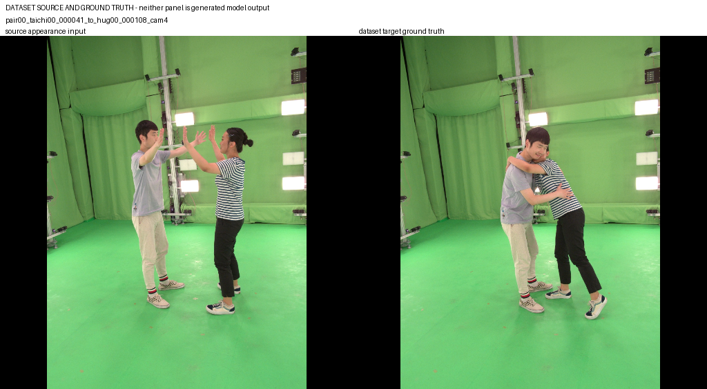
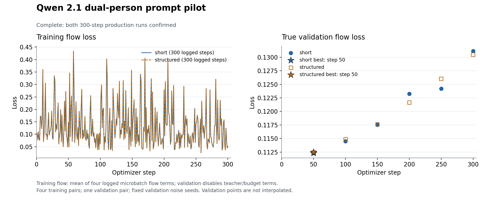
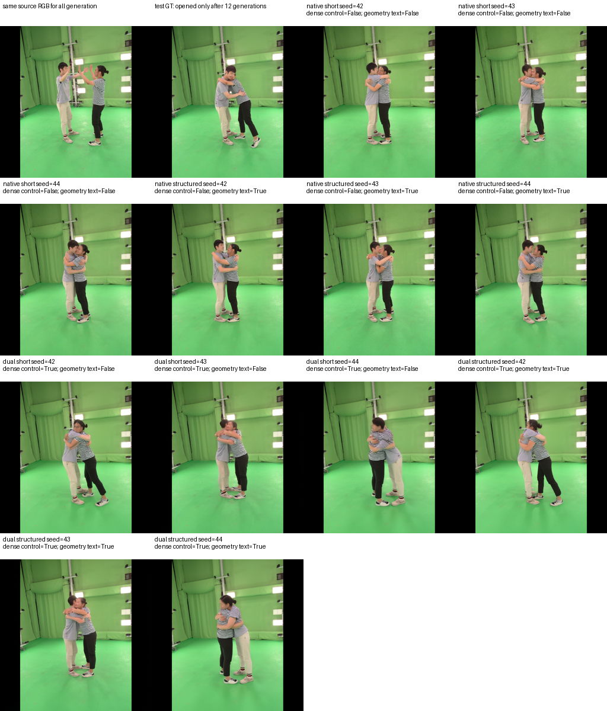

# Qwen-Image-2.1 双人逐样本动作提示词实验

更新：2026-10-14。四条真实训练配对已准备，short/structured 两支各完成 300 次更新；按独立验证配对选取各自第 50 步 best。锁定的测试配对完成四组、三个种子共 12 张生成及评分。测试生成没有反向传播或更新权重。

**本轮没有证实详细提示词训练会稳定改善双人 adapter。** 原生 Qwen 在这条样本上，仅用明确的“拥抱”短提示词已经能生成可辨认的拥抱。结构化 adapter 没有显示一致收益，人物位置、遮挡和身份保持仍有问题。四条训练配对和一条测试配对不足以否定逐样本提示词的方向，也不足以宣称双人质量达标。

## 实验问题

检验源人物指认、动作语义和可靠的外部几何描述，能否调用冻结 Qwen 已有的语义能力，并改善双人 adapter 的生成。Qwen 文本编码器与主干不参与参数更新。两组分别独立训练，除提示词与其文本编码外，初始化、样本顺序、噪声、优化目标和更新次数保持一致。

目标 RGB 用于训练的 flow matching 监督，这是有监督训练的必要真值；它不作为生成条件。测试生成只接收源图、源人物信息、动作提示词及外部目标几何；测试 GT 仅在全部图像生成完成后用于评测。外部几何来源于目标帧的 SMPL、相机和现有骨架，属于目标几何已知的控制任务。本轮没有验证“仅源图和动作文字自动预测目标几何”的重定向能力，也没有更新 Qwen 的语义分支参数。

## 样本

| 划分 | pair | 源帧 | 目标帧 | 相机 |
|---|---|---|---|---|
| 训练 | pair14 | talk14/32 | hug14/45 | 4 |
| 训练 | pair14 | talk14/32 | hug14/62 | 4 |
| 训练 | pair12 | highfive12/28 | highfive12/33 | 4 |
| 训练 | pair12 | highfive12/28 | highfive12/82 | 4 |
| 验证 | pair22 | game22/52 | hug22/46 | 4 |
| 测试 | pair00 | taichi00/41 | hug00/108 | 4 |

四条训练配对、一个验证配对和一个测试配对按官方工程 split 的 pair 划分互斥。训练前的 `selection_lock.json` 固定了原始 JSONL 行及文件/行 SHA；测试不是从生成结果中挑选。未核实跨 pair 的全局演员身份，也无法证明基础模型预训练未见过这些图像。

真实 RGB 与掩码从 940×1280 等比缩放、填充到 512×512。源帧形状参数独立拟合，目标固定对应源 actor 的 beta；没有联合使用目标帧来估计源形状。真实 SMPL-X 为 10,475 顶点、20,908 面，身体拟合均值约 10–13 mm、单关节最大误差小于 38 mm。拟合是外部几何代理；手指与表情未观测，不能作为详细动作真值。

## 提示词

短提示词包含实际动作标签和人物/背景保持要求。结构化提示词在此基础上加入源图 A/B 位置、朝向、间距、可靠的手腕高度和肘部姿态。文本仅依据动作标签、源掩码位置和外部几何，不读取目标 RGB，不生成不确定的手指或表情细节。

例如测试配对的 A 在源图右侧、B 在左侧，结构化提示词首先写明：

> A is the person on the right in the source image. B is the person on the left in the source image. Make the two existing people hug.

后续可靠的手臂描述及完整原文见 `research/qwen21_dual_prompt_pilot_evidence/selected_prompts.md`。两个相邻 hug 训练帧产生相同的粗粒度文本，两条 highfive 帧则有不同的手臂高度描述。样本文本正确反映可靠动作比强行让每条字符串唯一更重要。

## 训练与选择检查点

两组各 300 步，有效 batch4、lr1e-4；每 50 步用固定的三个验证噪声种子计算无梯度 flow loss 并选择 best。原生 Qwen 与导入的单人几何参数被冻结；训练新双人参数 40,524,064 个。初始化为 iPER body step19500 与相同的新双人参数，没有复用旧双人单样本过拟合检查点。

| 组别 | 实际更新 | 验证 best 步数 | best 验证 flow loss | 第300步验证 loss |
|---|---:|---:|---:|---:|
| short | 300 | 50 | 0.1123397934 | 0.1311421320 |
| structured | 300 | 50 | 0.1124632967 | 0.1305103401 |

两支都有 300 条连续指标、六个真实验证点，best/last 文件 SHA 已核对。后续验证 loss 都上升，best 差值很小，不能作为详细提示词胜出的证据。验证 flow loss 也不能直接代表姿态、接触或身份效果。

## 真实测试设计

正式测试固定为 pair00 taichi00/41 → hug00/108 camera4，40 步、CFG1、种子 42/43/44。生成以下四组，共 12 张图片：

| 组别 | 提示词 | 显式 adapter 几何 | 文本内的几何描述 |
|---|---|---|---|
| 原生短提示词 | short | 无 | 无 |
| 原生结构化提示词 | structured | 无 | 有 |
| 双人短提示词 | short | 有 | 无 |
| 双人结构化提示词 | structured | 有 | 有 |

结构化原生组也接收几何衍生的文字信息，不能描述为完全没有几何。双人组使用各自的验证 best。两组检查点及训练源码签名必须匹配已完成的实际运行。

真实测试进程退出0，墙钟约370秒。已核验 [inference_guard.json](../research/qwen21_dual_prompt_pilot_evidence/final_test/test/inference_guard.json)：12次生成及监控的原生前向均为无梯度推理；Qwen transformer、文本编码器、VAE、两支 adapter 都冻结且为 eval，前后实际参数 SHA 相同，所有参数 grad 为 None。optimizer 实例前后均为0，`Tensor.backward`、`autograd.backward/grad`、optimizer 初始化和 step 尝试均为0。

`run.json` 记录目标监督在12张图生成后才打开，未传入 generate。离线数据准备的 mesh 参数拟合属于控制预处理；测试生成及 Multi-HMR RGB 重建未更新 Qwen/adapter。

## 实际图像与指标

已人工查看完整图板及512单图。12张中均可辨认两个人物，没有明显第三人；原生短提示词已产生拥抱。adapter 的 seed44 两组中，条纹人物在左、灰衣人物在右并明显弯腰，相比目标的灰衣左/条纹右和身体关系偏离。脸部、手臂重叠及局部形态仍有问题。这是图像观察，不是身份模型已确认的交换率。

**检测器漏检不等于图中少了一人。** 同一 DWPose 评测器处理真实目标 RGB 也只检出1人，说明遮挡影响这条样本的评分。未用 GT 检测结果修改生成检测；既有逐人 target DWPose 观测仍是姿态参照。以下 PCK 只对可评分人物成立，必须连同分母阅读。

| 组别 | DWPose 双人检出输出 | 可评分人物 | 身体 PCK@.02 | 身体 PCK@.05 | 可评分关节/目标合格关节 | 背景 MAE↓ |
|---|---:|---:|---:|---:|---:|---:|
| native_short | 0/3 | 3/6 | 0.1364 | 0.6364 | 66/135 | 0.02231 |
| native_structured | 1/3 | 4/6 | 0.2247 | 0.7528 | 89/135 | 0.02198 |
| dual_short | 2/3 | 5/6 | 0.3363 | 0.6283 | 113/135 | 0.01742 |
| dual_structured | 0/3 | 3/6 | 0.2206 | 0.7059 | 68/135 | 0.01736 |

全身 PCK@.05 分别为0.6591、0.6086、0.5977、0.4724，同样受覆盖差异影响。背景空间像素分母均为433,071（3张，等价于1,299,213个RGB通道标量）；明确排除左右各68像素 letterbox 黑边。不同组的可评分人物/关节不同，不能只按 PCK 数字排名。

| 组别 | DINO 双人外观均值/覆盖 | DINO 交换/可判定输出 | ArcFace 双人均值/覆盖 | ArcFace 交换/可判定输出 | 接触距离/估计身高↓ | 接触覆盖 | 重建失败输出 |
|---|---|---|---|---|---:|---:|---:|
| native_short | NA；0/3 | NA；0 | NA；0/3 | NA；0 | 0.01668 | 24/24 | 0/3 |
| native_structured | 0.7887；1/3 | 0/1 | 0.3567；1/3 | 0/1 | 0.02386 | 24/24 | 0/3 |
| dual_short | 0.6662；2/3 | 0/2 | NA；0/3 | NA；0 | 0.05973 | 8/24 | 2/3 |
| dual_structured | NA；0/3 | NA；0 | NA；0/3 | NA；0 | 0.02653 | 8/24 | 2/3 |

逐人 DINO A/B 均值及覆盖：native_short 为 NA(0/3)/0.6567(3/3)，native_structured 为0.7846(1/3)/0.7014(3/3)，dual_short 为0.6395(3/3)/0.7110(2/3)，dual_structured 为0.6946(2/3)/0.6761(1/3)。完整逐人脸部、关节和每例失败原因见 [run.json](../research/qwen21_dual_prompt_pilot_evidence/final_test/test/run.json) 及12个同名输出JSON。

DINO 是衣着/外观代理；双人交换仅在两源、两生成 embedding 齐全时可判定。0/1或0/2不能证明无交换，NA不能写成0。接触来自生成RGB的 Multi-HMR 网格，没有用控制网格替代；无符号邻近距离不能证明接触准确或无穿透。两支 adapter 只有8/24可评分接触，不能据剩余值宣称改进。

## 运行中断与处理

原前台 SSH 作业以 `client_loop: send disconnect: Connection reset` 结束，没有写出完成记录。精确训练进程退出信号未捕获，不能补测该进程退出时的主干内存 SHA。原日志、两组指标、structured step200/best50 的字节副本和 SHA 均保留。

恢复候选核对第 201 步时，前向 loss 及微批记录一致，梯度范数未逐位一致，严格保护停止了 optimizer 更新。该尝试记为 `failed_no_completion_claim`，未成为本轮正式训练结果。没有放宽相等条件来宣称精确续训。

最终保留真实 short300，由独立后台作业从相同 iPER 权重和新双人初始化完整重训 structured 1–300，丢弃部分模型/Adam，复用同一缓存、样本顺序、噪声和配置。新作业退出0，墙钟约5030秒。操作脚本在冻结镜像外，81个训练源文件 SHA 未改变。新 structured 进程实测主干前后 SHA 相同；不声称补测了原中断进程的最终内存，也不声称跨进程浮点曲线逐位可复现。最终 completion 明确记录这些来源差异。

## 使用与复现

指标解释：身体 PCK 的阈值为 512×512 画布对角线的 0.02/0.05（约 14.5/36.2 像素），目标和预测关节置信度门槛均为 0.3。聚合 PCK 只覆盖可评分人物，因此必须同时列出可评分人数/预期人数与逐人缺失，不能用漏检后剩下一个人的高 PCK 表示双人成功。DINO/ArcFace 的交换率也仅对两个源和生成 embedding 都齐全的输出计算，须显示分母。

接触距离来自生成 RGB 的 Multi-HMR 重建，除以两人平均估计身高，是无符号的部位邻近代理；低距离不能证明没有穿透。背景 MAE 在源/目标人物区域并集扩张后的背景上计算，GT 掩码仅属于评测代码。

详细命令、完成记录检查、回归测试与图表生成见 [运行手册](../docs/experiments/2026-10-13-qwen21-dual-prompt-pilot.md)。

- SSH：`ssh sg`
- 隔离实现：`/home/shangguanrz/project/pic-edit/research/qwen21_dual_prompt_pilot_20261013/implementation`
- 数据：`/home/shangguanrz/project/pic-edit/research/qwen21_dual_prompt_pilot_20261013/data`
- 运行根目录：`/home/shangguanrz/project/pic-edit/experiments/4.two man /qwen21_dual_prompt_pilot/20261013_v1`
- 两个最终 best：运行根目录下的 `short/checkpoint_best.pt` 与 `structured/checkpoint_best.pt`，均为验证选取的第50步。
- 测试结果：运行根目录下 `test_pair00_v1`，含图板、12张PNG/JSON、指标、guard及 Multi-HMR 原始输出。
- 本地已下载84个测试证据文件到 `research/qwen21_dual_prompt_pilot_evidence/final_test`，训练证据到 `final_training`；检查点保留在远端。

| 证据 | SHA256 |
|---|---|
| short/checkpoint_best.pt | `7aa609d910a655f5b73622f69a0cd32dfa9d5ca8b7e72225c81c109decd8bab7` |
| structured/checkpoint_best.pt | `3de39e96942c1474e2418fbfafa2b18e3b36498df90a305360ef6e6ff187aa36` |
| 根 training_complete.json | `d5483f9575c5ed5e751ad8dffebf72dfa2a8099748b0d45b2f2c03404cc6593d` |
| run.json | `14462f074ebb596a4d9a112385f5bbcf11a350e2015c75cd9ab96158764a32c4` |
| inference_guard.json | `5fcf768c6e72ed4ab9bbe993fe8adec4e8c720de82801aa5b25bf4887a1b1b61` |
| comparison_board.png | `12cc88cb31286fdc0400989767a09656711f1925de508dc7b6622f10a452563e` |
| 测试证据ZIP | `800ab31d1992b5bde96a24ff0814c3bc750724ba4f1c5f87fdf8f9edcff08dd2` |

`4.two man ` 的目录末尾含空格，命令中必须将完整路径加引号。现有代码和旧实验保留，实际运行依赖已保存的隔离镜像、源码签名和实现快照；单独 Git HEAD 不能重建已有未提交基线。

## 结论范围

明确动作标签与源人物绑定是合理的输入改进，已经进入真实训练、推理和缓存签名。这条测试说明原生 Qwen 能理解“拥抱”，不能假设生成全部依靠 adapter；本次结构化文本没有带来一致的 adapter 质量收益。

四条配对、约四千万新参数、训练/测试左右绑定方向不同，以及拥抱遮挡下评分覆盖不足，都限制解释。未做消融，不能确定哪个因素是原因。下一轮若继续，应在更多独立验证配对上检查语义/几何一致性、人物绑定和遮挡评分，再决定细节和训练规模。本次没有根据已查看的测试结果继续优化模型。

三个种子不是三个独立测试样本。验证 flow loss 只用于选 checkpoint；本轮不能证明总体泛化或双人质量验收通过。
