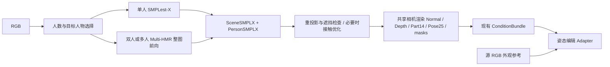

# SMPL-X 单人 / 多人链路评估

扫描与实测日期：2026-10-03（当前会话日期）。服务器：`ssh sg`。项目：`/home/shangguanrz/project/pic-edit`。

**建议采用“单人默认 SMPLest-X Huge，双人 / 多人默认 Multi-HMR”作为上游路由。** 两套代码、权重、人体资产和独立环境已经在 sg 上，已完成真实图片前向和网格覆盖渲染。这里将用户所说的 `smplxest` 理解为服务器已有的 **SMPLest-X**。

Multi-HMR 的单图多人、共同 camera space、单次前向设计符合这个用途；官方已发布训练与评测代码。[Multi-HMR 官方仓库](https://github.com/naver/multi-hmr)。SMPLest-X 是另一套完整的全身表达姿态与形状估计模型。[SMPLest-X 官方仓库](https://github.com/MotrixLab/SMPLest-X)。

“能估计 SMPL-X”与“已经接入编辑链路”是两个完成阶段：目前前者已经验证；统一接口、多人条件图组织及编辑验收仍需实现。

## 已有资产

以下路径均在 sg 上，相对于 `/home/shangguanrz/project/pic-edit`。

| 用途 | 模型 / 资产 | 路径 | 状态 |
|---|---|---|---|
| 单人全身 SMPL-X | SMPLest-X Huge | `add/tools/SMPLest-X` | 代码存在，HEAD `fdebd88` |
| 单人网络权重 | `smplest_x_h.pth.tar` | `add/tools/SMPLest-X/pretrained_models/smplest_x_h/` | 8,246,417,153 字节；含训练 checkpoint 数据，不代表纯网络参数大小 |
| 单人检测器 | YOLOv8x | `add/tools/SMPLest-X/pretrained_models/yolov8x.pt` | 已安装、此次检测成功 |
| 单人环境 | Python 3.12.3 / Torch 2.8.0+cu128 | `add/envs/smplestx_bw/bin/python` | CUDA 前向成功 |
| 多人全身 SMPL-X | Multi-HMR | `add/tools/multi-hmr` | 代码存在，HEAD `651fb41`；已有本地兼容修改 |
| 多人网络权重 | `multiHMR_896_L.pt` | `add/tools/multi-hmr/models/multiHMR/` | 1,286,462,544 字节；此次加载成功 |
| 多人环境 | Python 3.9.23 / Torch 2.8.0+cu128 | `add/envs/multihmr/bin/python` | CUDA 前向成功 |
| 多人 backbone 代码 | DINOv2 | `add/tools/dinov2_e1277af` | 使用本地目录，关闭 xFormers |
| 人体资产 | `SMPLX_NEUTRAL.npz` | 两套模型各自的 `human_model_files/smplx/` 或 `models/smplx/` | SHA256 一致，顶点 10475 |

中性人体资产 SHA256：`376021446ddc86e99acacd795182bbef903e61d33b76b9d8b359c2b0865bd992`。可以共用拓扑、蒙皮权重和 Part14 标签映射。

Multi-HMR 官方当前 README 的 demo 已切换到 **Anny** checkpoint。此项目要 SMPL-X，应该显式固定 `multiHMR_896_L`，使用现有 `demo_smplx_only.py`，避免直接照抄新的默认 demo 参数。[官方 checkpoint 列表与更新说明](https://github.com/naver/multi-hmr/blob/master/README.md)。

这次主要扫描 `add/tools`、对应模型目录、环境、已有评测产物和 `src/pose_control`；没有把整个服务器当成模型库做穷举。

## 此次真实前向结果

| 测试 | 输入 | 结果 | 首次前向耗时 | Torch 峰值 allocated |
|---|---|---|---|---|
| SMPLest-X Huge | `inputs/person1.jpg`，640×425，滑雪单人 | YOLO 检出 1 人；全部输出有限值；网格 `[1,10475,3]` | 0.220 s | 3.32 GB |
| Multi-HMR 896 L | Hi4D `pair22/hug22/cam4/000005`，940×1280 | 一次前向检出 2 人；每人网格 `[10475,3]`、关节 `[127,3]`；全部输出有限值 | 1.025 s | 3.70 GB |

GPU 为 NVIDIA RTX 6000D。上述是一次首次前向的记录，排除权重加载，SMPLest-X 也排除 YOLO；不能作为公平速度排名。Torch allocated 也不是整卡总显存。

Multi-HMR 阈值 `0.3`，NMS kernel `3`，两人检测分数约 `0.569 / 0.733`，共享同一 K。此处采用 demo 默认假设 FOV 60°，**没有使用 Hi4D 相机标定**。骨盆 camera 位置约为：

- 人 0：`[-0.177, -0.158, 2.904]`
- 人 1：`[ 0.360, -0.093, 2.811]`

这些是模型与假设相机下的估计位置，不是经过真值校验的绝对测距。样本来自拥抱序列，但这一帧两人尚未发生明显身体接触，不能据此声称接触恢复已通过。

SMPLest-X 的 checkpoint 没有 unexpected keys；17 个 missing keys 都是人体层资产 / buffer，已从本地 SMPL-X 文件建立，网络参数未缺失。保存参数重新调用同一人体层，与原 mesh 和根相对 joints 的最大差值均为 0。

已按各自 native K 渲染覆盖图：


本次没有执行训练、下载权重或修改现有业务 / 模型仓库代码。SMPLest-X 首次导入 Ultralytics 时，第三方库因旧用户配置字段不兼容重建了用户级 `settings.json`；已在复测脚本中设置独立 `YOLO_CONFIG_DIR`，后续运行使用输出目录下的临时配置。

## 必须处理的接口差异

**1. 平移的参考点不同。**

Multi-HMR 的默认 `person_center="head"`，输出 `transl` 是头部 camera 位置；`transl_pelvis` 是骨盆 camera 位置。标准 `smplx.create(...)(transl=...)` 的 transl 则是整个模型的加性平移。[官方人体层实现](https://github.com/naver/multi-hmr/blob/master/blocks/smpl_layer.py)。

将骨盆位置也直接塞进标准 transl，仍会出错。转换应为：

```text
M0 = SMPL-X(同一 shape、expression、pose、global_orient，transl=0)
canonical_transl = pelvis_camera - M0.joints[pelvis]
```

此次两人 FP32 对照中，错误地直接使用骨盆位置造成约 **37.2 cm / 35.0 cm** 最大坐标偏移；正确转换的最大误差均为 `4.77e-7 m`。这是坐标转换验证，不是模型预测精度。

Multi-HMR demo 的原生网格来自 AMP；保存的旋转向量用 FP32 人体层重建，与 AMP 网格会有约 2.4–2.9 mm 的最大坐标差异。因此先保留 native `v3d/j3d`，重建网格时声明使用的精度与容差，避免误判为转换错误。

SMPLest-X 的 `cam_trans` 已直接传入标准 SMPL-X 人体层，可以作为其 native 加性 transl。它的 `smplx_joint_cam` 却是**骨盆相对关节**，不能直接当作绝对 camera joints。[官方模型代码](https://github.com/MotrixLab/SMPLest-X/blob/main/models/SMPLest_X.py)。

**2. 手部均值约定不同。**

实测 SMPLest-X：`use_pca=False, flat_hand_mean=False`；Multi-HMR：`use_pca=False, flat_hand_mean=True`。建议统一使用 `flat_hand_mean=True`，同时保留原始参数与来源。

对当前使用的 SMPL-X 实现，SMPLest-X 到统一约定的转换是：

```text
left_hand_pose_canonical  = left_hand_pose_native  + native_layer.left_hand_mean
right_hand_pose_canonical = right_hand_pose_native + native_layer.right_hand_mean
```

这里遵循人体层对 axis-angle 参数加 pose mean 的实际实现。此次样本不处理均值造成 **7.77 cm** 最大网格坐标误差；处理后为 `3.81e-6 m`。不要在未来改用另一人体层实现时，未经验证直接沿用这条规则。

**3. 图像坐标、相机和 joints 必须带版本约定。**

- Multi-HMR 先等比缩放、再补边到 896 方图；`K/j2d` 对应补边后的 canvas。保存精确变换 `H_image_to_canvas`；用 `K_image = inverse(H) @ K_canvas` 恢复原图相机，`j2d` 同样反变换。
- 当前双人样本的 H 恰好为 `[[0.7,0,119],[0,0.7,0],[0,0,1]]`。其他尺寸要按实际缩放取整和补边计算，不能固定这一矩阵。
- SMPLest-X 产生 512×384 patch，再送入 256×192 body encoder；其 projected joints 是热图坐标，并非原图像素。保留 bbox、crop 仿射变换、热图尺寸和 native K。
- 两者的内参均可能来自估计 / 假设。统一数据结构不意味着两条分支自动获得相同真实相机或准确绝对尺度。
- Multi-HMR native joints 是 127；SMPLest-X 输出的是 137 个监督关节，重新调用带 face contour 的人体层可得 144。需要按名称映射到 BODY25 等目标布局，不能按数组下标直接混合。
- Multi-HMR `rotvec[53,3]` 的顺序是 root、21 body、15 left hand、15 right hand、jaw；眼球姿态使用默认值。标准人体层参数用命名字段赋值，不直接当成其内部完整 pose 数组。
- `v3d` / `smplx_mesh_cam` 已在 camera space，渲染时不重复乘 global orientation 或加 transl。仅在渲染器边界转换 OpenCV / OpenGL 坐标。

**4. 本地现有导出有两个细节。**

- `SMPLest-X/main/inference.py` 虽支持 `--multi_person`，当前参数收集代码仅在 `bbox_id == 0` 时保存；其他人只走可视化。不能把这个选项视为完整多人参数导出。
- `--retarget_cam` 修改导出的 transl / K，但没有同步重建已经保存的 native `mesh_cam`。使用它时必须让参数、mesh、joints 和相机一起更新；初次接入建议保留 native camera，并采用对应的 `render_focal/render_princpt/render_bbox`。

## 建议接口和编辑链路

建议把相机放在场景层，人物参数放在人物层：

```text
SceneSMPLX
  image_size_wh
  K_image, image_to_network_transform
  camera_source: calibrated / assumed_fov / crop_derived
  coordinate_system: opencv_camera (+x right, +y down, +z forward)
  units: m; scale_source: monocular_estimate / calibrated
  persons: list[PersonSMPLX]

PersonSMPLX
  person_id, estimator, detection_score
  global_orient[3], body_pose[21,3]
  left_hand_pose[15,3], right_hand_pose[15,3], jaw_pose[3]
  betas[10], expression[10]
  transl[3]                 # 标准人体层加性平移
  pelvis_cam[3]             # 实际 camera 中的骨盆位置，单独保存
  vertices_cam[10475,3], joints_cam[J,3], joint_layout
  body_model_hash, gender=neutral, use_pca=false, flat_hand_mean=true
  valid_flags              # 眼球默认值不标为已估计，遮挡手部单独标记
  native_output            # 保留原始参数、camera 和精度信息
```

`detection_score` 只是人物检测分数，不能充当每个手指 / 面部关节的置信度。人物列表的 index 也不是稳定 A/B 身份；应结合人物 mask、参考图、二维位置或序列匹配建立身份。



项目当前 `src/pose_control` 中未发现 `PersonSMPLX` 定义或这两套模型的在线接入。已有 `scripts/build_tiktok_v6_conditions.py` 使用 10475 顶点 SMPL-X mesh，基于蒙皮权重渲染 Part14，并构造 `smplx_global[26] = betas10 + rot6d6 + transl3 + camera7`。因此桥接有可复用基础。

多人条件图应一起做 z-buffer，保留各人 ID / visible mask，同时生成每人几何与场景组合；单独渲染后简单叠加可能给出错误遮挡。Part14 是当前模型的部位标签，不负责区分 A/B，身份信息需要单独维护。

统一 `smplx_global` 时尤其要固定 transl / K 的语义。SMPLest-X crop camera 与 Multi-HMR 假设相机产生的数值分布不同，需要与下游训练所用条件一致，并做编辑回归验收。当前 full Adapter 的默认训练入口仍是 Body / Face；上游多人估计跑通不代表 full 双人 / 手部编辑分支已完成训练。

Multi-HMR 可作为双人初始几何，但不会自动保证拥抱、握手的正确接触，也不保证无穿模。后续验证至少应覆盖无遮挡双人、前后遮挡、拥抱、握手、小人物和额外背景人物；记录人数正确率、独立二维关键点重投影、身份绑定、mesh 穿透和接触偏差。

服务器已有 16 帧 SMPLest-X / Multi-HMR 二维对照产物，阈值变化会改变漏检与误差表现。它们不足以证明 SMPLest-X 在所有单人图上更好，或 Multi-HMR 双人接触精度足够。这个路由可作为默认配置，再按质量检查决定回退或精修。

## 如何查看和复测

本地研究目录包含 `probe_smplestx.py`、`probe_multihmr.py`、`check_conventions.py`、`render_probes.py`、两套 JSON / NPZ 输出、转换检查 JSON 和覆盖图。它们是研究用复测脚本，尚未成为项目生产接口。

服务器已放置对应脚本，可直接从本地 PowerShell 运行。每次可更换 `--output` 到自己的目录；脚本只写研究输出，不覆盖项目数据缓存。

```powershell
# 单人：更换 --image 可以测试自己的单人图片（服务器绝对路径）
ssh sg '/home/shangguanrz/project/pic-edit/add/envs/smplestx_bw/bin/python /tmp/pictureedit_probe_smplestx_20261003.py --image /home/shangguanrz/project/pic-edit/inputs/person1.jpg --output /tmp/pictureedit_smplx_retest/smplestx_single.json'

# 双人：原图整体进入 Multi-HMR；不分别裁剪 A/B
ssh sg '/home/shangguanrz/project/pic-edit/add/envs/multihmr/bin/python /tmp/pictureedit_probe_multihmr_20261003.py --image /home/shangguanrz/project/pic-edit/datasets/Hi4D_pilot_v1/final_assets_v4_2/sources/pair22/cam4/hug22/000005/rgb.jpg --output /tmp/pictureedit_smplx_retest/multihmr_hi4d.json'

# 两个 probe 输出齐全后，核对统一参数约定
ssh sg '/home/shangguanrz/project/pic-edit/add/envs/multihmr/bin/python /tmp/pictureedit_check_conventions_20261003.py --dir /tmp/pictureedit_smplx_retest'

# 使用保存的 meshes 与 native K 渲染，不再次加载网络
ssh sg '/home/shangguanrz/project/pic-edit/add/envs/multihmr/bin/python /tmp/pictureedit_render_probes_20261003.py --dir /tmp/pictureedit_smplx_retest'
```

检查 JSON：单人 `finite=true`、无网络 missing / unexpected keys；多人 `person_count=2` 且两人的 `finite=true`；转换误差接近浮点精度。打开 `smoke_previews.jpg` 人工核对网格与 RGB 的位置、尺度、手脚和遮挡。

若 Multi-HMR 漏掉一个人，可以把 `--threshold 0.2` 作为诊断复测，再核对误检；不能仅靠降阈值保证结果。新图中的 A/B 需要按目标人物关联，不直接拿分数最高的两个人代替。

远端 `/tmp` 产物是临时文件，本地脚本与研究结果已保存在此研究目录，服务器重启后可重新上传脚本。不要运行现有 `inference_blackwell.sh` 作为这项复测入口，其中包含清理 demo 输入 / 输出目录的命令。

代码及人体资产分别遵循其官方许可，参见 [Multi-HMR LICENSE.txt](https://github.com/naver/multi-hmr/blob/master/LICENSE.txt) 和 [SMPL-X 官方项目](https://smpl-x.is.tue.mpg.de/)。
