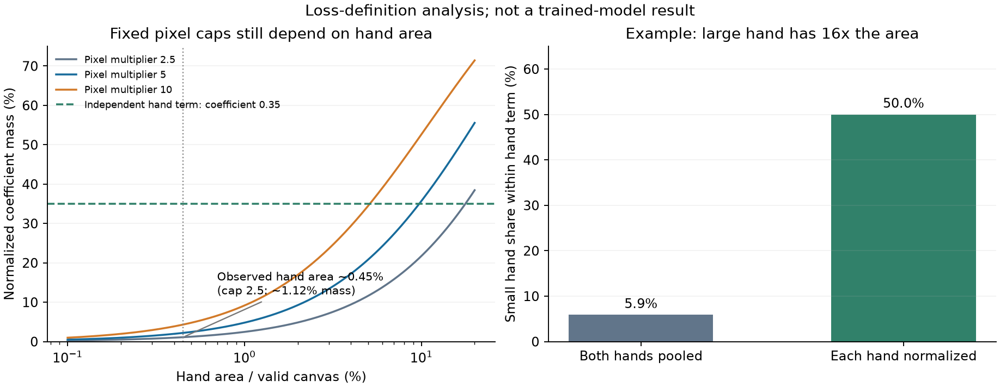

# 空间 Loss 调研：减少背景稀释，优先身体姿态与手部精度

本轮问题由用户明确为「解决背景 loss 稀释，手部和身体姿态精确」。建议把优化重点放到 **Person、Joint、每只 Hand 的独立归一化**，为各类区域设置显式系数；背景保留较小的全局与区域约束。当前证据支持开展这项实验，还不能证明它已经提高 Qwen 生成质量。

2026-11-17 完成论文原文核对、当前代码静态核查、服务器指标复算及 CPU 数学检查。没有下派 subagent，没有修改训练代码、安装包或启动 GPU 训练。工作区现有 V7 实现是另一项正在进行的改动，本报告用带 SHA256 的源码副本固定本次观察，不将它视作已经完成生产训练的模型。

## 里面有什么

- [paper-evidence.md](paper-evidence.md)：来稿 5 篇论文及补充方法的出处、公式位置、可迁移部分和限制。
- [scripts/check_loss_budgets.py](scripts/check_loss_budgets.py)：纯 CPU 的面积、每只手、置信度、padding、空区域、累积窗口与梯度冲突检查；不构造 Qwen、Adapter 或 optimizer。
- `input/downstream_comparison.json`、`input/region_loss_comparison.json`：通过 `scp` 新取回的原服务器消融指标，保留原字节。
- [output/checked-v1/checks.json](output/checked-v1/checks.json)：计算结果、输入 SHA、代码快照 SHA、Git HEAD 和采集时间。
- `output/checked-v1/source_snapshot/`：本次读取的 V6 空间 loss、V6.2 配置及 V7 loss/training 原文副本，仅作证据，不用作训练入口。
- `.gitattributes`：禁止 Git 转换输入和源码证据的换行符，确保重新 checkout 后仍能按原始字节验证 SHA。
- [output/checked-v1/loss_budget_comparison.png](output/checked-v1/loss_budget_comparison.png)：数学示意图，未使用训练后模型的预测结果。

## 现有证据说明了什么

服务器原实验为 `/data/shangguanrz/pic-edit-experiments/bilibili-single-spatial-train-20261115-bg035-ablation-v1/`，对照来自 `bilibili-single-spatial-train-20261108-ungated-v1`。这两组是 **Native V5 单人实验**，不能直接当作 V6.2/V7 双人实验的结果。

同为 update 10500：固定 10 对的 Body PCK@0.05 为 `0.91961 → 0.94471`；手部 15 对的 Hand MSE 为 `0.0349016 → 0.0349258`，背景 MSE 为 `0.0128082 → 0.0129697`，后者增加 `1.2603%`。背景降权有局部姿态收益，手部收益仍不足。150 条评估来自 25 对样本 × 6 个模型状态，不是 150 对独立样本。

`val_hand_active88` 的 v2 手部软 Token 面积合计 `222.7891`，有效画布面积合计 `49264`，比例 `0.452235%`；平均每对所有手部合计仅 `2.53169` 个完整 Token 的等效面积。它不是“每只手都有 2.53 个清晰手指 Token”，软区域、置信度和手数还会影响解释。

当前代码的差别也要保留：

| 位置 | 本次磁盘观察 | 对新方案的影响 |
|---|---|---|
| `native_v6/spatial_weights.py` | 先像素融合与 cap，再 area pooling；按 `C*sum(w)` 归一化 | 提高 cap 仍受小区域面积影响 |
| `native_v62/training/config.py` | Body/Joint/Hand 默认系数为 0；空间项与旧 Face/Hand 局部项互斥 | 不能把代码能力当成某次运行已启用；不直接删除互斥约束冒充新目标 |
| `native_v7/losses.py` | 已有 Person/Contact 各自的区域均值；没有逐只 Hand 独立项 | Person loss 内的小手仍然按面积占比贡献 |
| `native_v7/training.py` | Person/Contact 的附加项除以 `counts['velocity']` | 稀有区域可能还被无该区域的 micro-step 稀释 |
| `native_v5/losses.py` | 旧局部 Hand 合并多只手后归一化 | 大手会在 Hand 项内部压过小手；其 mask 也不同于 v2 粗可见区域 |

源码快照是静态观察，不是对全部 V7 实现的验收。本轮没有改动上述文件。

## 为什么提高 cap 不能充分解决问题

设手部占有效画布比例为 `r`，手部权重为 `k`、其余全部为 1。在误差相同的理想情形，手部所占归一化系数质量为：

`s_hand = k*r / (1-r+k*r)`

取 `r=0.0045`：cap=2.5、5、10 分别仅有 `1.117% / 2.210% / 4.325%`。想得到 20% 需要 `k≈55.31`。实际非手部还有 Body/Joint 加权，手部软权重也不一定达到 cap，所以此例不能当作实际梯度份额。

两只手面积比为 1:16 时，合并两手后归一化，小手只占 Hand 项的 `5.88%`；先对每只手归一化再平均，小手占该项的 `50%`。这是 loss 定义的性质，不等于小手姿态误差会减少 50%。



图中的 0.35 是独立 Hand 项的标量系数。Person/Joint 与 Hand 重叠会额外贡献；真实参数梯度还受误差、网络 Jacobian、冻结范围和梯度方向影响。

## 建议目标：先确定监督分配，再研究动态权重

沿用当前 Rectified Flow 的目标与概率路径：`z_sigma=(1-sigma)*z_GT+sigma*noise`，`v*=noise-z_GT`。Source 是条件，不直接替换目标图背景的 velocity。定义每 Token 的通道平均误差 `e_n=mean_c((v_pred-v*)²)`。

对人物、关节邻域、每只手分别构建固定的可见监督支持 `m_r`，面积为 `A_r=sum(m_r)`，采用：

`L_r = q_r * sum_n(m_r,n * e_n) / max(A_r, tau_r)`

- `q_r` 是整个 ROI 的可靠性，乘在区域均值**外面**；可靠性不能由可训练预测自己决定，否则存在缩小监督以降低 loss 的路径。
- v2 粗手区的 `.65` 是生成策略规定的幅度上限，不是经过校准的正确率。不能直接把它解释成“65% 可信”；新的 `q_r` 要有明确的可见性、标注质量或条件资格定义。
- `tau_r` 是以完整 Token 为单位的软面积下限。`tau_hand=0.5` 只作为待检验起点，不是已有论文给出的 Qwen 最优值。面积高于下限时消除面积稀释；面积极小时有意减弱监督，限制单 Token 梯度。
- 空区域返回带梯度的 0，不填假 ROI。有效性、可靠性与实际条件是否存在分别记录；粗可见手区不能证明精细手指几何可信。
- 检查软面积及有效支持数，不能只统计 `mask>0` 的格子。CPU 反例：20 个值均为 0.001 的格子，有效支持数为 20，但总面积只有 0.02 Token。
- 已含 coverage 的区域不重复乘 padding。对部分覆盖 Token，`m*e` 和 `m²*e` 是不同的目标。
- **RGB/velocity 监督只覆盖可见人物。** 遮挡投影可作条件，不能拿被 A 遮住的 B 区域，直接监督成 B 的可见纹理。

单人使用至多 2 只手，双人使用至多 4 只手。每图内部先对有效人物/手分别平均；累积窗口再对拥有该类有效区域的图求平均。区域可靠性留在均值外侧，不用 `sum(q)` 再归一化掉绝对可信程度。若整个窗口没有某区域，该项为 0，并记录有效计数。

这一顺序同时解决两种稀释：面积稀释，以及“4 个 micro-step 只有 1 个有效手区，却仍除以 4”的出现频率稀释。它还避免把一张有 4 只手的图自动赋予另一张只有 1 只手的图 4 倍权重。现有旧 `hand_area` 不能代替新逐手 mask 的实际资格计数。

第一版可比较如下**待验证的工程起点**：

`L = 0.10*L_global + 0.30*L_person + 0.15*L_joint + 0.35*L_hands + 0.10*L_background`

`L_person` 对每个可见人物独立平均；`L_joint` 对可靠身体关节邻域归一化；`L_hands` 按上面的逐手和逐图顺序求均值。Joint/Hand 与 Person 重叠是有意的附加监督，要在报告中计算实际有效系数图。背景项先只用同一合法 GT/同一 Canvas 的速度目标。

这些系数不是“35% 的参数梯度给手”。在所有区域均有效、置信度为 1、背景占 82.81% 的简化示例中，背景的总系数质量约为 `0.10 + 0.10*0.8281 = 18.281%`，还不是 10%，因为 Global 项也覆盖背景。有效 ROI 数、软面积下限和置信度变化时，目标总尺度也会变，必须记录，不能把它当成固定梯度预算。

Joint 项用于避免整个 Person loss 主要优化衣服纹理。它仍然是速度误差，不直接等同于 PCK/OKS 目标。HumanSD 的热图方法提供相关依据，但其原方法使用误差图与姿态估计器，且训练的是 SD UNet；这里的低成本 GT Joint 邻域是我们的改编，不能称作复现。[HumanSD §4.2、Table 2](https://openaccess.thecvf.com/content/ICCV2023/papers/Ju_HumanSD_A_Native_Skeleton-Guided_Diffusion_Model_for_Human_Image_Generation_ICCV_2023_paper.pdf)

### 三个不能省略的检查

1. **置信度是否真的生效。** CPU 检查中，将整区 mask 乘 0.1 后，区域均值仍为 `3.66667`；在均值外乘 0.1 后才降到 `0.366667`。
2. **区域项是否在争夺同一组参数。** 每隔固定更新，在相同的共享可训练参数子集上记录 Global/Person/Joint/Hand/BG 的梯度范数与余弦。不同模块的范数不能直接相除后声称某项占比。若冲突持续，再比较 GradNorm 或 PCGrad；它们是多任务优化方法，不是现成的 Qwen 空间 loss 配方。[GradNorm](https://proceedings.mlr.press/v80/chen18a.html)、[PCGrad](https://proceedings.neurips.cc/paper/2020/file/3fe78a8acf5fda99de95303940a2420c-Paper.pdf)
3. **Token 分辨率是否限制手指信息。** 当前平均 2.53 的手部软 Token 面积提示需要同时看清晰度与实际手指可辨识性。提高权重无法创造缺失细节；必要时把更高分辨率或局部 crop 训练作为独立实验。改变 Canvas/裁剪必须重建对应条件和冻结缓存。

## 实验怎么安排

先做同一架构、同一父 checkpoint 的两组主实验：当前 Weighted FM 与上述区域目标，各 2000 updates、3 组配对训练 seed。第一轮直接改变目标结构，学习率、路由、解冻策略、条件生产版本、更新预算和生成设置沿用同一个对照配置。任何梯度规模校准都在训练前记录，不中途静默调参。V5 结果用于形成假设，不能与另一架构 V7 的结果直接作因果比较。

训练前用代表性 Body/大手/小手/遮挡/无手样本检查真实前反向和区域资格。对于总梯度失衡或错误 mask，先修正并冻结配置，再启动训练。最终 loss 和区域 loss 口径固定；不能直接拿新训练目标的标量与旧标量比高低。

评估优先 Body17/Arm6/Wrist2 的 PCK@0.02、PCK@0.05 与像素或 bbox 归一化关键点误差，以及每只 Hand21 的 PCK@0.02、可检测率、失败率。像素 MSE、身份相似度与背景 LPIPS/PSNR 是辅助和回退检查，不替代姿态精度。

### 用户确认的验收取舍（2026-11-17）

用户选择「姿态优先，允许背景小幅退化」。模型选择先比较身体与手部姿态，再检查背景回退范围；全图 MSE 最低不作为主要选择依据。

- **主要收益**：身体、手部的配对姿态指标和生成图检查共同评估；报告可检测率与失败率，不通过丢弃失败样本改善平均误差。一项改善、另一项退化时分别列出，不能合成一个总分掩盖取舍。
- **背景容许范围**：允许小幅退化，具体定量阈值尚未设定。用基线多 seed 的波动及固定样本可视检查确定范围，在查看候选结果之前写入运行配置/验收记录。背景指标只在有可信、对齐参考的区域计算；明显残影、错误人物残留或大范围场景变化仍需单独记录。
- **比较方式**：保留当前初始 loss 系数，先通过区域与有效窗口归一化提高姿态监督份额。最终报告并列展示姿态收益和背景代价，不以新旧训练目标的标量大小决定优劣。

固定验证视频与样本后再看候选输出。已有 88 对手部活跃、90 对非活跃样本可作起点；姿态难例、遮挡、小手按事先规则分组。按原视频与 seed 报告配对差异；不把一个视频的很多帧当成独立样本来夸大确定性。多个 seed 既要覆盖训练 seed，也要在相同生成 seed 下做成对比较。test 不用于调系数或选更新点。

主实验有收益后，补 `去掉 Hand 项` 与 `去掉 Joint 项` 两个消融定位贡献。cap=10 可作为成本允许时的额外对照。Sigma-aware 系数留到固定区域目标有结果后：Min-SNR 支持研究时间步冲突，但其 DDPM 参数化的权重不能直接照搬到当前 RF velocity 上。[Min-SNR](https://openaccess.thecvf.com/content/ICCV2023/html/Hang_Efficient_Diffusion_Training_via_Min-SNR_Weighting_Strategy_ICCV_2023_paper.html)

跨背景训练另立协议：目标人体背景不同的 pair，不能同时要求全图 GT 背景重建和 Source 背景像素不变。保留区还应排除 Source/Target 人体并集的膨胀区域，并考虑相机变化、遮挡与配准。MaskFlow 提供一致修改概率路径和采样的参考，不能只摘取其背景速度目标替换当前 loss。[MaskFlow §4.1](https://arxiv.org/html/2608.06929v1#S4.SS1)

## 如何复算与使用

在仓库根目录运行，`--output-dir` 必须是新目录：

```powershell
python research/spatial-loss-region-budget-20261117/scripts/check_loss_budgets.py `
  --output-dir research/spatial-loss-region-budget-20261117/output/recheck-20261117
```

脚本在断言通过后生成 JSON、图和当时源码 SHA。它证明 loss 定义的数学性质与已保存指标可以复算，**不证明目标函数已接入训练或生成质量已改善**。训练接入应据此增加带版本的区域支持契约、有效窗口计数、loss 配置与真实梯度检查，再建立独立运行目录。

本专题上游是用户来稿、原论文、V5 的 bg035 消融与当前 V6.2/V7 草稿；下游是下一版可选区域目标的实现与实验设计。它不替代 V7 架构开发，也不把本目录源码快照作为正式训练入口。
