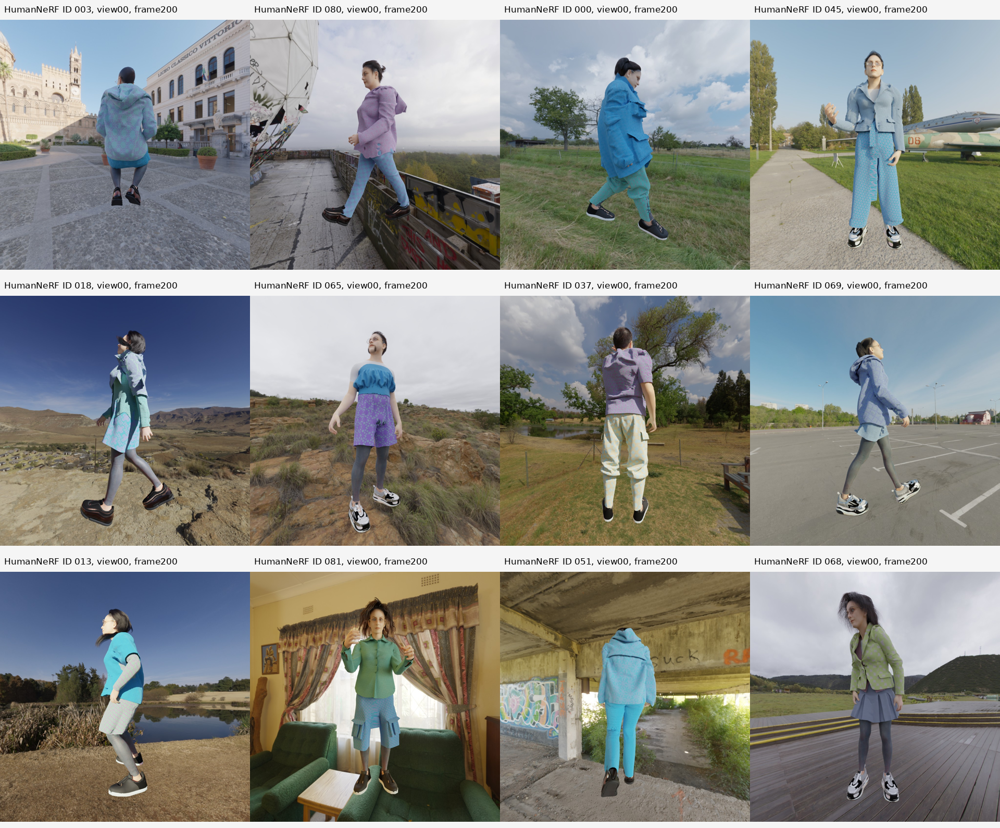
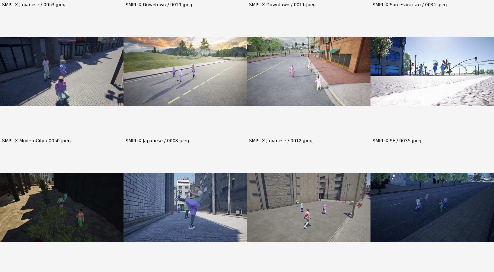
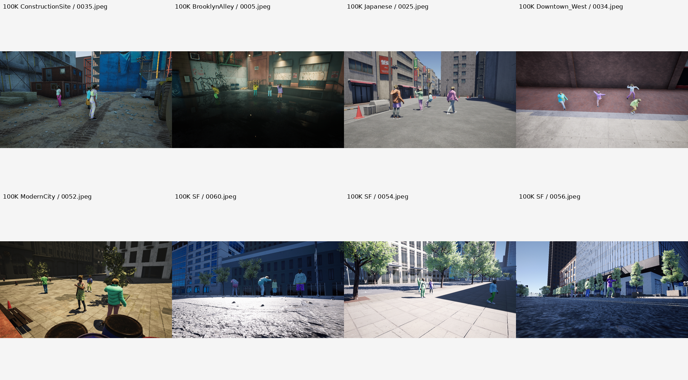

# SynBody 视觉质量复核

日期：2026-10-03。复核起因：用户指出 028/042 图板中的 A 人物与室内场景明显不贴合。

## 修正结论

用户指出的问题成立。该样本 A/C 的脚与地面缺乏可信的接触关系，接触阴影不足，人物材质、轮廓和环境融合不自然。它满足几何参数配对，却不满足本项目“日常人物照片”的视觉要求。**本组三元组不作为高真实感 RGB 监督样本。**

此前把“参数配对成立”进一步解释为“适合 Adapter 预训练”，证据不足。HumanNeRF 暂用于几何和输入边界调试；其他子集继续筛选，不能因为它们也有准确标注而自动放行。

## 原始数据追溯

比较压缩包 `HumanNeRF-subset/img.zip` 内 `028/img/00/0200.jpg` 与解压文件，两者逐字节一致：

```text
SHA256 = a1879b0ddeec1a3729a93754a5f65523928cee02b87633095d56ae74df6fa09e
```

图板只是对原始 RGB 缩放、排版、加文字。该违和感存在于原始数据，不能通过更换图板标签或尺寸解决。本轮没有修改人物、添加阴影、替换背景，也没有把修图结果当作真值。

当前未取得这组图像的原始渲染工程。环境贴图、地面几何、阴影设置等具体成因未被证实，不能把“看起来像贴到背景上”说成已确认的官方制作方法。

## 有限抽样

固定随机种子 `20261003`，样本选择写入 `visual_quality_20261003/sampling_manifest.json`：

| 子集 | 抽样 | 视觉观察 | 本次决定 |
|---|---|---|---|
| HumanNeRF | 另外 12 个人物，均为相机 00、帧 0200 | 多个样本有明显悬浮感、接触阴影不足；有的人物与栏杆、家具等场景的接触关系不合理 | 暂不作为高真实感 RGB 主监督 |
| SMPL-X subset | 8 个随机 RGB 帧 | 地面和阴影的衔接相对更好；仍有 CG 材质、人物很小、过曝或遮挡的问题 | 保留候选，逐人物裁剪后再审查 |
| SynBody-100K | 每个 RGB 压缩包抽 2 张，共 8 张 | 部分图有明确地面阴影；仍有明显 CG 外观及人物分辨率不足 | 保留几何用途，不自动认定为真实照片训练合格 |

这只是 **28 张图像的定性抽样**，未覆盖全部视角、帧或身份；没有计算全量合格率，也没有通过训练实验验证域差异的影响。以下图板为原始图像缩放排版，不是模型生成结果。

### HumanNeRF：12 人抽查



### SMPL-X subset：8 帧抽查



### SynBody-100K：8 帧抽查



## 对本项目的具体含义

- A 要是日常人物原图，人物、服装和环境的融合质量也必须满足要求。用渲染人物代替，需要单独标为合成域并通过验收。
- C 要监督真实人物编辑，就不能仅有正确骨架，却在落地、阴影和外观上明显失真。否则训练目标本身与产品需求不一致；实际训练影响尚未测量。
- B 只用于姿态参考时，合成数据的关节旋转、体型参数和关键点仍有价值。RGB 质量差不等于这些标注失效。
- 裁剪人物或移除背景不能补回真实皮肤、衣服纹理和人物场景关系，不把这种操作当作真实性修复。
- 自建合成配对需要显式处理地面、相机、落地/接触、遮挡和阴影，并审查脸与衣服的细节。当前只有资产和参数，不代表这条渲染生产线已经完成。

## 已落实的更正与使用

`example_ABC.json` 与其生成脚本 `verify_triplet.py` 已增加独立的质量记录：

```json
{
  "geometry_pairing_valid": true,
  "eligible_for_photoreal_rgb_training": false,
  "status": "rejected_for_photoreal_rgb_supervision"
}
```

这只是审计标记；示例格式没有接入现有训练 loader，不声称所有训练入口都已实现自动拦截。本轮没有启动训练。

在远端检查：

```bash
ssh sg
cd /data/shangguanrz/pic-edit-datasets/SynBody/inspection_20261003
/home/shangguanrz/nihaochen/envs/qwen21/bin/python verify_triplet.py
```

预期几何检查全部通过，同时 `eligible_for_photoreal_rgb_training` 为 false。抽样记录及图板位于同目录的 `visual_quality_20261003/`。

重新生成同一批抽样：

```bash
/home/shangguanrz/nihaochen/envs/qwen21/bin/python audit_visual_quality.py
```

查看原始 A：`extracted/HumanNeRF-subset/028/img/00/0200.jpg`。旧报告的结论与复现说明已同步修正。
