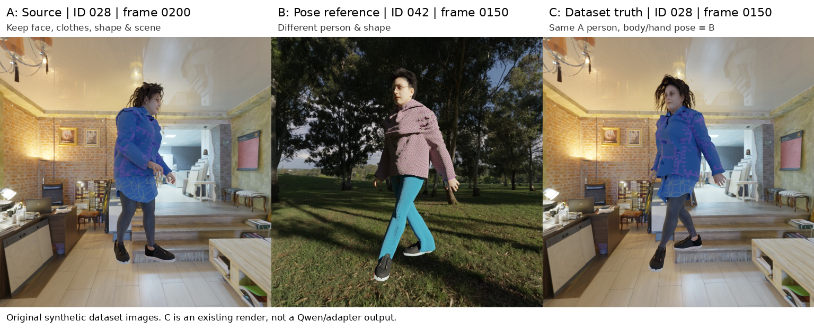

# SynBody 对人物跨身份姿态迁移的适用性

检查日期：2026-10-03。远端：`ssh sg`，主机 `node01`。

## 结论

**视觉质量复核后修正：028/042 的几何配对成立，但 RGB 不满足本项目“日常人物原图、人物自然融入场景”的要求，当前不作为高真实感 RGB 训练样本。HumanNeRF 暂仅用于几何链路调试。** 此前仅凭姿态参数配对便推荐用于 Adapter 预训练，判断过宽。

本地数据确实具有跨人物姿态匹配，但还需要独立的图像质量验收；它不直接提供任意真人日常照片 A 对应的新姿态真值 C。[新增视觉质量复核与 28 张抽样图板](SynBody视觉质量复核.md)。

SynBody 官方使用带衣服、头发、纹理的 SMPL-XL 人物进行动作重定向和渲染，SMPL-X 是人体参数标注。官方完整数据规模与本次实际下载子集的规模不同。参考：[官方项目](https://synbody.github.io/)、[论文](https://arxiv.org/html/2303.17368v2)、[发布目录](https://huggingface.co/datasets/caizhongang/SynBody/tree/main)。

## 1. 已确认的 A/B/C 实例

| 角色 | 人物 | 相机 | 帧 | 用途 |
|---|---|---|---|---|
| A | 028 | 00 | 0200 | 源人物、衣服、体型、场景 |
| B | 042 | 00 | 0150 | 另一个人物的姿态参考 |
| C | 028 | 00 | 0150 | A 人物在参考姿态下的已有渲染真值 |



图中的 C 是数据集原有 RGB，**不是 Qwen 或 Adapter 输出**。A/C 外观来自同一个序列，B 是另一个人物、另一套衣服和场景。**本组三元组已标记为真实感 RGB 监督不合格：脚与场景接触、阴影和材质融合不足。下列检查只证明几何配对，不证明图像真实感。**

实际检查结果：

- 028/042 的 300 帧 `body_pose`、左右手姿态和 `global_orient` 逐元素完全相同，最大差值为 0。
- 两人的 `betas` 不同，参数向量 L2 距离约为 3.98449。此值用于证明参数不同，不等于身高或体型误差的物理单位。
- 两人的 `transl` 不完全相同，整个序列的最大单分量差约为 0.02477。因此不能把相同关节旋转解释为相同屏幕像素坐标。
- 源帧 0200 与目标帧 0150 的身体姿态不同。
- 三张 RGB 和三张 mask 均存在，均可正常解码；RGB/mask 分辨率均为 1024×1024，mask 为灰度前景掩码。
- `verify_triplet.py` 的六项检查全部通过，生成 `example_ABC.json`。源、参考与监督目标分别存放，目标 RGB 没有放入源或参考字段。

遍历 HumanNeRF 的 100 个序列后，只有 028/042 这一组完整身体姿态序列具有相同的精确哈希。这不排除其他序列中存在相近或局部重复的姿态，但不能将全部 100 人任意组合为精确配对。

## 2. 本地压缩包结构与数量

原始数据根目录：

```text
/data/shangguanrz/pic-edit-datasets/SynBody/
├── HumanNeRF-subset/
│   ├── img.zip
│   ├── mask.zip
│   ├── camera_params.zip
│   ├── smplx.zip
│   └── smpl.zip
├── SMPL-X_subset/
│   ├── Synbody_v1_0_sampled.zip.001 ... .006
│   ├── Synbody_v1_0_sampled-smplx.zip
│   ├── Synbody_v1_0_sampled-smpl.zip
│   └── visualize_2d.py
├── SynBody-100K/
│   ├── S100K_rgb_part_1.zip ... part_4.zip
│   ├── S100K_mask.zip
│   └── S100K_SMPL.npz
├── Assets/
│   └── SMPL-XL-{100,1000}-{fbx,obj,meta}.zip
├── whac_a_mole/
│   ├── images/DuetDance-20240218-{000,001,002}.tar
│   └── annotations/*.npz
└── not_ready/pretrained_models/
```

本地原始文件总量约 378.41 GiB。下面的数量来自本地压缩包目录与标注，不能替换为论文中完整数据集的数量。

| 子集 | 本地实际内容 | 与本任务的关系 |
|---|---|---|
| HumanNeRF | 100 个序列，每个 8 视角×300 帧；240,000 张 RGB、200,800 张 mask；100 份相机/SMPL-X/SMPL 文件 | 先做几何配对调试；抽样的人景融合不足，暂不作为真实感 RGB 主监督 |
| SMPL-X subset | 164,298 张 JPEG，4,000 个相机序列，16,000 份有效人物 NPZ；提供 144 点的 2D/3D 关键点 | 更多人物和姿态；多人物遮挡、朝向、裁剪与帧对齐需要检查 |
| SynBody-100K | 91,242 张 RGB，91,242 张 EXR mask，105,192 条人物 SMPL 标注 | 主要用于人体几何；不能把 105,192 条标注当作独立 RGB 数 |
| Assets | 100+1,000 个 FBX/元数据；对应 OBJ 合计 1,097 个，含材质和纹理 | 可重新定义人物身份、服装、体型并构造渲染配对 |
| whac_a_mole | 3 个 tar，每个 100 个 MP4，另有 3 份 NPZ | 是额外的视频子集，本轮仅核对包结构，未完成三元组适用性审计 |
| not_ready | 若干预训练模型权重 | 不作为训练样本 |

SMPL-X 分卷是一个按字节拆分的 ZIP。检查时使用跨分卷随机读取，成功读取并校验了样例 RGB；不能把每个 `.001/.002` 当成独立 ZIP。此轮没有对这 164,298 张 RGB 做全量解压或逐文件完整性验证。

## 3. 已完成的解压

解压目录：

```text
/data/shangguanrz/pic-edit-datasets/SynBody/inspection_20261003/extracted/
├── HumanNeRF-subset/              # 完整解压
│   ├── 000/
│   │   ├── img/00/0000.jpg ... 0299.jpg
│   │   ├── img/01/ ... img/07/
│   │   ├── mask/00/0000.png ... 0250.png
│   │   ├── mask/01/ ... mask/07/
│   │   ├── camera.json
│   │   ├── smplx.npz
│   │   └── smpl_refit.npz
│   └── ... 099/
├── SMPL-X_subset/synbody_v1_0/     # 16,000 份有效 SMPL-X NPZ
└── Assets/
    ├── 100/                      # 全部 100 份 meta；3 人的 FBX、OBJ和纹理
    └── 1000/                     # 全部 1,000 份 meta
```

共写入 458,276 个文件，磁盘占用约 48 GiB。解压状态为 `complete`，各计划条目全部完成，读取时检查 ZIP CRC；没有覆盖既有数据。100K 图像、SMPL-X 分卷图像、其余大资产包及 WHAC 视频保留压缩状态。

## 4. 你需要的输入，哪些已经具备

| 输入 | 下载内容中是否现成提供 | 处理方式 |
|---|---|---|
| RGB_A / RGB_B / RGB_C | 有 | 按人物、视角和帧索引取图 |
| SMPL-X_A / SMPL-X_B | HumanNeRF 和 SMPL-X subset 有 | 使用发布参数；检查坐标约定和帧索引 |
| DWPose_A / DWPose_B | 没有预计算文件 | 在 RGB 上运行已有 DWPose；144 点标注不能直接当作 DWPose 的通道布局 |
| Mask | HumanNeRF 有灰度前景 mask；100K 有 EXR mask | 本轮检查确认的 HumanNeRF mask 是前景，不是语义 parsing |
| Depth / Normal | 当前包里没有逐帧深度、法线控制图 | 用 SMPL-X+相机渲染身体几何，或用完整带衣服资产重新渲染 |
| Parsing | 没有现成的人体/服装语义 parsing | 用解析模型预测，或在自建渲染中输出材质/部位标签 |

裸 SMPL-X 渲染的 depth、normal 和 mask 描述人体表面，不包含衣服厚度、裙摆、头发、鞋和环境几何；不能把它们称作原始 RGB 的精确深度或衣服轮廓。资产纹理中的 `skin_normal.png` 等也不是逐帧相机视角的 Normal 控制图。

论文描述的渲染系统能够输出 depth/normal/flow，不等于这次发布和下载的所有子集都包含这些文件。[论文的 Rendering and Annotations 与 Human Neural Rendering 部分](https://arxiv.org/html/2303.17368v2)。

## 5. 构造训练样本的建议

目标人体几何应遵循：

```text
目标关节旋转 θ_target = B 的姿态（对齐朝向与坐标后）
目标体型 β_target     = A 的体型
目标外观              = A 的 RGB / 人物资产
目标相机与场景        = A 所在画面的相机与场景
```

不要直接让 B 的体型参数或完整 depth 主导输出。不同体型下，相同关节旋转会产生不同的骨长和 2D 投影；要保留 A 的体型，应根据 `β_A + θ_B` 重投影关键点、渲染控制几何，并处理根位移、落地和场景位置。即便给模型保留原始 DWPose_B，也需要明确它是参考，不能要求它的所有像素坐标与保留 A 体型后的输出同时完全一致。

建议分两步：

1. **已有数据验证。** 使用 028/042 调试几何配对和输入边界，保持 `eligible_for_photoreal_rgb_training=false`；更大子集中的匹配候选需要经过可见性、相机、朝向、帧映射和视觉质量检查后再使用。
2. **扩充严格监督。** 用已发布的 SMPL-XL 资产定义 A/B。固定 A 的人物资产、材质、体型、相机、灯光和场景，分别用 θ_A、θ_B 渲染 A、C；另用 B 的资产渲染姿态参考。这样可以主动控制衣服和体型差异。官方工具 [XRFeitoria](https://github.com/openxrlab/xrfeitoria) 支持 Blender/Unreal 渲染，但本轮未安装引擎、未完成动画重定向或新图渲染。

训练划分应按人物身份、动作来源/片段划分，并把同一动作的不同人物或相机关联起来检查，避免相邻帧、同姿态副本跨入测试集。现有 Qwen 512 输入需要统一缩放/填充，并同步变换关键点和相机内参。

## 6. 已发现的具体限制

- **Mask 缺帧：** HumanNeRF RGB 为 0000–0299，而 mask 只有 0000–0250；后 49 帧不能当作有发布 mask 的样本。
- **长度元数据过期：** 100 份 HumanNeRF SMPL-X 文件中的 `__data_len__` 都与实际 300 帧数组不一致。应读取数组长度并验证 RGB 对齐。
- **初始姿态：** 预览的部分早期帧为 T-pose，不能把这类帧当作自然日常姿态；最终示例选择源帧 0200。
- **标注备份：** SMPL-X ZIP 另有 711 个 `.npz~时间戳~` 备份文件；本次全部排除。
- **候选不是已验收样本：** 去重相机目录后的身体姿态精确哈希，发现 757 组序列在不同 `betas` 下重复。只检查了身体局部旋转，不意味着 757 组的朝向、相机、位移、可见性均合格。第一组抽查的左右手参数也相同，但全局朝向和位移不同。
- **资产对应关系：** 1,100 份资产 meta 与 100 份 HumanNeRF `betas`，在 L2 < 1e-5 的条件下没有精确匹配。不能假设下载资产能直接重渲染 HumanNeRF 的原人物；即使仅体型匹配，也不足以证明脸、衣服、头发一致。自建严格三元组应使用明确的资产 ID 新建身份集合。
- **动画尚需补齐：** 抽查的 FBX 含骨骼、Skin/Cluster、材质和纹理标签，没有 AnimationStack/AnimationCurve；本轮没有验证导入引擎或驱动动画。OBJ 是 T-pose 网格，不能只改 SMPL-X 参数就自动得到带衣服的人物 RGB。
- **真实域仍需验证：** 这批是合成人物及场景。真实照片的脸部与衣服细节保持，需要继续使用真实单人数据验证，不能用合成 RGB 重建效果替代。

## 7. 查看与复现

在本地执行：

```powershell
ssh sg
```

登录后执行：

```bash
cd /data/shangguanrz/pic-edit-datasets/SynBody/inspection_20261003
/home/shangguanrz/nihaochen/envs/qwen21/bin/python verify_triplet.py
cat example_ABC.json
cat extraction_status.json
```

预期：六项 `geometry_checks` 为 true，解压 `state` 为 `complete`，但 `quality_gate.eligible_for_photoreal_rgb_training` 为 false。这表示几何配对有效、图像未通过真实感验收。图板：`preview/ABC_028_042.png`。

重新计算标注统计：

```bash
/home/shangguanrz/nihaochen/envs/qwen21/bin/python analyze_annotations.py
```

主要交付文件：`archive_inventory.json`、`annotation_audit.json`、`asset_mapping_audit.json`、`example_ABC.json`、`extraction_status.json`、`verify_triplet.py`、`analyze_annotations.py`、`extract_relevant.py` 与图板。本轮只完成数据检查、相关子集解压及样本验证，没有启动 Qwen 训练，也没有把示例格式接入现有训练 loader。
