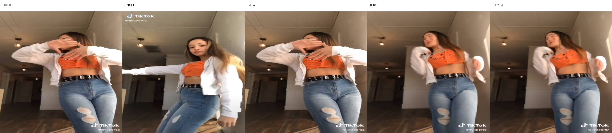

# TikTok 完整版 Qwen 2.1 训练链路检查与交付

检查与修改时间：2026-10-03；实际主机：`ssh sg`；GPU：RTX 6000D，约 84 GiB。
项目基线 HEAD：`b1a00c2a3b2955779af40ab19b5bab71ac19539a`。
远端输出：`/home/shangguanrz/nihaochen/tiktok_qwen21_full_20261003`。

## 结论

**训练链路已打通，适合小规模试训，暂不适合直接大规模长训。**

数据池、计算资源和 Body 条件具备试训基础。完整版 Body→Face 的真实前向、反向、更新、保存、恢复和
完整采样均已验证。生成质量仍未达到目标姿态准确、人脸明显改善的标准；全量 Face 缓存尚未提取。
建议先进行 100–300 步的 Body 验证，检查固定验证集的姿态、身份、服装和背景，再逐步放开 Face。

## 数据评价

| 项目 | 实际核实结果 |
|---|---|
| 严格筛选清单 | train 8,574 / val 1,120 / test 1,156 对 |
| 实际有配对的序列 | train 223 / val 28 / test 29 |
| 原视频组 | 20 / 3 / 3，组和序列交叉均为零 |
| 关键资产 | 280 个序列均有 v6 conditions、SMPLest-X params 和 part 目录；目标帧所需文件完整 |
| 身体关键点可见性 | 原清单共 36 对少于 8 个可见点；本次从 train/val 排除 26/8 对，test 未改动 |
| 实际 Body 训练清单 | train 8,548 / val 1,112 对 |
| 关键点重投影抽检 | 10 个序列、30 帧，缓存与修正后的具名 SMPLest-X 投影完全相同 |
| 视觉筛选 | 既有严格筛选保留 5,440 帧；检查了已有 24 对的 RGB/pose/normal 对照图 |
| Face 全量可用性 | 尚未建立完整 ArcFace/DINO 缓存；原简化版缓存不能直接用于完整版 |

既有严格筛选排除了全局、脸部、手部模糊的并集 1,469 帧。该工程筛选和原视频组隔离有助于降低数据问题，
但不等于对所有身份、遮挡和细节作了人工认证。部分画面为半身或下肢出界，应按可见部位评价姿态。

## 修复的断点

1. `QwenFullDataset` 原来固定按 iPER 结构读取，无法接入 TikTok v3；现在自动识别或显式选择数据类型，
   保留真实 Source/Target 路径与来源元数据。
2. TikTok loader 原来允许缺条件后静默生成零关键点和替代 part；完整版开启严格条件检查。
3. Face 条件与辅助监督原来用 `source_stem` / `target_stem` 判断元数据是否已转换，遇到 TikTok 原生字段时报错；
   现在按明确的 Source/Target appearance 字段识别。
4. 原有简化版 Face 缓存只有身份向量和 RGB crop，缺少完整版 DINO patches 和 72 点几何；新增完整缓存准备入口，
   仅从 Source 提取身份/纹理，Target-only 记录保持零特征。
5. Face 缓存加载增加形状、内容指纹和几何有效性的一致性检查。
6. 原生缓存预计算不再逐个重复配对构造全部 body heatmaps，而是按唯一图片和 Source/Target 角色编码。
   测试确认预处理像素与训练读取一致。
7. 增加学习率缩放，保持三组比例并校验非法数值、恢复时配置；短任务的 `--verify-resume` 也会执行，
   修复了此前固定只在第 21 步验证的行为。
8. 推理入口接入同一 TikTok 数据接口；启动脚本固定 sigma 推理进度和 checkpoint Face grid，避免旧默认调度差异。

保留的 47 个原始 adapter 核心文件未修改，等价与哈希回归均通过。
本地补齐了远端已有的完整命名空间，并同步本次修改；既有未提交工作未被回滚或批量提交。

## 实际训练与恢复证据

实际使用 4 个训练对、2 个验证对，训练和验证来自不同原视频组；两侧各只覆盖一个视频组。
这是工程连通性验证，不能据此推断跨组泛化。原始数据和已有 checkpoint 均未覆盖。

| 运行 | optimizer 更新 | 固定噪声 loss：前→后 | 显存峰值 | 结果 |
|---|---:|---:|---:|---|
| Body | 3（2＋恢复 1） | 0.2142 → 0.2099 | 约 21.0 GiB | 三个参数组均有梯度，冻结参数保持不变 |
| Face 原学习率对照 | 2 | 0.4366 → 2.7922 | 约 23.6 GiB | 明显退化，不作为建议配置 |
| Face 低学习率 | 4（2＋恢复到 3、4） | 0.4366 → 0.4397 | 约 23.6 GiB | 链路稳定，尚未证明训练收益 |

Face 采用 ROI flow、规范化 evaluator 输入和五点辅助对齐。低学习率运行第一步身份/感知损失到输出接口的
梯度范数分别约 16.47 / 7.88；第二步起 Face 编码器和控制核心也有非零梯度。
第一次只有输出接口梯度符合初始 Face bridge 为零的结构，而不是上游断梯度。

Body 第 3 步、Face 第 4 步的保存重载均确认参数和 optimizer 内容相等，恢复了 RNG。
另有独立进程从已有 checkpoint 继续实际更新。未宣称 CUDA 后续更新逐 bit 确定性。
证据详见 [verification.json](verification.json)。

## 完整生成与质量限制

一个未训练的验证对，固定 seed，相同 512 分辨率，initial / Body / Body＋Face 各完成 30 步。
全部 32 个 transformer block 的注入次数均为 30；未将 Target RGB 或其外观特征输入生成条件。
为公平比较，Body 采用 Face 初始化时对应的第 2 步 Body checkpoint。

| 模式 | PSNR | SSIM | 人体 MAE |
|---|---:|---:|---:|
| initial | 11.45 | 0.578 | 70.73 |
| Body | 12.15 | 0.545 | 66.20 |
| Body＋Face | 12.15 | 0.545 | 66.21 |

像素指标互有变化，不能据此判定姿态或身份已合格。观察图中 Body 有改变姿态，但伸臂和头部状态未准确跟随
Target；Face 结果与 Body 几乎相同。该验证 Source 脸部还有手遮挡，进一步说明检测通过不等于干净的 Face 参考。
尚需更多独立验证样本及姿态/身份指标。此次也未验证 Hand、Detail、Interaction 的训练。



## 如何测试与使用

完整操作命令见 [训练使用说明](../../docs/tiktok_qwen21_full_training.md)。最直接的重新验证命令：

```bash
ssh sg
cd /home/shangguanrz/project/pic-edit
bash scripts/run_tiktok_qwen21_full.sh smoke \
  /home/shangguanrz/nihaochen/tiktok_full_my_smoke
```

使用新的输出目录。`smoke` 包含训练、独立进程恢复与完整采样；`prepare` / `body` / `face-prepare` / `face`
提供后续独立 pilot 的入口。第一次 full-data 原生缓存和 Face 提取需额外时间，已交付的小样本缓存仅覆盖 4/2 对。

本次远端 **188 项相关回归通过**，本地 20 项新增测试通过；Python 编译和 shell 语法检查通过。
Windows 可执行 [verify_remote.ps1](verify_remote.ps1) 复测。底层 SWIG 弃用警告保留在测试日志中。

Source-only Face 缓存可按相同参数续做序列提取，输入变更会拒绝复用；训练恢复仍要求固定保存该缓存。
当前 checkpoint 未绑定完整 Face 缓存内容哈希，这是扩大训练前应补上的复现限制。
本次未启动正式长训，也未用单样本或几步更新宣称收敛。
