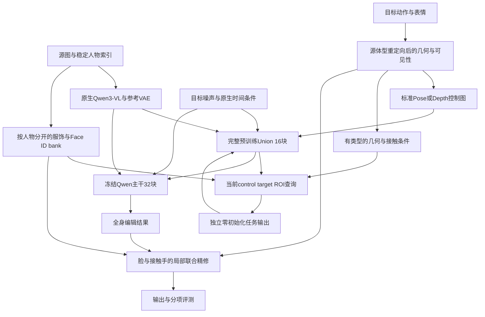

# Union 与人物 Adapter 的架构取舍

2026-10-17，基于 `ssh sg` 当前源码、checkpoint/Adam 状态、实验 JSON 和论文原文。用户选择：**效果优先，先用现有 85GB 单卡验证**。本轮产出是架构设计与证据审计，没有修改网络实现或启动新训练。下文“建议”均为待验证设计，不能读成已经达到的效果。

## 1. 推荐：以 Union 为控制骨架，迁入我们的人物任务条件

我推荐第二条路线：**完整保留官方 16 个 Qwen 原生控制块和发布权重，把我们真正有用的人物几何、身份、表情、接触条件，重新接到这条控制流上。** 第一条路线的价值在于整理并迁移已有任务模块，而不是继续保留 DeepGen 残差控制核。

最终结构是“原生 Qwen 编辑主干 + 预训练 Union 结构控制 + 人物任务条件模块 + 局部精修”。不把两个完整控制器的输出直接相加作为最终设计，也不把任务退化成一张 Pose 图。全身结构、人物外观、双人关系和小区域细节分别有可追踪的信息来源。

| 路线 | 具体含义 | 判断 |
|---|---|---|
| 按官方机制重构自有 Adapter | 保留条件前端和任务 API，把 SD3 控制核换为 Qwen 原生块；若仍采用少层/共享权重，则要重新训练或蒸馏 | 可作为轻量化后续路线；现有数据不宜先承担从头学习控制先验的成本 |
| **在 Union 上移植任务能力** | 官方 16 块、4096 维状态、原生时间/位置/attention 契约不变；新增条件融合、人物归属和 ROI 读取 | **主推。能完整使用控制预训练，同时补足我们任务实际缺失的信息** |
| 现有 Adapter 与 Union 并联 | 两套控制器都修改主干，靠尺度调和 | 可作短期对照；难以区分哪一路破坏身份，且保留旧接口负担 |

如果第一条路线最终也采用相同的 16 个原生块、加载相同 Union 权重、接入相同条件，它与第二条路线在计算图上已经合流；目录名字和类名不构成另一个算法。真正值得比较的是预训练继承、条件表示和注入机制。

设计还要覆盖任务书v3的真实验收，而非把PCK当全部目标。[原文只读摘录](evidence/task_v3_requirements.json)的XML段索引68–70要求：最终身高/胖瘦相对估计准确率≥80%，典型双人交互主观合理比例≥90%，整体编辑及接触手部细节相对Qwen-Edit基线的主观优胜率分别高于5%。因此保留独立的源体型估计/动作重定向、接触遮挡、手指结构和盲评流程。ArcFace、PCK、DINO是补充诊断，不能代替这些验收；也不能用2D像素分数声称毫米级3D准确性。本轮没有执行合同验收。

## 2. 当前证据说明了什么

官方固定源码是 VideoX-Fun `13bb3c625e8b1e457d7124d92207b49e00e4a6fe`；Union 权重 SHA256 为 `65d6b66d734da9e7ff5ef04e7db3a133553a52a3f29a7fcb3e9cce8fa21dcfcd`。当前本地 Transformer 配置为 32 层、hidden4096、32 heads×128、64 通道 VAE latent、空间下采样16。512×512 的目标是 1024 个 latent token；每个 VLM image slot 对应 4 个 latent token。[原生 Qwen 接口说明](https://huggingface.co/docs/diffusers/main/api/pipelines/qwenimage21)

Full 的实际控制核仍为 1536 维 SD3 单块递归6次，六组残差在32层重复使用。64→16 通道的 pixel shuffle 是桥接重排，不代表两个 VAE 的语义相同。轻量 Body 则逐注入层读取当前 Qwen target hidden；这个动态查询思想值得保留。证据分别见 [qwen_adapter.py:124](source_snapshot/adapter/qwen21_full/qwen_adapter.py#L124)、同文件585行、[control_core.py:296](source_snapshot/adapter/qwen21_full/control_core.py#L296)、[body_adapter.py:73](source_snapshot/adapter/qwen21/body_adapter.py#L73)。本地编辑器若不支持 `#L`，按所列行号定位。

| 现有组件 | 当前磁盘事实 | 迁移决定 |
|---|---|---|
| 单人 geometry 前端 | Body20k 的 spatial/global/person/single-geometry 参数有非零 Adam 二阶矩 | 可审计加载；仍须核对输入尺度、维度、坐标和归一化 |
| Full Body/Face | Body8548、Face3000 都有训练状态；不等于强泛化能力 | Face source content encoder 可试作初始化，旧 residual head 不硬搬 |
| 双人 contact/reasoning | Full 常用数据只装 person A，Body 参数组排除了 interaction；轻量 dual 只有一对人物的300步过拟合证据 | 复用数据契约与几何逻辑，关系编码和读取机制重新训练 |
| Detail | 默认参考特征只有 RGB 均值/标准差6维 | 不能当高频服饰纹理编码器继承 |
| Hand | 默认 BPS、depth、DINO 为零，mesh/reference validity 为 false；部分路径写死604×1080及person0 | 先补真实输入与坐标，不能把占位字段当已训练能力 |
| PersonTokenBinder | 相加 source/slot embedding，没有 hard bank isolation | 保留稳定人物索引，新增实际读取约束 |
| Contact token | src/dst人物、部位 embedding 相加，可能丢失端点配对 | 改为端点分别编码后融合，保留 `(person,part)` 配对 |

具体代码位置：`data_runtime.py:122,252,281,344`、`execution.py:407`、`joint_training.py:248`、`detail/encoders.py:155`、`token_encoders.py:78,214`，均在本目录 `source_snapshot/adapter/qwen21_full/`。非零 Adam 状态只证明历史梯度，不证明质量。

**已有质量结果不能简单归纳为“姿态网络越强越好”。** [Body20k 的50对评测](evidence/body20k_50_summary.json)中，on 的 `pose_pck_002.mean=0.98`，但身份 cosine 从 off 的0.81866降至on的0.35105，各47张检出脸。Full Face 的24对结果仅从0.43276升至0.43909；其顶层 reliable count=21、指标内部 n=22，口径还需整理。旧 PCK@.02 与下表 strict PCK 的阈值/归一化定义不同，不能横向混算。

方案A实际生成48张，当前只评估31个唯一组合，缺17项双人评估。完整的三个单人样本、两seed均值如下；DINO是身体外观代理，不是 Face ID：[生成记录](evidence/official_matrix_records.jsonl)、[指标](evidence/official_matrix_metrics.jsonl)。

| 样本 | Native strict PCK | Union0.5 | Union1.0 | Native DINO | Union0.5 | Union1.0 |
|---|---:|---:|---:|---:|---:|---:|
| hard_02 | .7500 | .8571 | .9643 | .9164 | .9077 | .5846 |
| hard_05_torso | .3889 | .3889 | .3889 | .9199 | .8943 | .5773 |
| medium_02 | .8438 | .9063 | .9375 | .9068 | .9249 | .8650 |

这支持“预训练控制可迁移，但存在姿态—外观权衡”，还不能证明新架构优于所有旧模型。Native 与 Union scale0 逐seed相同，说明接入零控制路径已成立。

方案B真实200 updates的固定flow loss由0.1598302降到0.1314015，下降17.7868%，低于原定20%门槛，队列已停止；正式512、target-only与test结果没有产生。[gate](evidence/overfit200_gate.json)、[队列](evidence/pilot_b_queue_events.jsonl)。18/18个固定位置均改善，按iPER/TikTok/Hi4D分别下降11.775%/17.772%/26.659%；只能说这组 joint/rank16/预算未过门槛，不能说 Union 结构失效、loss已平台化或身份改善。旧门槛保持失败，不改标。

另有两项历史证据须纠正：workflow 六臂的 Native baseline 是 source_person、30steps，却被按 source_torso 打分，Union 是40steps且prompt不同；其 `.3333→.6111` 不能作同条件架构收益。`bg_ssim_own` 实际是全图SSIM。Hybrid 的 output为空，mock step/offload测试也不是生成效果证据。不要据旧README里的概括作选型。

## 3. 最终计算图与五个职责



图中回路表示同一次控制链的层内读写，不是再运行一套完整 Union。新任务模块均写 target positions；原生文本、参考图、RoPE和block-causal规则保持原义。

### 3.1 几何先统一：源体型、目标动作、同一相机

对人物p，来源应明确分开：`shape_p=source betas`、`pose_p=target joints/rotations`、`expression_p=target expression`、`appearance_p=source RGB`。Global26不含完整关节姿态，不能代替目标pose。双人还要在同一camera下表达root位姿、相对深度和接触端点。

源侧单独输出shape/size estimate与置信度：由SMPL-X重建的规范姿态身高、体型描述及相机不确定性形成可复核的相对估计，再进入重定向。跨视角的图上像素高度不能直接当真实身高，β拟合也不能自充验收标签；高低/胖瘦顺序需要独立标注或可追溯真值，在留出人物上测试任务书要求的相对准确率。此模块与生成模型分开，避免生成得更像目标体型反而掩盖源体型估计错误。

先按源体型重定向目标动作，再渲染 Pose、depth、normal、part、instance owner与visibility。不同身高/臂长时，接触可能在重定向后断开，需在几何层联合调整允许的root/关节自由度，保存偏离量与求解置信度。不能把目标B的体型normal直接当成源A的目标几何，也不能认为图像网络能自动修复所有不相容的3D约束。

几何契约分三层：`driver_pose`保留原始目标动作；`requested_pose`是源体型、指定camera下尚未作接触修正的重定向请求；`solved_pose`是接触求解结果。控制图、owner与contact统一从solved生成，评测同时列求解相对requested的偏离、生成相对solved的误差，以及最终相对原请求的总偏离。初版求解固定camera和地面锚点，root修正上限为源身高5%，关节旋转修正上限5°；这是起始诊断边界，不是合同阈值，也不是已验证最优值。超限/不收敛时回退requested并标记接触约束未满足，不静默修改请求或删掉失败样本。任何调整边界只在val登记后锁定。

配对GT的flow重建训练要求监督图与使用的pose一致。未经重渲染/独立标注，不能对原target RGB套用已改变动作的solved pose再当精确配对；优先在原同人帧配对上使用无额外修正的几何，跨体型求解与非零修正另作有来源标记的验证/一致性实验。身高/胖瘦估计也单独评估，不能由目标pose变好推断β估计准确。

现有数据已具备起点：iPER/TikTok锁定的各568条都有normal/depth/mask；Hi4D568条都有geometry.npz，包含front_owner、per-person depth、occlusion与contact maps。但这些多为现成目标拟合资产，必须审计来源、相机和重定向一致性。Hi4D部分DWPose用了目标mask，继续标注资产协议；3DPW数值点目前是GT RGB detector估计，仅用于评测。

### 3.2 Union 完整继承，标准图与结构化条件分路

原样保留官方 `control_img_in`、16个control blocks、before/after投影和加载校验；标准Pose或Depth走原来的129通道。其含义仍为 `control latent64 | keep-mask1 | masked-image latent64`。Normal、part、contact、owner等新类型走独立的小编码器，不能塞进后65通道冒充inpainting，也不能把两张VAE latent相加就称已支持多条件联合。[官方模型卡](https://huggingface.co/alibaba-pai/Qwen-Image-2.1-Fun-Controlnet-Union)

保留我们已有的 Qwen3-VL/VAE source reference 接入。官方发布的control pipeline把`input_images/vae_images`设为None，`image`仅作inpaint底图；这一点仍需使用已经验证的参考图wrapper处理，不能直接替换回原control pipeline而丢掉身份来源。源码见 [pipeline:627](source_snapshot/official/pipeline_qwenimage21_control.py#L627)。

新编码器先区分空间与非空间条件：depth/normal/part在目标canvas上对齐；source外观bank不按目标像素直接相加。每种输入携带type、person、confidence、validity及坐标变换，缺失时显式mask，并统计覆盖率。稀疏顶点splat depth与稠密mesh raster分开登记，不能共用未标注的缓存。

### 3.3 人物外观读取：每人独立 bank，归属决定读取范围

Source bank至少分为整人/服饰特征、Face ID和可选手部参考。冻结提取器的高分辨率源特征可以缓存；可训练resampler每次重新计算。Face ID可使用现有ArcFace，纹理用已有DINO或Qwen参考视觉特征，目标表情只来自目标landmarks/jaw/expression，不能从target RGB取identity或texture。

当前control target hidden作query，读取被分配人物自己的K/V。A的人体/脸ROI不访问B的外观bank；背景与不可见/不可靠区域有独立background/null分支。源图左右只是初始化稳定索引，人物移动或交叉后不能重新按target左右排序身份。

重叠处用目标SMPL-X的front_owner、depth、visibility分配**外观**读取权；接触推理仍允许两个target人物交换几何信息。不能用bbox覆盖规则抹掉被遮挡的人，也不能把contact两端的外观bank合成一池。归属监督使用可信的instance/visibility mask并报告伪标注来源。

这只能限制新增读取路径，后续Union target self-attention仍可能跨人传播；必须通过换bank、人物交叉与强遮挡测试检验串人。小脸/手可能没有任何latent token中心落入ROI，采用ROIAlign/soft support及最小覆盖规则，显式记录采样面积，不能静默跳过无query样本。

### 3.4 接触专用条件：保存两个端点，而不是一个“正在互动”标签

每条关系保存 `(src_person,src_part,dst_person,dst_part,relative_position,relative_depth,normal_or_contact_type,confidence)`。先分别编码两个端点，再concat或用有角色的关系attention融合；无向接触可最后对称化。旧式四个embedding直接相加可能混淆A手→B肩和A肩→B手。

几何/part/owner来自同一camera与同一target transform。接触map、相对骨盆/手腕位置和遮挡方向联合进入control侧关系模块；对无接触或单人样本提供明确的empty relation与validity。Hi4D标签中存在`target_contact_label=true`但`contact_count=0`，不能只读动作名或布尔标签。

目前Hi4D锁定样本contact>0/zero为train501/11、val13/11、test30/2；分层汇报，不能拿总体分数证明“不会虚构接触”。Mesh collision/contact可用于上游几何审计；RGB生成没有可微3D重建链时，不能声称直接受3D碰撞loss监督。

### 3.5 效果优先保留局部精修，接触手必须联合处理

全身512图中小脸和手在VAE网格上分辨率有限，单纯加token无法恢复不存在的空间带宽。最终系统保留第二阶段：根据第一阶段结果与目标几何裁剪脸/手ROI，放大到768起步，复用Qwen/Union的局部inpaint能力、对应source bank与目标表情/手部控制，再按同一transform融合。这里的inpaint底图是**第一阶段生成图**，不是GT target。

脸部细节目标是源身份加目标表情；握手等场景裁剪覆盖双方接触手与局部上下文，联合精修，不能逐手独立改完破坏接触。独立评估精修前后PCK/表情/ID/接触/接缝，若细节提升以破坏几何为代价，该分支不通过。768/1024以及ROI数量是验证变量，不承诺85GB上任意batch都可运行。

首版refiner单独训练：锁定由val选择的stage-1 checkpoint及采样协议，按固定seed离线生成train底图并detach，登记每张图/ROI/输入checkpoint的SHA256；val/test底图也只由该冻结stage-1生成。底图不使用GT或加噪GT代替，GT只进入监督。接触双手ROI由目标几何关系与可见性给出，包含双方；无效/极小ROI显式记覆盖并退回coarse结果。更新stage-1或做端到端联合训练必须另立实验，不能复用旧底图缓存并宣称是同一分布。

背景路径也独立定义：有可靠同canvas源/目标前景时，可用官方inpaint保留共同可见背景，编辑mask覆盖源人物与目标人物的并集并适当膨胀，避免留下旧肢体。人体移开后露出的未知背景仍需生成。此前六臂显示mask×layout有强交互，因此先做refs-only与inpaint的同条件验证，不把inpaint默认为无副作用的开关。

## 4. 新模块在 control block 内怎样接

设官方原始联合embedding为X0，官方控制块为B^U_k、输出投影为A^U_k；M_T是原生target mask。先保持官方控制输入和第0块合流方式。对每个控制层k：

```text
u_k = B^U_k(c_(k-1); native modulation, RoPE, segments, key_valid)
q_k = project_4096_to_d(LN(u_k[target]))
f_k = Fuse(q_k, aligned_geometry, owned_source_bank, typed_contact, t, k)
d_k = Z_k(f_k)                       # 新增唯一终端零投影
c_k = u_k + scatter_target(d_k)      # 仅写目标，保留供下一控制块读取
hint_k = A^U_k(c_k)                  # 官方已训练投影不重置
base_(2k)_out += control_scale * hint_k
```

不选中的k令d_k=0。首轮试验选control索引 `{0,4,8,12}`（对应base `{0,8,16,24}`），与8个位置作消融；**16个官方控制块始终全部保留**。4个位置只是初始实验参数，没有论文证明恰好4个最好。每个选中位置有独立Z_k，每层query取当前control状态，不复用同一份静态残差连续打多层。

这里B^U_k指底层`QwenImage21TransformerBlock`计算，而不是原包装类整个`forward`。官方包装块会在内部立即生成skip，并返回`[历史skips...,当前skip,running c]`堆叠状态。实现须在底层block返回u后、官方`after_proj`之前融合d，再append本层task-aware hint与running state；历史skips保持原样。只在原包装块返回后改最后一个running state会错过本层hint，不能视为等价实现。checkpoint重算边界覆盖该完整操作，不使用修改堆叠tensor的全局hook替代明确接口。

任务中间维d可从512起步，4096维官方流不压缩。四个`Linear(512,4096,bias=True)`仅输出头合计8,404,992参数；这不是整个新模块参数量，编码器、Q/K/V、router、LoRA另计，实施时用named_parameters实测登记。关闭任务head、控制LoRA、学习gate与ROI精修的全部新增影响时，应恢复**带相同source references的Union基线**；不是默认恢复无控制Native。只关闭head、仍保留已经训练的LoRA时不要求恢复原官方数值。

官方joint hints先完整保留；把全部Union输出改为target-only是独立消融。新任务增量只写target，并在保持原block-causal mask的前提下不能反向改写prefix；这不代表官方joint hints本身不修改prefix。prefix检查是在固定同一组Union/LoRA权重时比较task开关，不能拿训练后LoRA的prefix去要求等于训练前官方prefix。不要将这些范围混为一个开关。

训练正确性必须同时满足：

- 只冻结原参数的`requires_grad`，不能把新增注入之后的Union/base forward整体放进`no_grad`；loss要穿过冻结块回传新模块。
- Z_k归零，内部attention/融合使用正常非零初始化，gate初始1。不能再串一个全零上游投影，或令“全零gate×全零head”导致死分支。首步只有Z_k更新可接受，更新后检查上游梯度。
- 仅缓存冻结的VAE/VLM/ArcFace/DINO原始特征。含trainable resampler、geometry encoder、binder的输出不得跨optimizer step detach复用。
- 参考image slot的4倍展开、原生target mask、RoPE、t=0 prefix、valid padding和CFG正负分支布局一致。KV cache初版关闭；以后验证每条分支与offload/checkpoint重算一致性。
- 任务条件来自source和目标几何；target RGB、target脸/服饰特征只在监督路径。身份bank或region mask无效时显式退回null及覆盖率统计。

控制强度不应永远用一个固定标量替代任务设计。保留官方scale1作为复现基线，用val比较0.5/1；任务模块再尝试按层/区域/timestep的有界gate，初值1。早期偏结构、后期偏身份是待检验假设，必须与恒定gate对照，不能用test逐图调参。

## 5. 怎么训练，85GB用在哪里

优先保留完整预训练主干，冻结Qwen、VAE/VLM及原始Union，用任务模块和控制LoRA学习新条件；稳定后再比较局部解冻，不能先全量训练3.775B控制参数。只解冻后几层也要重新登记实际参数和显存，不能根据“冻结主干”推断没有反向激活开销。

已测的旧joint/rank16 LoRA为23,267,344个FP32可训练参数，GPU smoke约28GiB allocated、29GiB reserved；仅证明旧512配置可运行，不是新ROI/任务模块的显存证明。若3.775B控制参数本身以FP32参数、梯度、两份Adam状态保存，四份合计约56.26GiB，尚未计冻结基座和activation。单卡先缓存并释放VLM/VAE、采用checkpointing、micro-batch1；效果版不以削减官方控制块作为第一选择。

训练分阶段但目标保持完整：

1. **输出适配启动**：先训练新增终端head/router，冻结提取器和原Union；确认梯度能进入每条有效条件分支。
2. **单人姿态—外观解耦**：iPER/TikTok使用同身份不同姿态source-target。让几何支路服从目标，appearance支路保持source，避免复制源姿态/表情。
3. **双人绑定与接触**：混入Hi4D，保留单人replay；使用真实owner/contact、人物索引交换增强、重叠/无遮挡与正/零接触分层。不能只在一对人上train=val后宣称泛化。
4. **脸与接触手精修**：补有效高分辨率ROI/手部条件，再训练局部分支。无效mesh/depth/reference不计为有效监督。
5. **联合微调**：可学习任务模块加控制LoRA，共同优化分项验证指标。训练步数/LoRA rank/解冻集合在新run协议登记；不把旧200步失败run改为成功或静默续成另一预算。

主损失使用Qwen flow matching：`z_t=(1-sigma)z0+sigma*noise`、目标`noise-z0`，与动态shift/timestep一致。全图content loss之外，增加有覆盖率与面积归一化的身体/脸/手/接触局部flow项；不让大背景或极小ROI决定全部梯度。

局部mask先按face→contact→remaining hand→remaining body分配优先级，soft边界按剩余权重分配，局部各项之和不超过1。每项为`sum(mask_r * squared_error)/(channels * sum(mask_r))`；无有效面积时跳过并报告覆盖。`L_flow=lambda_global*L_content+sum(lambda_r*L_r)`显式记录每个lambda；global与local的重叠是有意的区域加权，局部分区间不再意外重复计数。第一轮先验证区域flow与梯度，再加入图像特征loss；两路线对照复用相同loss配置，后续权重只在val锁定。

Face ID对齐到source；表达/landmark/pose对齐目标几何；衣服局部特征对齐source人物，背景只评估/监督共同可见区域。额外图像loss在合适噪声范围从可微VAE的x0预测计算，数值权重按独立验证确定。对flow的`x0_hat=z_t-sigma*v_hat`需核对当前参数化，不套DDPM的epsilon公式。

生成侧使用目标几何给出的固定ROI/landmark affine，经Torch ROIAlign/插值/归一化取crop；VAE及ArcFace/DINO参数冻结，但generated-side forward保留输入梯度，不能转PIL/NumPy后再算loss。Source embedding可detach缓存。若现有ArcFace只有ONNX/NumPy推理，则它暂时只用于bank提取/离线评测，训练需先验证等价的可微Torch实现；不能把无梯度分数当训练项。动态检测、NMS与评测bbox不进入该反传路径。

DWPose的NMS/grouping不可微，先只作离线评测。若加姿态一致性训练，使用另行验证的可微heatmap/坐标提取器，并检查其梯度与失效覆盖；不能把调用DWPose再算numpy PCK写成可训练pose loss。

## 6. 论文与社区实现：采纳机制，不搬不兼容权重

| 来源 | 基座与可借机制 | 本方案的取舍 |
|---|---|---|
| [OminiControl](https://arxiv.org/html/2411.15098v2)，§3.2–3.4 | FLUX；区分空间对齐控制与非对齐参考，复用图像token表示 | 采纳两类条件分路；不移植FLUX位置编码到Qwen |
| [UNO](https://arxiv.org/html/2504.02160v1)，§3.3/4.1 | FLUX；单参考到多参考课程、参考位置解耦 | 采纳课程和source姿态解耦，不改Qwen原生RoPE |
| [StoryMaker](https://arxiv.org/html/2409.12576v1)，§4.3/4.5/4.7 | SDXL；face/整人独立resampler、背景token、instance attention监督 | 主要借鉴人物bank和归属监督；其主要定量评测是单人，不能证明双人接触已解决 |
| [UniPortrait](https://arxiv.org/html/2408.05939v2)，§3.3–3.4/4.3 | SD1.5；监督ID router、推理top1；源脸结构可能抑制编辑性 | ID与目标表情分离；其权重不能接入Qwen |
| [MIP-Adapter](https://arxiv.org/html/2409.17920v1)，§3.5/4.3 | SDXL；空间融合仍会多条件冲突，需要多主体训练 | person bank不是自动防串人的证明，要做归属/重叠/交换实验 |
| [PeopleComposer](https://arxiv.org/html/2605.23178v1)，§3.2与Appendix A | FLUX；人物级text/pose/image绑定，联合预测Pose+RGB | 借人物绑定思想；其bbox重叠用后者覆盖，严重重叠会失效，不照搬τ-RoPE或另造Pose生成主干 |
| [Stable-Pose](https://arxiv.org/html/2406.02485v1)，§3 | SD1.5；pose区域attention、区域加权训练 | 借局部权重，不能复制UNet注入层位或视为身份方案 |
| [Xinsir ControlNet-Union](https://github.com/xinsir6/ControlNetPlus#network-arichitecture) | SDXL；type embedding、多条件学习融合 | 新几何类型必须训练，不只是换control type ID；它与本项目Qwen Union不是同一权重 |
| [ContactGen](https://arxiv.org/html/2401.17212v1)，§3 | SMPL-X参数空间；部位接触关系与表面约束 | 借关系表示和上游几何审计，不宣称可直接对RGB施加mesh碰撞loss |
| [ControlNet++](https://arxiv.org/html/2404.07987v2)，§3.3/5 | 条件一致性训练；作者明确pose因不可微提取未覆盖 | 借可微一致性思路，不把DWPose当现成reward梯度；也不与Xinsir同名项目混淆 |

这些来源支持结构选择，但没有任何一篇验证“本项目Qwen2.1 + 四处任务head + 当前数据”最优。当前设计是基于兼容性、任务信息与现有副作用的推荐假设。

## 7. 代码迁移边界与最小判别实验

未来实现放共享源码，实验放既有Qwen控制实验族，模型权重和缓存继续在`/data/shangguanrz/`。`union-adapter/fulladapter`目前仍是引用原`src`的快照，不能只改副本后宣称实验已生效。`pro-adapter/`本轮只提供设计入口，不伪造可运行包。

| 新组件建议职责 | 现有来源 | 实施要求 |
|---|---|---|
| native Union loader/runtime | 已验证的`qwen21_union/pipeline.py`与参考wrapper | 保留180控制tensor校验、source图像槽与版本pin |
| task condition pack/preparer | Full conditions、geometry与数据坐标工具 | 修正Global26含义、移除硬编码画布，增加person/type/validity/asset指纹 |
| geometry/contact encoder | 已训练单人前端可选初始化，关系部分重新设计 | 端点不交换混淆；front_owner与target变换一致 |
| source bank/router | Face content encoder与人物索引契约 | source-only，按人K/V，background/null，visibility归属 |
| native control task block | 新实现 | 当前4096 control query、独立zero终端、target scatter、保持梯度 |
| local refiner | 现有ROI坐标/监督工具与官方inpaint | 脸与接触手分任务，整段transform可逆，精修前后联合评测 |

先补齐现有48张中的17项缺失评估，复核历史指标定义，避免再生成一批却依旧缺关键结论。新的实验证据按以下顺序积累：

1. **实现契约**：所有新head关闭时与相同references的官方Union一致；逐层prefix task增量为0；官方180 tensors未被误归零；首步/更新后上游梯度存在；invalid/null、微小ROI、A/B交换、CFG/offload/checkpoint恢复均通过。
2. **条件因果性**：错pose应改变姿态目标；换source bank应主要改变对应人物外观；交换整套source+目标归属编号应保持物理语义；移除contact/owner在对应难例中应产生可解释变化。原生target attention仍可能串人，不能只测输入mask。
3. **同条件小规模比较**：沿用train内6条、固定18位置和200updates作工程探针，同时保存step0/200图。随后val12（每数据集4，Hi4D覆盖两个val pair、正/零接触和重叠）×4配置×2seed=96张，均40steps。比较Native、冻结Union、同架构的Union-LoRA、完整新任务Adapter；另以val小样本检查路线1原生重构是否值得扩大。重复不相同的前训练/容量须单列，不能把收益全归因于拓扑。
4. **结构消融用val，不用test调参**：geometry、bank/router、contact、local refinement逐项加入；joint/target-only、4/8任务位置、constant/时间gate单因素比较。先报告全组合，再选验证集Pareto方案，不能只挑pose最好的图。
5. **锁定后正式测试**：复用1536/72/128 split与原样本指纹，训练配置和最终checkpoint规则先登记。128条×4最终arm×2seed=1024张；如果路线1未进入最终四组，报告其小规模淘汰原因，不能声称已作完整正式比较。

报告分开列：strict PCK与detector coverage（含出画请求）、Face ID及检出率、服饰DINO、真实背景mask下的误改、双人人数/归属/身份交换、contact/occlusion分层、精修前后变化与显存/耗时。先seed均值、再独立人物/视频/pair分组，Hi4D test仅两个pair，不作人口级泛化推断；iPER是appearance留出，不是完全未见身份。

合同层另列源身高/胖瘦相对估计、交互主观合理率、全图与接触手的成对盲评优胜率，使用同输入、同协议的Qwen-Edit类基线并报告评审人数、一致性与不确定性。不能把“机器指标升了5%”替换成任务书“主观优胜率高于基线5%”。几何求解同时报告requested→solved偏离及超限率，拒绝靠改请求换取接触分数。

建议研究评测协议明确以下口径；这些是本方案的技术定义，不是替任务书增写条款或宣称已经验收：

- **相对体型**：以去重人物对为单位，源高低与胖瘦分别计准确率，二者都报告，不平均掩盖单项失败。身高优先用独立测量/真实尺度标注，2%以内标为相近；胖瘦采用三名独立标注者的“更瘦/相近/更胖”多数结果，不用当前拟合器β自评。没有可靠标签的样本在锁定测试前标unknown并报告比例，多视角/重复帧先合并到人物对。80%分别对两项检查，另报相近类覆盖与混淆矩阵。
- **交互合理性**：每例由三名盲评者按动作准确、人物归属、接触位置、可见遮挡及手部结构逐项判断，未满足任一必要项记失败；多数判定为例级结果。分母包含未检出/生成失败，先平均seed，再按动作宏平均，并列每动作结果；总体90%不能掩盖握手等类别失败。现有Hi4D两个test pair只能作pilot，不能充当充分的跨人物验收集。
- **主观优胜**：同输入/输出设置的成对盲评记录W/T/L，整体与接触手分别统计。定义`score_new=(W+0.5*T)/N`、`score_base=(L+0.5*T)/N`，同时报告`100*(W-L)/N`个百分点差和`score_new/score_base-1`相对差，避免将两种“5%”混写。研究目标先用new score>55%并且百分点差>5作明确门槛，最终验收时保留全部原始票据与合同口径映射。建议至少100个去重案例、五类动作各20例、每例三评；当前pilot不足时不外推。置信区间按人物/视频/pair分组，不把seed或重复帧当独立人群。

验收核心是：**在相同条件与预算下提高几何跟随，同时不靠牺牲身份、衣服、背景和双人归属换分。** 新模块是否保留，由这些联合证据决定，而非模块数量或训练loss单项下降。

## 8. 本轮完成范围与下一步

已完成两条路线比较、实际代码/权重/数据/实验审计、10项论文与社区机制筛选，以及上述控制层顺序、信息来源、梯度/缓存、ROI、训练和评测契约设计。源码与小型JSON证据随本目录保存，文件指纹见`manifest.json`。

尚未证明新架构优于现有方法，也没有生成新的checkpoint或修改官方Union。下一步进入实现时，先做共享runtime中的任务block、typed condition pack和bank接口，把零分支等价与梯度测试跑通，再按单人→双人→局部精修验证；不续跑已经失败的旧队列来充当新方案结果。
